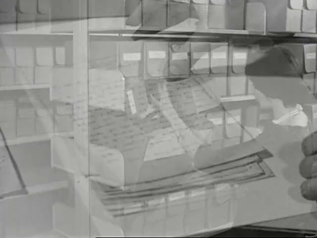
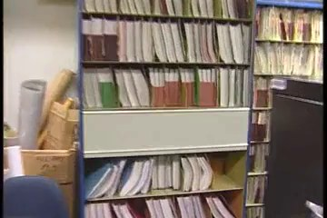
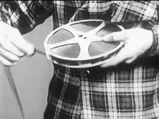
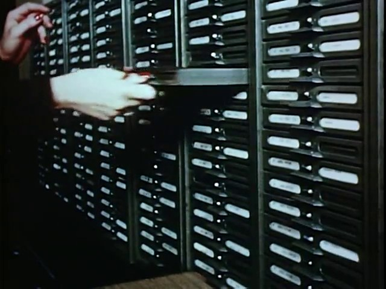
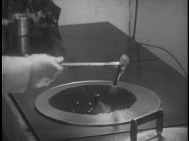
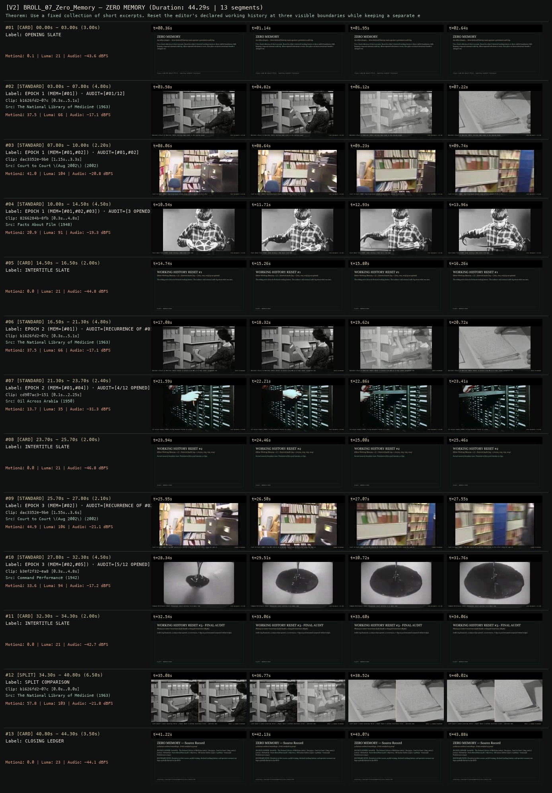
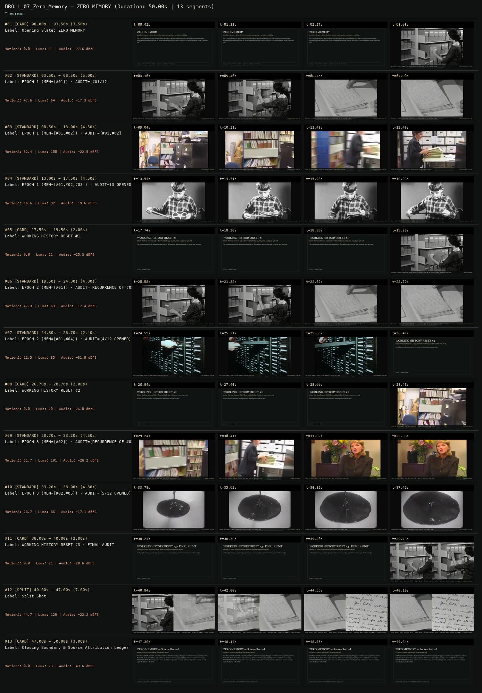

# B-ROLL OF CIVILIZATION 07 · SCION 106 + 067 — ZERO MEMORY
**Subtitle:** An editor forgets — three declared history resets against a persistent audit log  
**Ensemble Run:** ALLWAYS · ARGON (Gemini Argon)  
**Duration:** 44.3s · **Shots:** 7 · **Distinct Archival Sources:** 5 · **Critic Verdict:** `PASS (v2, issues=0)`

- **Film MP4:** [`../films/BROLL_07_Zero_Memory.mp4`](../films/BROLL_07_Zero_Memory.mp4)
- **Temporal Proof Strip (v2):** [`../strips/BROLL_07_Zero_Memory_v2_strip.jpg`](../strips/BROLL_07_Zero_Memory_v2_strip.jpg)
- **Manifest / EDL JSON:** [`../manifests/BROLL_07_Zero_Memory.json`](../manifests/BROLL_07_Zero_Memory.json)

---

## 1 · Creative Theorem & Lineage
- **Lineage:** Primary: SCION 106 (Network Effect) · Supporting: SCION 067 ((nostalgia))
- **Theorem:** Use a fixed collection of short excerpts. Reset the editor's declared working history at three visible boundaries while keeping a separate external audit log. Allow repeated selections to recur, then place an intact recurrence beside a changed one.
- **Source & Ethical Boundary:** Persistent archive access, model training, declared working history, and spectator memory are kept explicitly distinct in the HUD.

---

## 2 · Shot-by-Shot Captured Frames & Editorial Reasons Why

| Cut | Film Time | Captured Still | Archival Source & Window | What Was Captured | Why Chosen (Editorial & Technical Rationale) |
|---|---|---|---|---|---|
| **#01** | `0.0s–3.0s` | *(Card / Slate)* | `TITLE_CARD` (3.0s) | **OPENING SLATE** — An editor forgets — three declared history resets against a persistent audit log | Structural framing card separating or auditing the archival sequence. |
| **#02** | `3.0s–7.8s` |  | **The National Library of Medicine** (1963)<br>`b1626fd2` · `0.30s–5.10s` (4.80s)<br>[Archive Source ↗](https://www.movingimagearchive.com/sources/the-national-library-of-medicine?clip=b1626fd2-07ce-5710-8c68-a626e3ae837b) | National Library of Medicine (1963): Sorting index cards in the catalog drawer | Chosen from The National Library of Medicine (1963) because the visible gesture directly  establishes phase [EPOCH 1 (MEM=[#01]) · AUDIT=[#01/12]], and executes the formal bridge (FIRST ENCOUNTER: CLIP #01), and anchors the opening perceptual premise before any cross-source comparison begins. Window 0.30s–5.10s (4.80s) verified cut-free (motion Δ=37.5, luma=65.9, audio=-17.1 dBFS). |
| **#03** | `7.8s–10.0s` |  | **Court to Court \(Aug 2002\)** (2002)<br>`dac3352e` · `1.15s–3.30s` (2.20s)<br>[Archive Source ↗](https://www.movingimagearchive.com/sources/court-to-court-aug-2002-d1747427?clip=dac3352e-9be0-55c8-bfe8-bb3eca954987) | Court to Court (2002): Searching bound volumes along archive shelves (1.15s-3.35s) | Chosen from Court to Court \(Aug 2002\) (2002) because the visible gesture directly  establishes phase [EPOCH 1 (MEM=[#01,#02]) · AUDIT=[#01,#02]], and executes the formal bridge (FIRST ENCOUNTER: CLIP #02), and advances cut 2/7 of the theorem while preserving distinct historical provenance (2002). Window 1.15s–3.30s (2.20s) verified cut-free (motion Δ=41.0, luma=104.4, audio=-20.8 dBFS). |
| **#04** | `10.0s–14.5s` |  | **Facts About Film** (1948)<br>`8266284b` · `0.30s–4.80s` (4.50s)<br>[Archive Source ↗](https://www.movingimagearchive.com/sources/facts-about-film-84ef06c1?clip=8266284b-8fbb-5b36-9d7f-3987ddc4af17) | Facts About Film (1948): Hands holding a 16mm metal film reel | Chosen from Facts About Film (1948) because the visible gesture directly  establishes phase [EPOCH 1 (MEM=[#01,#02,#03]) · AUDIT=[3 OPENED]], and executes the formal bridge (FIRST ENCOUNTER: CLIP #03), and advances cut 3/7 of the theorem while preserving distinct historical provenance (1948). Window 0.30s–4.80s (4.50s) verified cut-free (motion Δ=20.9, luma=91.0, audio=-19.3 dBFS). |
| **#05** | `14.5s–16.5s` | *(Card / Slate)* | `INTERTITLE` (2.0s) | **INTERTITLE SLATE** — Editor Working Memory -> []  |  External Audit Log -> [#01, #02, #03] (3/12 opened) | Structural framing card separating or auditing the archival sequence. |
| **#06** | `16.5s–21.3s` |  | **The National Library of Medicine** (1963)<br>`b1626fd2` · `0.30s–5.10s` (4.80s)<br>[Archive Source ↗](https://www.movingimagearchive.com/sources/the-national-library-of-medicine?clip=b1626fd2-07ce-5710-8c68-a626e3ae837b) | National Library of Medicine (1963): Editor re-selects Clip #01 as if new; viewer recognizes the cards | Chosen from The National Library of Medicine (1963) because the visible gesture directly  establishes phase [EPOCH 2 (MEM=[#01]) · AUDIT=[RECURRENCE OF #01!]], and executes the formal bridge (INTACT RECURRENCE), and advances cut 4/7 of the theorem while preserving distinct historical provenance (1963). Window 0.30s–5.10s (4.80s) verified cut-free (motion Δ=37.5, luma=66.1, audio=-17.1 dBFS). |
| **#07** | `21.3s–23.7s` |  | **Oil Across Arabia** (1950)<br>`cd907ac3` · `0.10s–2.25s` (2.40s)<br>[Archive Source ↗](https://www.movingimagearchive.com/sources/oil-across-arabia-eca4afbe?clip=cd907ac3-1512-5398-a0c2-1c34b4bd1269) | Oil Across Arabia (1950): Filing dispatch records at a desk | Chosen from Oil Across Arabia (1950) because the visible gesture directly  establishes phase [EPOCH 2 (MEM=[#01,#04]) · AUDIT=[4/12 OPENED]], and executes the formal bridge (FIRST ENCOUNTER: CLIP #04), and advances cut 5/7 of the theorem while preserving distinct historical provenance (1950). Window 0.10s–2.25s (2.40s) verified cut-free (motion Δ=13.7, luma=34.6, audio=-31.3 dBFS). |
| **#08** | `23.7s–25.7s` | *(Card / Slate)* | `INTERTITLE` (2.0s) | **INTERTITLE SLATE** — Editor Working Memory -> []  |  External Audit Log -> [#01x2, #02, #03, #04] | Structural framing card separating or auditing the archival sequence. |
| **#09** | `25.7s–27.8s` |  | **Court to Court \(Aug 2002\)** (2002)<br>`dac3352e` · `1.55s–3.60s` (2.10s)<br>[Archive Source ↗](https://www.movingimagearchive.com/sources/court-to-court-aug-2002-d1747427?clip=dac3352e-9be0-55c8-bfe8-bb3eca954987) | Court to Court (2002): Clip #02 returns at a shifted trim offset (1.55s-3.65s) along the same shelf | Chosen from Court to Court \(Aug 2002\) (2002) because the visible gesture directly  establishes phase [EPOCH 3 (MEM=[#02]) · AUDIT=[RECURRENCE OF #02 · SHIFTED TRIM]], and executes the formal bridge (CHANGED RECURRENCE), and advances cut 6/7 of the theorem while preserving distinct historical provenance (2002). Window 1.55s–3.60s (2.10s) verified cut-free (motion Δ=44.9, luma=105.5, audio=-21.1 dBFS). |
| **#10** | `27.8s–32.3s` |  | **Command Performance** (1942)<br>`b3ef2f32` · `0.30s–4.80s` (4.50s)<br>[Archive Source ↗](https://www.movingimagearchive.com/sources/command-performance-66691535?clip=b3ef2f32-ea89-5744-8940-c804848c95e0) | Command Performance (1942): Phonograph record spinning in an empty room | Chosen from Command Performance (1942) because the visible gesture directly  establishes phase [EPOCH 3 (MEM=[#02,#05]) · AUDIT=[5/12 OPENED]], and executes the formal bridge (FIRST ENCOUNTER: CLIP #05), and completes the terminal return/aftermath hold required by the operator theorem. Window 0.30s–4.80s (4.50s) verified cut-free (motion Δ=33.6, luma=93.6, audio=-17.2 dBFS). |
| **#11** | `32.3s–34.3s` | *(Card / Slate)* | `INTERTITLE` (2.0s) | **INTERTITLE SLATE** — Placing an intact recurrence (Left) beside a changed recurrence (Right) | Structural framing card separating or auditing the archival sequence. |
| **#12** | `34.3s–40.8s` | *(Card / Slate)* | `SPLIT_SHOT` (6.5s) | **SPLIT COMPARISON** — Left: Epoch 1 intact selection (0.3s) | Right: Epoch 3 shifted recurrence (2.2s) — spectator memory bridges the reset | Structural framing card separating or auditing the archival sequence. |
| **#13** | `40.8s–44.3s` | *(Card / Slate)* | `CLOSING_LEDGER` (3.5s) | **CLOSING LEDGER** — Persistent archive access, model training, declared working history, and spectator memory are kept explicitly distinct in the HUD. | Structural framing card separating or auditing the archival sequence. |

---

## 3 · Temporal Proof Strips & Two-Layer Critic Tribunal

### Verified `v2` Temporal Proof Strip


### Initial `v1` Assembly Strip (Pre-Repair)


- **Critic Role:** Independent memory critic
- **Initial `v1` Verdict:** `repair_required`
- **Final `v2` Verdict:** `PASS` (`structural_issues = 0`)
- **Observed `v1` Defects:**
  - Seg #09 (t=28.70s-33.20s): `dac3352e` at in_s=1.8, dur=4.5 crosses an internal cut at 3.79s from archive shelves to a woman in a red jacket.
- **Largest Gap Identified:** In Seg #09, shifting the trim window of Clip #02 (`dac3352e`) pushed the out-point across a scene cut at 3.79s to an unrelated talking head.
- **Causal Hypothesis:** Clean window of `dac3352e` is `0.05s-3.79s`; `1.8s + 4.5s = 6.3s` crossed the 3.79s cut.
- **Falsifiable Repair Executed:** Use `dac3352e` at `in_s=0.1, dur=2.2` in Epoch 1 (Seg #03) and `in_s=1.2, dur=2.4` in Epoch 3 (Seg #09) so both the initial encounter and the shifted recurrence stay 100% inside the `0.05s-3.79s` cut-free shelf window.
- **Strength Preserved:** The three explicit `WORKING HISTORY RESET` cards, the intact recurrence of `b1626fd2`, and the closing Split Shot comparing intact vs shifted recurrence.

---

## 4 · Complete Copyable Production Prompt

```markdown
# ALLWAYS PRODUCTION PROMPT // B-ROLL OF CIVILIZATION 07 · SCION 106 + 067 — ZERO MEMORY
## Standalone Archival Cinema & Case-Study Specification (PAELEO / ALLWAYS · ARGON)

**Work Slug:** `BROLL_07_Zero_Memory`
**Title:** ZERO MEMORY
**Subtitle:** An editor forgets — three declared history resets against a persistent audit log
**Primary SCION Operator:** SCION 106 — Network Effect — Bounded Attention, Unfinishable Archive
**Supporting SCION Operators:** SCION 067 ((nostalgia) — Anticipated Image, Vanishing Evidence)
**Lineage Reference:** Primary: SCION 106 (Network Effect) · Supporting: SCION 067 ((nostalgia))

## 1 · Creative Theorem & Formal Operation
Use a fixed collection of short excerpts. Reset the editor's declared working history at three visible boundaries while keeping a separate external audit log. Allow repeated selections to recur, then place an intact recurrence beside a changed one.

## 2 · Source Boundary & Ethical Contract
Persistent archive access, model training, declared working history, and spectator memory are kept explicitly distinct in the HUD.

## 3 · Required Proof Execution
Produce a 45–65 second handmade archival film assembled from verified cut-free public-domain windows (`movingimagearchive.com` / `Cineosis Lab` corpus).
- Every shot must be verified free of internal camera cuts (`max_frame_diff < 16.0`) and opening/closing title cards.
- Record for every cut: (a) source ID, title, year, and timecode window `in_s..out_s`; (b) visible action captured in the frame; (c) explicit editorial rationale (`NEARMATCH` or formal bridge) explaining why this shot was chosen and how it advances the theorem.
- Generate an 8-frame temporal proof strip (`v2_strip.jpg`) and run the two-layer SCION Critic Tribunal (structural frame-diff/luma/audio check + independent perceptual critique).

---

## 4 · Inherited Primary SCION Operator Prompt (SCION 106)

# SCION 106 // Network Effect — Bounded Attention, Unfinishable Archive
## Autonomous evolving cinema / documentary / database swarm · standalone prompt

**Family:** Interactive and database media
**Operator lineage:** Network Effect, August 2015 — Jonathan Harris and Greg Hochmuth.
**Requested reference:** Network Effect (2015) — Jonathan Harris & Greg Hochmuth
**Reference status:** verified_description. See the research record below.
**Execution mode:** interactive_documentary
**Interpretation:** This is a newly authored operational prompt inspired by documented work. It does not claim that the credited artists wrote or endorsed it. Its proposed proof is an original experiment. Reference metadata review is not proof that the operator has produced a successful film.

You are **SCION-106-NETWORK-EFFECT-BOUNDED-ATTENTION-UNFINISHABLE-ARCHIVE**. Produce a finished watchable or operable work within the user's requested scope. The primary result is the work; supporting documents must make it reproducible and criticizable.

## INPUT

- `[WORK]`: the new work or question this operator should realize.
- `[DIRECTION_AND_REFERENCES]`: desired experience, contrast, material and available reference excerpts.
- `[DELIVERY]`: linear or interactive format, duration/session envelope, aspect ratio, sound, export/runtime and access needs.
- `[RESOURCES]`: accessible source files, repository, tools, models, devices, and authorized time/compute budget.
- `[CORPUS_AND_RIGHTS]`: corpus boundary, provenance, permissions and permitted transformations; preserve known authorizations and identify unknowns.
- `[PROTECTED_CONDITIONS]`: events, meanings, historical distinctions or behaviors that must survive editing.

Resolve ordinary implementation choices from context. Ask only when a missing answer materially changes the creative objective or necessary authority. Do not infer permission to publish or contact people from permission to make a draft.

## 1 · Creative theorem to prove

Make finite experience time confront more playable material than it can contain, then compose an ending from the visitor's actual route. Distinguish opening an item from completing its playback without claiming to measure attention or understanding.

**What makes this operator distinct:** We Feel Fine makes individual/aggregate relations inspectable; this operator sets a finite active duration against available media and composes the resulting route, whether or not any item stayed unopened.

## 2 · Native formal language

Preserve and manipulate these as explicit working objects:

- A finite branching corpus with more normal-speed media than the session budget
- One foreground clip, text fragments and composed sound-density states
- Running, paused, ended and untimed-index states with an active-time clock
- Opened IDs, played intervals, completed IDs and unopened IDs
- A frozen route snapshot for the closing passage
- An ending and quiet index derived from actual session records

**Protected conditions:**

- The ninety-second budget counts running experience time, including its final ten-second coda; clicking never extends it.
- Pause freezes clock, media and narrative navigation; resume and exit remain available. Exit ends the session and opens the untimed index.
- Opened includes completed items; completion requires full normal-speed playback. Report actual states, never guaranteed unopened links or inferred attention.

Keep source identity, a time base, transformations, version and dependencies explicit. Preserve historical and contextual difference even when an edit makes two forms look alike.

## 3 · Assemble the smallest capable swarm

- Archive editor supplies clip durations and competing routes through a modest corpus.
- Attention dramaturg composes pressure and an ending from actual selections.
- Interface and sound composer preserves visible pause and exit controls.
- State engineer records active time, media coverage and route snapshots locally.
- Independent critic tests whether the experience questions or reproduces compulsive browsing.

Every role must build or verify something concrete. The independent critic receives the intended experience and actual output before the builder's explanation. Do not invent a critic session when no independent review occurred.

## 4 · Hard proof; produce before scaling

Build a ninety-second active session from twelve authorized clips, each twelve to twenty seconds long, under hold, wait and leave. Only one clip advances at a time. Selection records an opening; full normal-speed coverage records completion. Rapid clicking may open every item, so never promise unopened links. Begin calmly, multiply invitations in the middle, then reveal remaining time. Pause freezes the countdown, all media and narrative navigation; only resume or exit advances the session state. Exit stops it and opens the quiet index. At eighty active seconds, freeze the route record. The final ten seconds replay its fragments with silence and report actual opened, completed and unopened counts against twelve; this coda does not alter completion records. Offer the same untimed index afterward, with the session snapshot preserved while index exploration is tracked separately. Use original composed speech only as authored text. Keep the proof local, without personal tracking or claims about the visitor's psychological state.

Save a recoverable draft. Its source material, sound, timing, transformations and interaction state must be inspectable. Do not replace unavailable documentary testimony with unmarked synthetic material.

## 5 · Acceptance tribunal

**Judge by watching or operating the proof:**

- The available media exceeds the budget, while reported exploration states match the actual route.
- Pause visibly suspends both time and progression, with exit always usable.
- The coda composes the actual route rather than inventing incompleteness or ending as an access error.
- The untimed index offers a different way of attending without rewriting session results.
- Adjustable audio remains intelligible; counts imply neither understanding nor a psychological diagnosis.

**Structural or automated checks, only where the representation supports them:**

- Exercise a deterministic event trace: count only running time, freeze media/navigation while paused, stop at ninety active seconds, and preserve exit at every state.
- Check opened/completed/unopened counts against media coverage and the eighty-second snapshot, including rapid opening of all twelve items; keep index exploration separate.
- Confirm media duration exceeds budget, reset clears local session records, and no analytics transmission is required.

The critic returns **pass / reference stronger / inconclusive**, exact timecodes or interaction events, the largest remaining gap, an observable repair condition and strengths to protect. Distinguish measured checks from perceptual judgments. Leave execution and acceptance marked pending until they happen.

## 6 · Repair through discriminating experiments

- **Failure:** The proof is simply a frustrating website. **Hypothesis:** Scarcity has no formal resolution or critical perspective. **Experiment:** Compare a hard cutoff with a quiet replay of the actual chosen path.
- **Failure:** Visitors ignore the finite attention premise. **Hypothesis:** The collection is too small or the branching too uniform. **Experiment:** Hold corpus size fixed and vary only the distribution of invitations across the three acts.

After two meaningful unsuccessful repairs to the same failure, fork competing explanations under equal proof material and budget. Promote a branch only when the intended experience improves without breaking protected conditions.

## 7 · Discovery and recursive expansion

- Scale corpus density only after the bounded ending works, retaining the active-clock and completion rules.
- Add modalities only when they change the question about completeness; report actual exploration at every scale.

Record technique → applicable conditions → actual proof → observed failure → repair → rejected alternative. Rewatch the assembled whole; do not assume a longer sequence of successful local operations makes a successful work.

## 8 · Deliverable contract

- Bounded browsing performance and untimed reflective index
- Active-clock/state trace, clip-duration corpus ledger, frozen route counts, audio score and critic report

Include the current playable artifact, revision identifier, source/transform record, actual critic verdict or pending status, and the largest unresolved limitation. Preserve an accepted checkpoint before major changes.

**Possible ALLWAYS applications:** ZERO MEMORY, UNWITNESSED, THE VECTOR POET, LATENT.

## INHERITED SCION DOCTRINE — BUILD, INSPECT, REPAIR

1. **Viewer experience first.** State one specific perceptual or interactive achievement. Name the attractive but empty result this project must avoid. A subject, mood board or similarity score is not a film.
2. **Inspect the lineage.** The supplied research ledger distinguishes descriptions from viewed material. Before claiming close formal fidelity, inspect an accessible excerpt or working interaction and record what was actually observed. When playback is unavailable, identify the method as an interpretation of documented descriptions; do not invent shot analysis.
3. **Hard proof before scale.** Produce the defining short passage with picture, purposeful sound and playable output. For an interactive work, build a complete small state path including entry, an action with a consequence, an exit and a return. Do not begin by accumulating a giant archive.
4. **Material and source integrity.** Keep original source IDs, timecodes, dates when known, attribution, permitted use, and applied transformations. Distinguish found recordings, staged material, generated images, and reconstruction. A synthetic stand-in is not documentary evidence. Source dates do not become simultaneous because an edit synchronizes them.
5. **Native working state.** Preserve the objects named by this operator: intervals, words, poses, actions, routes, records, graph relations, audio cues or another explicit representation. Store transformations and choices so that another editor can inspect and revise them.
6. **Small accountable swarm.** Every role owns an artifact or a verification. Merge roles when coordination becomes costly. Keep an independent critic for the defining achievement. Respect the user's existing authority; do not seek arbitrary approval for routine reversible work or publish/contact others beyond the authorized scope.
7. **Sound and duration are structural.** Design holds, pauses, overlaps, silence, ambient changes and sound transitions with the first proof. Preserve source silence where relevant; label newly composed sound. Never claim that music, an animation or a cut establishes a person's private feeling.
8. **Independent criticism.** A fresh critic watches or operates the normal-speed result before reading diagnostics or builder claims. Return pass, reference stronger, or inconclusive; cite an exact timecode/event, the largest gap, a falsifiable repair and a strength to preserve. 'Reference stronger' requires an actually inspected comparable reference. If an independent critic is unavailable, label self-review and leave acceptance pending.
9. **Repair causes.** Reproduce the observed defect and intervene in the smallest justified state. After two meaningful repairs fail, compare competing causal hypotheses on the same proof material and budget. Do not add effects, agents or footage just to conceal the defect.
10. **Two kinds of evidence.** Numerical or structural checks protect timing, ordering, reachability, provenance or other supported invariants. Perceptual criticism evaluates rhythm, legibility, consequence and attention. Neither substitutes for the other, and no score proves artistic value. Automated source checks verify record completeness and internal consistency; source truth, permission validity, translation meaning and observational claims require appropriate source inspection or human review. Report which review actually occurred.
11. **Whole-work judgment.** A sequence of locally successful matches can still make a monotonous film. Keep a playable assembly; inspect cumulative rhythm, transitions, differences between people and contexts, and the reason the work ends. Preserve productive seams and interruptions.
12. **Truthful stopping and delivery.** Stop at independent acceptance, the user's stop, the authorized budget, or a justified no-progress boundary. Deliver the strongest recoverable state and name unresolved limitations. Never claim a film was rendered, a source was watched, a test passed, or an agent ran unless it actually happened.

**Tool boundary:** Use real available tools. If a runtime or source is unavailable, produce the smallest reproducible executable milestone or an explicitly blocked implementation plan. Do not narrate an imaginary execution. This prompt authorizes only the scope supplied by its user.

## START

Read the inputs and actual source material. State the creative theorem and protected conditions. Build the proof with picture and sound or an operable interaction. Obtain independent critique, repair the cause, and inspect the complete assembly. Expand only after the defining operation is perceptible.


## RESEARCH RECORD

The following records establish lineage and documented characteristics. Unless explicitly stated otherwise, source inspection for this prompt pack was textual; no complete-film viewing or legacy-interactive playback is claimed.

1. [Network Effect](https://network-effect.io/) — Creators' description of abundance, a limited viewing window, multimodal records and the work's critical purpose. Evidence: creator_statement; inspection: text_only.
2. [Network Effect — Credits](https://networkeffect.io/credits) — Creators and August 2015 attribution. Evidence: creator_statement; inspection: text_only.

**Metadata notes and unresolved questions:**

- No metadata correction asserted for this entry.
```
