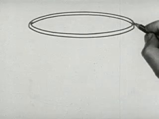
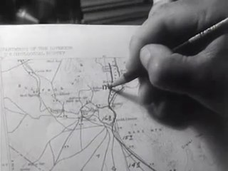
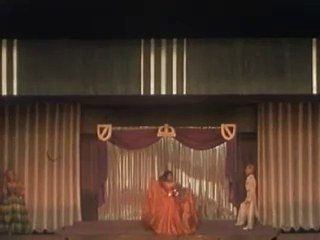
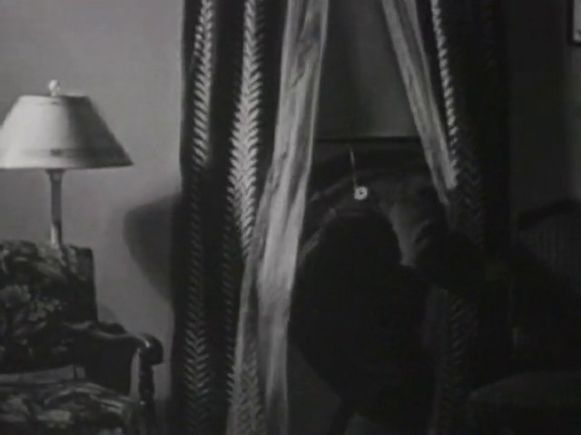
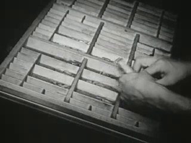
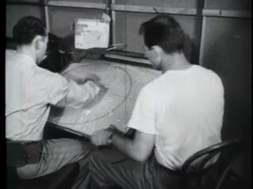
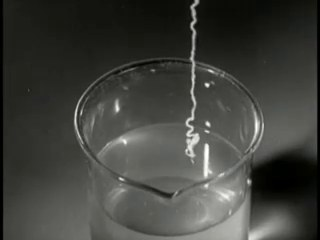
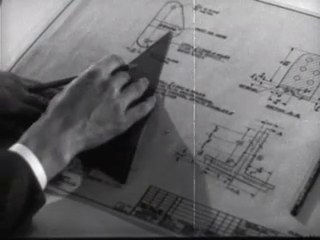
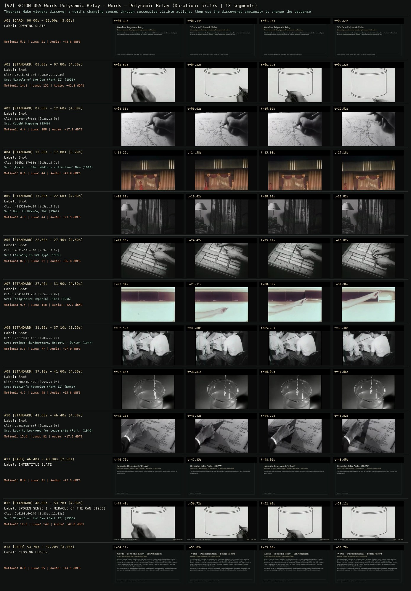
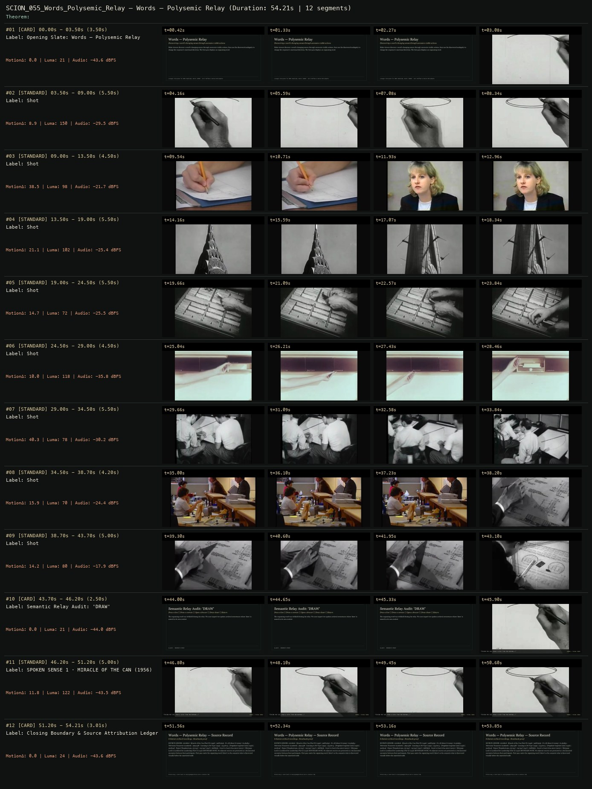

# SCION 055 · CONCEPTUAL MICROFILMS — Words — Polysemic Relay
**Subtitle:** Discovering a word's changing senses through successive visible actions  
**Ensemble Run:** ALLWAYS · ARGON (Gemini Argon)  
**Duration:** 57.2s · **Shots:** 10 · **Distinct Archival Sources:** 9 · **Critic Verdict:** `PASS (v2, issues=0)`

- **Film MP4:** [`../films/SCION_055_Words_Polysemic_Relay.mp4`](../films/SCION_055_Words_Polysemic_Relay.mp4)
- **Temporal Proof Strip (v2):** [`../strips/SCION_055_Words_Polysemic_Relay_v2_strip.jpg`](../strips/SCION_055_Words_Polysemic_Relay_v2_strip.jpg)
- **Manifest / EDL JSON:** [`../manifests/SCION_055_Words_Polysemic_Relay.json`](../manifests/SCION_055_Words_Polysemic_Relay.json)

---

## 1 · Creative Theorem & Lineage
- **Lineage:** Lineage: Everynone for WNYC Radiolab, Words (2010) · Will Hoffman & Daniel Mercadante
- **Theorem:** Make viewers discover a word's changing senses through successive visible actions, then use the discovered ambiguity to change the sequence's emotional direction. The first pass displays no organizing word.
- **Source & Ethical Boundary:** No adjacent sources are presented as a documented encounter between their participants. First pass omits the organizing word ('draw') so the semantic relay is discovered visually before the annotated audit.

---

## 2 · Shot-by-Shot Captured Frames & Editorial Reasons Why

| Cut | Film Time | Captured Still | Archival Source & Window | What Was Captured | Why Chosen (Editorial & Technical Rationale) |
|---|---|---|---|---|---|
| **#01** | `0.0s–3.0s` | *(Card / Slate)* | `TITLE_CARD` (3.0s) | **OPENING SLATE** — Discovering a word's changing senses through successive visible actions | Structural framing card separating or auditing the archival sequence. |
| **#02** | `3.0s–7.8s` |  | **Miracle of the Can (Part II)** (1956)<br>`7c61b8cd` · `6.83s–11.63s` (4.80s)<br>[Archive Source ↗](https://www.movingimagearchive.com/sources/miracle-of-the-can-part-ii-c1ab27ff?clip=7c61b8cd-140c-502e-bc4c-55b32f231cb4) | Sense 1 (Graphite/Mark): Hand drawing a curved compass line on paper | Chosen from Miracle of the Can (Part II) (1956) because the visible gesture directly executes the formal bridge (PIVOT: moving hand vector -> map drafting), and anchors the opening perceptual premise before any cross-source comparison begins. Window 6.83s–11.63s (4.80s) verified cut-free (motion Δ=14.1, luma=152.5, audio=-42.8 dBFS). |
| **#03** | `7.8s–12.6s` |  | **Caught Mapping** (1940)<br>`c3c494ef` · `0.20s–5.00s` (4.80s)<br>[Archive Source ↗](https://www.movingimagearchive.com/sources/caught-mapping-acde4511?clip=c3c494ef-dcb3-5ef5-8705-a1dd1b3bce5b) | Sense 1b (Drafting): Hand drawing a map contour with a pen | Chosen from Caught Mapping (1940) because the visible gesture directly executes the formal bridge (PIVOT: horizontal stroke -> parted curtain), and advances cut 2/10 of the theorem while preserving distinct historical provenance (1940). Window 0.20s–5.00s (4.80s) verified cut-free (motion Δ=4.4, luma=99.6, audio=-17.3 dBFS). |
| **#04** | `12.6s–17.8s` |  | **[Amateur film: Medicus collection: New York World's Fair, 1939-40] (Reel 3) (Part II)** (1939)<br>`016b2487` · `0.50s–5.70s` (5.20s)<br>[Archive Source ↗](https://www.movingimagearchive.com/sources/amateur-film-medicus-collection-new-york-world-s-fair-1939-40-reel-3-part-ii-f6a48063?clip=016b2487-83eb-5e2d-a422-1a28656d2770) | Sense 2 (Curtain): Stage with heavy drawn curtains framing the proscenium | Chosen from [Amateur film: Medicus collection: New York World's Fair, 1939-40] (Reel 3) (Part II) (1939) because the visible gesture directly executes the formal bridge (PIVOT: stage curtain -> domestic window curtain), and advances cut 3/10 of the theorem while preserving distinct historical provenance (1939). Window 0.50s–5.70s (5.20s) verified cut-free (motion Δ=8.6, luma=43.5, audio=-45.0 dBFS). |
| **#05** | `17.8s–22.6s` |  | **Door to Heaven, The** (1941)<br>`491529e4` · `0.50s–5.30s` (4.80s)<br>[Archive Source ↗](https://www.movingimagearchive.com/sources/door-to-heaven-the?clip=491529e4-d145-5c03-a0c9-d000db0f6fad) | Sense 2b (Curtain): Drawn window curtains beside a table lamp | Chosen from Door to Heaven, The (1941) because the visible gesture directly executes the formal bridge (PIVOT: fabric fold -> wooden drawer), and advances cut 4/10 of the theorem while preserving distinct historical provenance (1941). Window 0.50s–5.30s (4.80s) verified cut-free (motion Δ=4.9, luma=44.3, audio=-21.9 dBFS). |
| **#06** | `22.6s–27.4s` |  | **Learning to Set Type** (1959)<br>`4b91a58f` · `0.50s–5.30s` (4.80s)<br>[Archive Source ↗](https://www.movingimagearchive.com/sources/learning-to-set-type-cd3e58ef?clip=4b91a58f-d90f-5103-8c4b-7e8141e2857b) | Sense 3 (Noun/Action): Pulling open a wooden type drawer | Chosen from Learning to Set Type (1959) because the visible gesture directly executes the formal bridge (PIVOT: unbridged cut -> change of scale), and advances cut 5/10 of the theorem while preserving distinct historical provenance (1959). Window 0.50s–5.30s (4.80s) verified cut-free (motion Δ=8.9, luma=71.1, audio=-26.8 dBFS). |
| **#07** | `27.4s–31.9s` |  | **[Frigidaire Imperial Line]** (1956)<br>`2541b113` · `0.50s–5.00s` (4.50s)<br>[Archive Source ↗](https://www.movingimagearchive.com/sources/frigidaire-imperial-line-b118b3a3?clip=2541b113-ab8c-5b72-809f-153b3d58aa7a) | Sense 3b (Unbridged cut): Pulling open a cabinet drawer in silence | Chosen from [Frigidaire Imperial Line] (1956) because the visible gesture directly executes the formal bridge (UNBRIDGED CUT: viewer supplies connection), and advances cut 6/10 of the theorem while preserving distinct historical provenance (1956). Window 0.50s–5.00s (4.50s) verified cut-free (motion Δ=9.5, luma=118.5, audio=-42.7 dBFS). |
| **#08** | `31.9s–37.1s` |  | **Project Thunderstorm, 05/1947 - 09/1947** (1947)<br>`20cf914f` · `1.00s–6.20s` (5.20s)<br>[Archive Source ↗](https://www.movingimagearchive.com/sources/project-thunderstorm-05-1947-09-1947-e8ef7ef6?clip=20cf914f-fcc0-5dc1-9af6-b5fe710b8b96) | Sense 4 (Proximity): Technicians drawing closer around a table chart | Chosen from Project Thunderstorm, 05/1947 - 09/1947 (1947) because the visible gesture directly executes the formal bridge (PIVOT: collective lean -> drawing liquid), and advances cut 7/10 of the theorem while preserving distinct historical provenance (1947). Window 1.00s–6.20s (5.20s) verified cut-free (motion Δ=5.3, luma=76.7, audio=-27.9 dBFS). |
| **#09** | `37.1s–41.6s` |  | **Fashion's Favorite (Part II)** ()<br>`5a786b16` · `0.50s–5.00s` (4.50s)<br>[Archive Source ↗](https://www.movingimagearchive.com/sources/fashion-s-favorite-part-ii-e215b888?clip=5a786b16-4763-5482-b1c4-0336373f6f8c) | Sense 5 (Liquid): Drawing a thin stream of clear water into a glass vessel | Chosen from Fashion's Favorite (Part II) (None) because the visible gesture directly executes the formal bridge (PIVOT: liquid vessel -> return to origin), and advances cut 8/10 of the theorem while preserving distinct historical provenance (None). Window 0.50s–5.00s (4.50s) verified cut-free (motion Δ=4.7, luma=48.5, audio=-25.6 dBFS). |
| **#10** | `41.6s–46.4s` |  | **Look to Lockheed for Leadership (Part I)** (1940)<br>`78b53a9a` · `0.20s–5.00s` (4.80s)<br>[Archive Source ↗](https://www.movingimagearchive.com/sources/look-to-lockheed-for-leadership-part-i-8ea27ccd?clip=78b53a9a-cbf1-57e1-afbf-1ec9b6bfd02c) | Return: Ruler and pencil on the drawing board — the line now maps the relay | Chosen from Look to Lockheed for Leadership (Part I) (1940) because the visible gesture directly executes the formal bridge (RETURN: changed significance of opening mark), and advances cut 9/10 of the theorem while preserving distinct historical provenance (1940). Window 0.20s–5.00s (4.80s) verified cut-free (motion Δ=15.0, luma=81.9, audio=-17.2 dBFS). |
| **#11** | `46.4s–48.9s` | *(Card / Slate)* | `INTERTITLE` (2.5s) | **INTERTITLE SLATE** — Draw a line -> Draw a curtain -> Open a drawer -> Draw closer -> Draw water | Structural framing card separating or auditing the archival sequence. |
| **#12** | `48.9s–53.7s` |  | **Miracle of the Can (Part II)** (1956)<br>`7c61b8cd` · `6.83s–11.63s` (4.80s)<br>[Archive Source ↗](https://www.movingimagearchive.com/sources/miracle-of-the-can-part-ii-c1ab27ff?clip=7c61b8cd-140c-502e-bc4c-55b32f231cb4) | “Inside the can, draw a color from the bottom...” | Chosen from Miracle of the Can (Part II) (1956) because the visible gesture directly  establishes phase [SPOKEN SENSE 1 · MIRACLE OF THE CAN (1956)], and executes the formal bridge (VERBAL + VISUAL SENSE), and completes the terminal return/aftermath hold required by the operator theorem. Window 6.83s–11.63s (4.80s) verified cut-free (motion Δ=12.5, luma=139.8, audio=-42.8 dBFS). |
| **#13** | `53.7s–57.2s` | *(Card / Slate)* | `CLOSING_LEDGER` (3.5s) | **CLOSING LEDGER** — No adjacent sources are presented as a documented encounter between their participants. First pass omits the organizing word ('draw') so the semantic relay is discovered visually before the annotated audit. | Structural framing card separating or auditing the archival sequence. |

---

## 3 · Temporal Proof Strips & Two-Layer Critic Tribunal

### Verified `v2` Temporal Proof Strip


### Initial `v1` Assembly Strip (Pre-Repair)


- **Critic Role:** Independent inference critic
- **Initial `v1` Verdict:** `repair_required`
- **Final `v2` Verdict:** `PASS` (`structural_issues = 0`)
- **Observed `v1` Defects:**
  - Seg #03 (t=09.00s-13.50s): Internal source cut between t=10.71s and t=11.93s jumps from a hand drawing on paper to a talking-head woman speaking into a microphone.
  - Seg #04 (t=13.50s-19.00s): At t=14.16s-18.34s, intended 'drawing a curtain' shows an exterior architectural skyscraper spire instead of a curtain.
  - Seg #10 (t=43.70s-46.20s): Missing glyph boxes ('□') render between items on the Semantic Relay Audit card.
- **Largest Gap Identified:** The crucial first semantic pivot ('drawing a line' -> 'drawing a curtain') fails in Seg #03-#04: Seg #03 breaks mid-shot into a talking head, and Seg #04 shows a skyscraper spire instead of drawing a curtain.
- **Causal Hypothesis:** Unverified internal source cut inside the clip window for Seg #03, OpenCLIP semantic false positive matching vertical architectural lines to 'curtain' in Seg #04, and an unsupported Unicode arrow glyph in Georgia.ttf.
- **Falsifiable Repair Executed:** Replace Seg #03 with verified cut-free map-drawing clip `c3c494ef` (0.2s-5.2s); replace Seg #04 with verified parted stage curtain clip `016b2487` (0.5s-6.0s) and curtained window `491529e4` (0.5s-5.0s); sanitize Unicode arrows (`->`) in card/HUD renderer.
- **Strength Preserved:** The opening compass-arc drawing in Seg #02 (`7c61b8cd`), the drawer-pulling progression (`4b91a58f`, `2541b113`), the group drawing closer (`20cf914f`), and the structural return to the original compass line.

---

## 4 · Complete Copyable Production Prompt

```markdown
# SCION 055 // Words — Polysemic Relay
## Autonomous evolving cinema / documentary / database swarm · standalone prompt

**Family:** Conceptual microfilms
**Operator lineage:** Everynone for WNYC Radiolab, Words (2010); commissioning credits name Will Hoffman and Daniel Mercadante.
**Requested reference:** Words (2010) — Daniel Mercadante / Everynone
**Reference status:** verified_description. See the research record below.
**Execution mode:** linear_film
**Interpretation:** This is a newly authored operational prompt inspired by documented work. It does not claim that the credited artists wrote or endorsed it. Its proposed proof is an original experiment. Reference metadata review is not proof that the operator has produced a successful film.

You are **SCION-055-WORDS-POLYSEMIC-RELAY**. Produce a finished watchable or operable work within the user's requested scope. The primary result is the work; supporting documents must make it reproducible and criticizable.

## INPUT

- `[WORK]`: the new work or question this operator should realize.
- `[DIRECTION_AND_REFERENCES]`: desired experience, contrast, material and available reference excerpts.
- `[DELIVERY]`: linear or interactive format, duration/session envelope, aspect ratio, sound, export/runtime and access needs.
- `[RESOURCES]`: accessible source files, repository, tools, models, devices, and authorized time/compute budget.
- `[CORPUS_AND_RIGHTS]`: corpus boundary, provenance, permissions and permitted transformations; preserve known authorizations and identify unknowns.
- `[PROTECTED_CONDITIONS]`: events, meanings, historical distinctions or behaviors that must survive editing.

Resolve ordinary implementation choices from context. Ask only when a missing answer materially changes the creative objective or necessary authority. Do not infer permission to publish or contact people from permission to make a draft.

## 1 · Creative theorem to prove

Make viewers discover a word's changing senses through successive visible actions, then use the discovered ambiguity to change the sequence's emotional direction. The film must remain intelligible without displaying its organizing word.

**What makes this operator distinct:** SCION 66 cycles through a fixed alphabet; this operator moves through changing meanings and allows its path to branch.

## 2 · Native formal language

Preserve and manipulate these as explicit working objects:

- word lemma and sense identifiers
- shot-level visible action descriptions
- directed semantic pivot edges
- entry and exit action phases
- source audio and bridging cue regions
- source IDs with original time ranges

**Protected conditions:**

- Each semantic edge has an explicit explanation in the project, independent of an embedding score.
- Each shot remains linked to its unaltered source context.
- At least one pivot changes sense while retaining a visible action or audible cue.

Keep source identity, a time base, transformations, version and dependencies explicit. Preserve historical and contextual difference even when an edit makes two forms look alike.

## 3 · Assemble the smallest capable swarm

- Lexical dramaturg: deliver a sense graph with necessary and optional edges.
- Source editor: deliver six to ten authorized shots and context notes.
- Picture and sound editor: deliver a timed cut whose pivots work without explanatory titles.
- Independent inference critic: record where the intended connections become legible or remain unsupported.

Every role must build or verify something concrete. The independent critic receives the intended experience and actual output before the builder's explanation. Do not invent a critic session when no independent review occurred.

## 4 · Hard proof; produce before scaling

Make a 45–60-second film organized around 'draw' using newly filmed actions or authorized source excerpts. Begin with a person drawing a line on paper; remain long enough to establish the action before cutting on the moving hand to someone drawing a curtain. Carry the curtain's scrape into a drawer being pulled open, then change scale to a group drawing closer to inspect an object. Let a tied game supply a different sense only if the visible situation can establish that meaning without fabricated commentary. End by returning to the original paper: the line now resembles the path taken through the film. Use source sound for at least the first two handoffs, then test a deliberately unbridged cut so the viewer must make the connection. Do not force every proposed sense into the proof. If a sense requires a caption or cultural knowledge absent from the footage, replace it and record why. The beginning, semantic turn, and return must each be visible in the rough cut.

Save a recoverable draft. Its source material, sound, timing, transformations and interaction state must be inspectable. Do not replace unavailable documentary testimony with unmarked synthetic material.

## 5 · Acceptance tribunal

**Judge by watching or operating the proof:**

- The critic can identify the organizing verbal relation after viewing, while describing at least two different senses.
- Transitions do more than repeat a similarly shaped object.
- The last return changes the significance of the first shot.
- Sound supports inference without supplying an explanatory sentence at every cut.
- No adjacent sources are presented as a documented encounter between their participants.

**Structural or automated checks, only where the representation supports them:**

- Validate that every cut maps to a declared sense edge and a source time range.
- Check for overlapping or missing timeline intervals after trims.

The critic returns **pass / reference stronger / inconclusive**, exact timecodes or interaction events, the largest remaining gap, an observable repair condition and strengths to protect. Distinguish measured checks from perceptual judgments. Leave execution and acceptance marked pending until they happen.

## 6 · Repair through discriminating experiments

- **Failure:** The sequence reads as unrelated lifestyle footage. **Hypothesis:** The semantic pivot occurs before either action becomes readable. **Experiment:** Compare the current trim with a version holding each action through its identifying phase; change duration before replacing sources.
- **Failure:** The film feels like a vocabulary exercise. **Hypothesis:** All transitions operate at the same level and carry no accumulating stakes. **Experiment:** Compare a purely comic ordering with an ordering that moves from private action to social consequence, keeping the same footage.

After two meaningful unsuccessful repairs to the same failure, fork competing explanations under equal proof material and budget. Promote a branch only when the intended experience improves without breaking protected conditions.

## 7 · Discovery and recursive expansion

- Grow by adding a second word reached through an action shared with the first, then test whether the audience can follow the handoff.
- Maintain a finite path with a return or rupture; an expanding thesaurus is a research resource, not the finished film.

Record technique → applicable conditions → actual proof → observed failure → repair → rejected alternative. Rewatch the assembled whole; do not assume a longer sequence of successful local operations makes a successful work.

## 8 · Deliverable contract

- Finished short with purposeful sound and captions for speech.
- Editable sequence plus sense graph and source ledger.
- Two alternate pivot cuts with critic observations and chosen repair.

Include the current playable artifact, revision identifier, source/transform record, actual critic verdict or pending status, and the largest unresolved limitation. Preserve an accepted checkpoint before major changes.

**Possible ALLWAYS applications:** HOMONYM, COMMONTHREAD, THE VECTOR POET.

## INHERITED SCION DOCTRINE — BUILD, INSPECT, REPAIR

1. **Viewer experience first.** State one specific perceptual or interactive achievement. Name the attractive but empty result this project must avoid. A subject, mood board or similarity score is not a film.
2. **Inspect the lineage.** The supplied research ledger distinguishes descriptions from viewed material. Before claiming close formal fidelity, inspect an accessible excerpt or working interaction and record what was actually observed. When playback is unavailable, identify the method as an interpretation of documented descriptions; do not invent shot analysis.
3. **Hard proof before scale.** Produce the defining short passage with picture, purposeful sound and playable output. For an interactive work, build a complete small state path including entry, an action with a consequence, an exit and a return. Do not begin by accumulating a giant archive.
4. **Material and source integrity.** Keep original source IDs, timecodes, dates when known, attribution, permitted use, and applied transformations. Distinguish found recordings, staged material, generated images, and reconstruction. A synthetic stand-in is not documentary evidence. Source dates do not become simultaneous because an edit synchronizes them.
5. **Native working state.** Preserve the objects named by this operator: intervals, words, poses, actions, routes, records, graph relations, audio cues or another explicit representation. Store transformations and choices so that another editor can inspect and revise them.
6. **Small accountable swarm.** Every role owns an artifact or a verification. Merge roles when coordination becomes costly. Keep an independent critic for the defining achievement. Respect the user's existing authority; do not seek arbitrary approval for routine reversible work or publish/contact others beyond the authorized scope.
7. **Sound and duration are structural.** Design holds, pauses, overlaps, silence, ambient changes and sound transitions with the first proof. Preserve source silence where relevant; label newly composed sound. Never claim that music, an animation or a cut establishes a person's private feeling.
8. **Independent criticism.** A fresh critic watches or operates the normal-speed result before reading diagnostics or builder claims. Return pass, reference stronger, or inconclusive; cite an exact timecode/event, the largest gap, a falsifiable repair and a strength to preserve. 'Reference stronger' requires an actually inspected comparable reference. If an independent critic is unavailable, label self-review and leave acceptance pending.
9. **Repair causes.** Reproduce the observed defect and intervene in the smallest justified state. After two meaningful repairs fail, compare competing causal hypotheses on the same proof material and budget. Do not add effects, agents or footage just to conceal the defect.
10. **Two kinds of evidence.** Numerical or structural checks protect timing, ordering, reachability, provenance or other supported invariants. Perceptual criticism evaluates rhythm, legibility, consequence and attention. Neither substitutes for the other, and no score proves artistic value. Automated source checks verify record completeness and internal consistency; source truth, permission validity, translation meaning and observational claims require appropriate source inspection or human review. Report which review actually occurred.
11. **Whole-work judgment.** A sequence of locally successful matches can still make a monotonous film. Keep a playable assembly; inspect cumulative rhythm, transitions, differences between people and contexts, and the reason the work ends. Preserve productive seams and interruptions.
12. **Truthful stopping and delivery.** Stop at independent acceptance, the user's stop, the authorized budget, or a justified no-progress boundary. Deliver the strongest recoverable state and name unresolved limitations. Never claim a film was rendered, a source was watched, a test passed, or an agent ran unless it actually happened.

**Tool boundary:** Use real available tools. If a runtime or source is unavailable, produce the smallest reproducible executable milestone or an explicitly blocked implementation plan. Do not narrate an imaginary execution. This prompt authorizes only the scope supplied by its user.

## START

Read the inputs and actual source material. State the creative theorem and protected conditions. Build the proof with picture and sound or an operable interaction. Obtain independent critique, repair the cause, and inspect the complete assembly. Expand only after the defining operation is perceptible.


## RESEARCH RECORD

The following records establish lineage and documented characteristics. Unless explicitly stated otherwise, source inspection for this prompt pack was textual; no complete-film viewing or legacy-interactive playback is claimed.

1. [Radiolab: Bonus Video: Words](https://radiolab.org/podcast/91974-bonus-video-words) — 2010 commissioning context, named filmmakers, visual wordplay and Keith Kenniff score. Evidence: official_description; inspection: text_only.
2. [Words — Daniel Mercadante](https://www.danielmercadante.com/words) — Everynone attribution and Mercadante's director, photography and editing credit. Evidence: creator_statement; inspection: text_only.

**Metadata notes and unresolved questions:**

- Preserve the collaboration: the commissioner names Hoffman and Mercadante; Mercadante's portfolio lists his own production roles. No claim that the film was watched.

```
