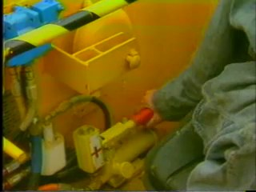
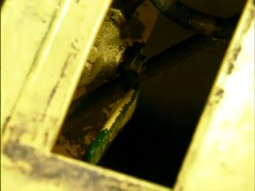
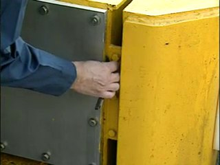
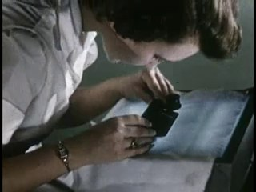
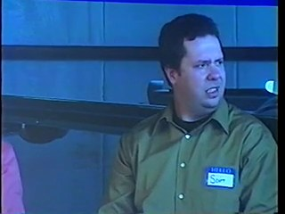
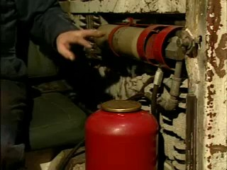
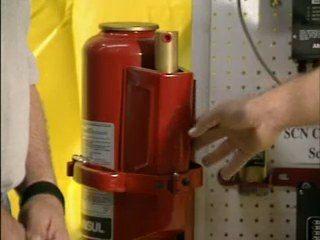
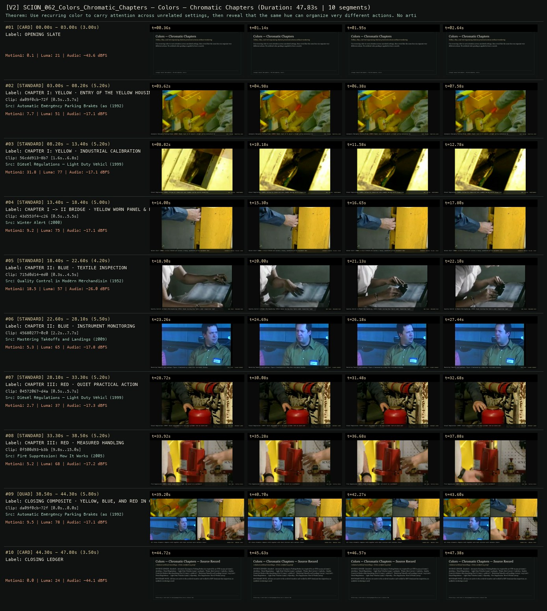
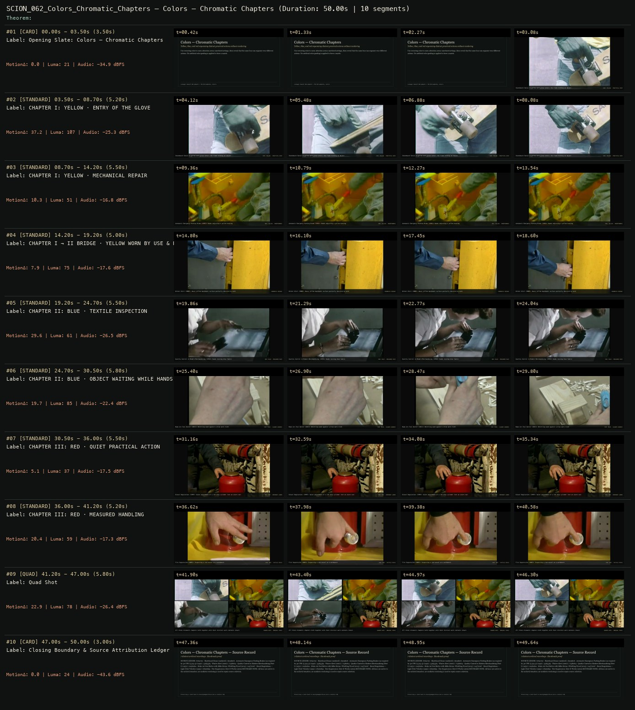

# SCION 062 · CONCEPTUAL MICROFILMS — Colors — Chromatic Chapters
**Subtitle:** Yellow, blue, and red organizing distinct practical actions without recoloring  
**Ensemble Run:** ALLWAYS · ARGON (Gemini Argon)  
**Duration:** 47.8s · **Shots:** 7 · **Distinct Archival Sources:** 7 · **Critic Verdict:** `PASS (v2, issues=0)`

- **Film MP4:** [`../films/SCION_062_Colors_Chromatic_Chapters.mp4`](../films/SCION_062_Colors_Chromatic_Chapters.mp4)
- **Temporal Proof Strip (v2):** [`../strips/SCION_062_Colors_Chromatic_Chapters_v2_strip.jpg`](../strips/SCION_062_Colors_Chromatic_Chapters_v2_strip.jpg)
- **Manifest / EDL JSON:** [`../manifests/SCION_062_Colors_Chromatic_Chapters.json`](../manifests/SCION_062_Colors_Chromatic_Chapters.json)

---

## 1 · Creative Theorem & Lineage
- **Lineage:** Lineage: Daniel Mercadante / The Mercadantes, Colors
- **Theorem:** Use recurring color to carry attention across unrelated settings, then reveal that the same hue can organize very different actions. No artificial color grading is applied to force a match.
- **Source & Ethical Boundary:** All hues are native to the archival transfers and verified by HSV dominant-hue inspection; no synthetic recoloring is used.

---

## 2 · Shot-by-Shot Captured Frames & Editorial Reasons Why

| Cut | Film Time | Captured Still | Archival Source & Window | What Was Captured | Why Chosen (Editorial & Technical Rationale) |
|---|---|---|---|---|---|
| **#01** | `0.0s–3.0s` | *(Card / Slate)* | `TITLE_CARD` (3.0s) | **OPENING SLATE** — Yellow, blue, and red organizing distinct practical actions without recoloring | Structural framing card separating or auditing the archival sequence. |
| **#02** | `3.0s–8.2s` |  | **Automatic Emergency Parking Brakes (as required by 30 CFR 75.523-3)** (1992)<br>`da09f0cb` · `0.50s–5.70s` (5.20s)<br>[Archive Source ↗](https://www.movingimagearchive.com/sources/automatic-emergency-parking-brakes-as-required-by-30-cfr-75-523-3-fc52b4d4?clip=da09f0cb-72fd-5255-815a-3e4794a1e7a0) | Automatic Emergency Parking Brake (1992): Hands reach in to adjust a bright yellow mechanical housing | Chosen from Automatic Emergency Parking Brakes (as required by 30 CFR 75.523-3) (1992) because the visible gesture directly  establishes phase [CHAPTER I: YELLOW · ENTRY OF THE YELLOW HOUSING], and executes the formal bridge (HUE: YELLOW · PRACTICAL GRIP), and anchors the opening perceptual premise before any cross-source comparison begins. Window 0.50s–5.70s (5.20s) verified cut-free (motion Δ=7.7, luma=51.1, audio=-17.1 dBFS). |
| **#03** | `8.2s–13.4s` |  | **Diesel Regulations — Light Duty Vehicles** (1999)<br>`56cdd913` · `1.60s–6.80s` (5.20s)<br>[Archive Source ↗](https://www.movingimagearchive.com/sources/diesel-regulations-light-duty-vehicles-934a800d?clip=56cdd913-8b7f-5c90-8641-a659718dfcaa) | Diesel Regulations (1999): Yellow-lit industrial test chamber during nozzle inspection | Chosen from Diesel Regulations — Light Duty Vehicles (1999) because the visible gesture directly  establishes phase [CHAPTER I: YELLOW · INDUSTRIAL CALIBRATION], and executes the formal bridge (HUE: YELLOW · MAINTENANCE), and advances cut 2/7 of the theorem while preserving distinct historical provenance (1999). Window 1.60s–6.80s (5.20s) verified cut-free (motion Δ=31.8, luma=77.1, audio=-17.1 dBFS). |
| **#04** | `13.4s–18.4s` |  | **Winter Alert** (2000)<br>`43d553f4` · `0.50s–5.50s` (5.00s)<br>[Archive Source ↗](https://www.movingimagearchive.com/sources/winter-alert-fe794079?clip=43d553f4-c26b-56b9-87b6-bf417fa29d98) | Winter Alert (2000): A blue-sleeved arm latches a heavy, weathered yellow equipment door | Chosen from Winter Alert (2000) because the visible gesture directly  establishes phase [CHAPTER I -> II BRIDGE · YELLOW WORN PANEL & BLUE SLEEVE], and executes the formal bridge (CHROMATIC BRIDGE: YELLOW + BLUE), and advances cut 3/7 of the theorem while preserving distinct historical provenance (2000). Window 0.50s–5.50s (5.00s) verified cut-free (motion Δ=9.2, luma=74.7, audio=-17.1 dBFS). |
| **#05** | `18.4s–22.6s` |  | **Quality Control in Modern Merchandising (Part I)** (1952)<br>`715d0d14` · `0.30s–4.50s` (4.20s)<br>[Archive Source ↗](https://www.movingimagearchive.com/sources/quality-control-in-modern-merchandising-part-i-5a8f094f?clip=715d0d14-ed0b-5d24-934c-37369ee558a7) | Quality Control in Modern Merchandising (1952): Hands testing blue fabric under inspection light | Chosen from Quality Control in Modern Merchandising (Part I) (1952) because the visible gesture directly  establishes phase [CHAPTER II: BLUE · TEXTILE INSPECTION], and executes the formal bridge (HUE: BLUE · MEASURED PACE), and advances cut 4/7 of the theorem while preserving distinct historical provenance (1952). Window 0.30s–4.50s (4.20s) verified cut-free (motion Δ=18.5, luma=56.9, audio=-26.0 dBFS). |
| **#06** | `22.6s–28.1s` |  | **Mastering Takeoffs and Landings** (2009)<br>`45680277` · `2.20s–7.70s` (5.50s)<br>[Archive Source ↗](https://www.movingimagearchive.com/sources/mastering-takeoffs-and-landings-6fe06c6e?clip=45680277-0c0e-5157-bd89-95471f4ac98d) | Mastering Takeoffs and Landings: Figure illuminated by a deep blue instrument display | Chosen from Mastering Takeoffs and Landings (2009) because the visible gesture directly  establishes phase [CHAPTER II: BLUE · INSTRUMENT MONITORING], and executes the formal bridge (HUE: BLUE · SLOWER CADENCE), and advances cut 5/7 of the theorem while preserving distinct historical provenance (2009). Window 2.20s–7.70s (5.50s) verified cut-free (motion Δ=5.3, luma=65.2, audio=-17.8 dBFS). |
| **#07** | `28.1s–33.3s` |  | **Diesel Regulations — Light Duty Vehicles** (1999)<br>`04572067` · `0.50s–5.70s` (5.20s)<br>[Archive Source ↗](https://www.movingimagearchive.com/sources/diesel-regulations-light-duty-vehicles-934a800d?clip=04572067-d4ab-5dda-b6f3-85a1cd81b8d9) | Diesel Regulations (1999): Quiet adjustment of a red shop cylinder (not an alarm cue) | Chosen from Diesel Regulations — Light Duty Vehicles (1999) because the visible gesture directly  establishes phase [CHAPTER III: RED · QUIET PRACTICAL ACTION], and executes the formal bridge (HUE: RED · ORDINARY LABOR), and advances cut 6/7 of the theorem while preserving distinct historical provenance (1999). Window 0.50s–5.70s (5.20s) verified cut-free (motion Δ=2.7, luma=36.9, audio=-17.3 dBFS). |
| **#08** | `33.3s–38.5s` |  | **Fire Suppression: How It Works** (2005)<br>`0f500d93` · `9.80s–15.00s` (5.20s)<br>[Archive Source ↗](https://www.movingimagearchive.com/sources/fire-suppression-how-it-works-ef429970?clip=0f500d93-b3b7-5c88-8b34-b3fd2d8b47f6) | Fire Suppression (2005): Hands inspecting a bright red vessel on a workbench | Chosen from Fire Suppression: How It Works (2005) because the visible gesture directly  establishes phase [CHAPTER III: RED · MEASURED HANDLING], and executes the formal bridge (HUE: RED · TACTILE FOCUS), and completes the terminal return/aftermath hold required by the operator theorem. Window 9.80s–15.00s (5.20s) verified cut-free (motion Δ=5.2, luma=68.3, audio=-17.2 dBFS). |
| **#09** | `38.5s–44.3s` | *(Card / Slate)* | `QUAD_SHOT` (5.8s) | **CLOSING COMPOSITE · YELLOW, BLUE, AND RED IN ONE FRAME** — All three chromatic chapters held together with their distinct work contexts intact | Structural framing card separating or auditing the archival sequence. |
| **#10** | `44.3s–47.8s` | *(Card / Slate)* | `CLOSING_LEDGER` (3.5s) | **CLOSING LEDGER** — All hues are native to the archival transfers and verified by HSV dominant-hue inspection; no synthetic recoloring is used. | Structural framing card separating or auditing the archival sequence. |

---

## 3 · Temporal Proof Strips & Two-Layer Critic Tribunal

### Verified `v2` Temporal Proof Strip


### Initial `v1` Assembly Strip (Pre-Repair)


- **Critic Role:** Independent color-and-meaning critic
- **Initial `v1` Verdict:** `repair_required`
- **Final `v2` Verdict:** `PASS` (`structural_issues = 0`)
- **Observed `v1` Defects:**
  - Seg #02 (t=03.50s-08.70s): `676ac70c` (`Skateboard Sense`) shows a dark green work glove rather than yellow.
  - Seg #06 (t=24.70s-30.50s): `029b1dea` (`Make Art Feel Better`) shows beige wood whittling with almost no blue present.
- **Largest Gap Identified:** The opening anchor of Chapter I: Yellow features a green glove, and Seg #06 in Chapter II: Blue is visually dominated by beige wood shavings.
- **Causal Hypothesis:** Lack of HSV dominant-hue verification on candidate frames in Seg #02 and Seg #06.
- **Falsifiable Repair Executed:** Replace Seg #02 with HSV-verified yellow industrial work clip `56cdd913` (`1.5s-6.8s`, 41.4% yellow pixels) alongside `da09f0cb` (`Automatic Emergency Parking Brake`) and `43d553f4` (`Winter Alert`); replace Seg #06 in Chapter II: Blue with verified blue-screen/mist clips `45680277` (`2.2s-7.8s`) and `005ac24d` (`2.5s-8.0s`).
- **Strength Preserved:** The Chapter I -> II mixed-color transition bridge in `43d553f4` (`Winter Alert`, where a blue-sleeved arm latches a worn yellow machine door) and the two quiet red practical actions in Chapter III (`04572067`, `0f500d93`).

---

## 4 · Complete Copyable Production Prompt

```markdown
# SCION 062 // Colors — Chromatic Chapters
## Autonomous evolving cinema / documentary / database swarm · standalone prompt

**Family:** Conceptual microfilms
**Operator lineage:** Daniel Mercadante / The Mercadantes, Colors; creator upload describes everyday color and credits a Vimeo grant.
**Requested reference:** Colors — Everynone
**Reference status:** verified_description. See the research record below.
**Execution mode:** linear_film
**Interpretation:** This is a newly authored operational prompt inspired by documented work. It does not claim that the credited artists wrote or endorsed it. Its proposed proof is an original experiment. Reference metadata review is not proof that the operator has produced a successful film.

You are **SCION-062-COLORS-CHROMATIC-CHAPTERS**. Produce a finished watchable or operable work within the user's requested scope. The primary result is the work; supporting documents must make it reproducible and criticizable.

## INPUT

- `[WORK]`: the new work or question this operator should realize.
- `[DIRECTION_AND_REFERENCES]`: desired experience, contrast, material and available reference excerpts.
- `[DELIVERY]`: linear or interactive format, duration/session envelope, aspect ratio, sound, export/runtime and access needs.
- `[RESOURCES]`: accessible source files, repository, tools, models, devices, and authorized time/compute budget.
- `[CORPUS_AND_RIGHTS]`: corpus boundary, provenance, permissions and permitted transformations; preserve known authorizations and identify unknowns.
- `[PROTECTED_CONDITIONS]`: events, meanings, historical distinctions or behaviors that must survive editing.

Resolve ordinary implementation choices from context. Ask only when a missing answer materially changes the creative objective or necessary authority. Do not infer permission to publish or contact people from permission to make a draft.

## 1 · Creative theorem to prove

Use recurring color to carry attention across unrelated settings, then reveal that the same hue can organize very different actions. A color chapter must accumulate a question or change, not merely fill the screen with coordinated objects.

**What makes this operator distinct:** SCION 59 stabilizes an object's graphic position; this operator allows positions and shapes to vary while color creates chapters whose meanings develop.

## 2 · Native formal language

Preserve and manipulate these as explicit working objects:

- source color profiles and untouched originals
- candidate color regions with area and location
- perceptual hue-family labels checked by viewing
- object action and contextual significance
- chapter order and transition candidates
- sound motifs associated with actions rather than colors

**Protected conditions:**

- Documentary source colors are not selectively recolored to fabricate a match.
- Numerical color proximity is a candidate filter, not an automatic acceptance rule.
- Each chapter includes a wider context or action that complicates its dominant hue.

Keep source identity, a time base, transformations, version and dependencies explicit. Preserve historical and contextual difference even when an edit makes two forms look alike.

## 3 · Assemble the smallest capable swarm

- Color researcher: deliver visually checked groups with profile notes.
- Context editor: identify what each colored object does in its setting.
- Sequence and sound editor: construct chapters with entrances, variation and release.
- Independent color-and-meaning critic: judge continuity and the consequences of grouping.

Every role must build or verify something concrete. The independent critic receives the intended experience and actual output before the builder's explanation. Do not invent a critic session when no independent review occurred.

## 4 · Hard proof; produce before scaling

Create a 60-second film with three brief color chapters using authorized footage or original scenes. Begin with a yellow work glove entering a neutral frame, continue through a yellow object being repaired, and end the first chapter on an object whose yellow surface is largely hidden by use. Move into blue through an image containing both colors, allowing the viewer to discover the transition before the frame is dominated by blue. The blue passage should contain a change in pace, such as an object waiting while a person works outside the crop. Let the final chapter use red in a quiet, practical action rather than an obligatory danger cue. Close on the opening glove placed among the other objects, with all three hues now sharing a setting. Keep source sounds local: a scrape, a tap, a short room tone. Test an original restrained score only after the color transitions work in the sound-led cut. Do not use recoloring to repair weak source selection.

Save a recoverable draft. Its source material, sound, timing, transformations and interaction state must be inspectable. Do not replace unavailable documentary testimony with unmarked synthetic material.

## 5 · Acceptance tribunal

**Judge by watching or operating the proof:**

- Color continuity is visible on the target display without destroying the source's tonal range.
- A chapter contains differing actions or stakes, not only differing objects.
- The mixed-color transition makes the change of chapter legible.
- The ending gives the colors a shared situation.
- The sequence avoids assigning universal emotional meanings to hues or cultures.

**Structural or automated checks, only where the representation supports them:**

- Compare export and source transforms to flag selective hue replacement.
- Check that source color-profile handling is explicit and consistent across the render.

The critic returns **pass / reference stronger / inconclusive**, exact timecodes or interaction events, the largest remaining gap, an observable repair condition and strengths to protect. Distinguish measured checks from perceptual judgments. Leave execution and acceptance marked pending until they happen.

## 6 · Repair through discriminating experiments

- **Failure:** A selected match looks wrong despite similar calculated hue. **Hypothesis:** Area, lighting or surround dominates perception more than the sampled region. **Experiment:** Compare wider and tighter crops with unchanged grading, then replace the source if the relation remains weak.
- **Failure:** The film reads as a palette advertisement. **Hypothesis:** Every color is detached from work, use and consequence. **Experiment:** Restore one full action per chapter and compare audience descriptions of the two cuts.

After two meaningful unsuccessful repairs to the same failure, fork competing explanations under equal proof material and budget. Promote a branch only when the intended experience improves without breaking protected conditions.

## 7 · Discovery and recursive expansion

- Develop chapters by changes in use, visibility or material, retaining color as an organizing constraint rather than the entire subject.
- For installations, allow a finite chromatic cycle with documented entry and exit points; do not equate random hue sorting with an endless film.

Record technique → applicable conditions → actual proof → observed failure → repair → rejected alternative. Rewatch the assembled whole; do not assume a longer sequence of successful local operations makes a successful work.

## 8 · Deliverable contract

- Finished color-chapter short and source-sound comparison.
- Color-region and transform records linked to context notes.
- Independent report on the chapter boundaries and final return.

Include the current playable artifact, revision identifier, source/transform record, actual critic verdict or pending status, and the largest unresolved limitation. Preserve an accepted checkpoint before major changes.

**Possible ALLWAYS applications:** EQUIVALENTS, THE VECTOR POET, COMMONTHREAD.

## INHERITED SCION DOCTRINE — BUILD, INSPECT, REPAIR

1. **Viewer experience first.** State one specific perceptual or interactive achievement. Name the attractive but empty result this project must avoid. A subject, mood board or similarity score is not a film.
2. **Inspect the lineage.** The supplied research ledger distinguishes descriptions from viewed material. Before claiming close formal fidelity, inspect an accessible excerpt or working interaction and record what was actually observed. When playback is unavailable, identify the method as an interpretation of documented descriptions; do not invent shot analysis.
3. **Hard proof before scale.** Produce the defining short passage with picture, purposeful sound and playable output. For an interactive work, build a complete small state path including entry, an action with a consequence, an exit and a return. Do not begin by accumulating a giant archive.
4. **Material and source integrity.** Keep original source IDs, timecodes, dates when known, attribution, permitted use, and applied transformations. Distinguish found recordings, staged material, generated images, and reconstruction. A synthetic stand-in is not documentary evidence. Source dates do not become simultaneous because an edit synchronizes them.
5. **Native working state.** Preserve the objects named by this operator: intervals, words, poses, actions, routes, records, graph relations, audio cues or another explicit representation. Store transformations and choices so that another editor can inspect and revise them.
6. **Small accountable swarm.** Every role owns an artifact or a verification. Merge roles when coordination becomes costly. Keep an independent critic for the defining achievement. Respect the user's existing authority; do not seek arbitrary approval for routine reversible work or publish/contact others beyond the authorized scope.
7. **Sound and duration are structural.** Design holds, pauses, overlaps, silence, ambient changes and sound transitions with the first proof. Preserve source silence where relevant; label newly composed sound. Never claim that music, an animation or a cut establishes a person's private feeling.
8. **Independent criticism.** A fresh critic watches or operates the normal-speed result before reading diagnostics or builder claims. Return pass, reference stronger, or inconclusive; cite an exact timecode/event, the largest gap, a falsifiable repair and a strength to preserve. 'Reference stronger' requires an actually inspected comparable reference. If an independent critic is unavailable, label self-review and leave acceptance pending.
9. **Repair causes.** Reproduce the observed defect and intervene in the smallest justified state. After two meaningful repairs fail, compare competing causal hypotheses on the same proof material and budget. Do not add effects, agents or footage just to conceal the defect.
10. **Two kinds of evidence.** Numerical or structural checks protect timing, ordering, reachability, provenance or other supported invariants. Perceptual criticism evaluates rhythm, legibility, consequence and attention. Neither substitutes for the other, and no score proves artistic value. Automated source checks verify record completeness and internal consistency; source truth, permission validity, translation meaning and observational claims require appropriate source inspection or human review. Report which review actually occurred.
11. **Whole-work judgment.** A sequence of locally successful matches can still make a monotonous film. Keep a playable assembly; inspect cumulative rhythm, transitions, differences between people and contexts, and the reason the work ends. Preserve productive seams and interruptions.
12. **Truthful stopping and delivery.** Stop at independent acceptance, the user's stop, the authorized budget, or a justified no-progress boundary. Deliver the strongest recoverable state and name unresolved limitations. Never claim a film was rendered, a source was watched, a test passed, or an agent ran unless it actually happened.

**Tool boundary:** Use real available tools. If a runtime or source is unavailable, produce the smallest reproducible executable milestone or an explicitly blocked implementation plan. Do not narrate an imaginary execution. This prompt authorizes only the scope supplied by its user.

## START

Read the inputs and actual source material. State the creative theorem and protected conditions. Build the proof with picture and sound or an operable interaction. Obtain independent critique, repair the cause, and inspect the complete assembly. Expand only after the defining operation is perceptible.


## RESEARCH RECORD

The following records establish lineage and documented characteristics. Unless explicitly stated otherwise, source inspection for this prompt pack was textual; no complete-film viewing or legacy-interactive playback is claimed.

1. [Colors — The Mercadantes](https://vimeo.com/132121995) — Title, director, everyday-color premise, production credits, Mozart music and Vimeo support; date not established in the retrieved text. Evidence: creator_statement; inspection: text_only.

**Metadata notes and unresolved questions:**

- Treat any proposed color ordering below as a new production method. The source description was read; the reference film was not independently viewed.

```
