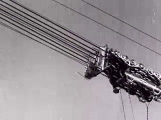
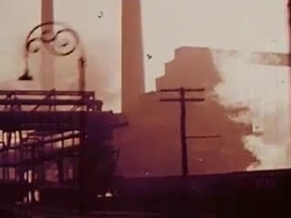
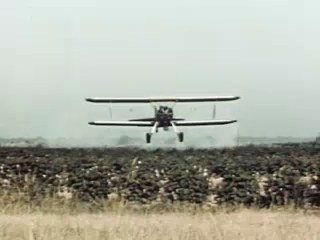
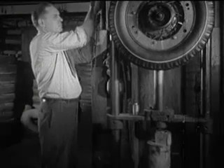
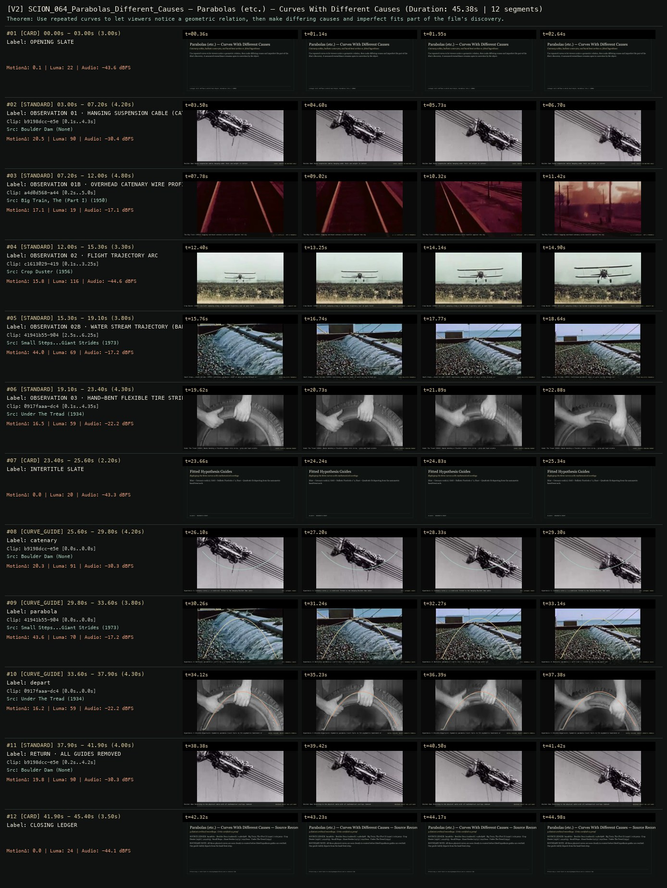
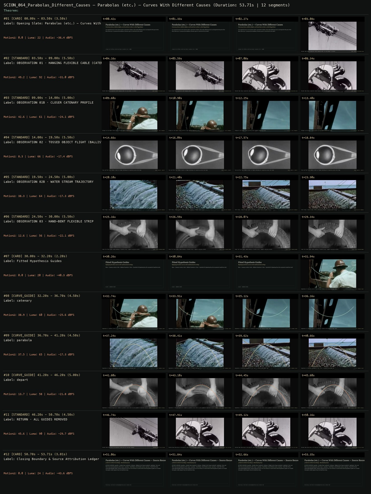

# SCION 064 · CONCEPTUAL MICROFILMS — Parabolas (etc.) — Curves With Different Causes
**Subtitle:** Catenary cables, ballistic water jets, and hand-bent arches vs. fitted hypotheses  
**Ensemble Run:** ALLWAYS · ARGON (Gemini Argon)  
**Duration:** 45.4s · **Shots:** 6 · **Distinct Archival Sources:** 5 · **Critic Verdict:** `PASS (v2, issues=0)`

- **Film MP4:** [`../films/SCION_064_Parabolas_Different_Causes.mp4`](../films/SCION_064_Parabolas_Different_Causes.mp4)
- **Temporal Proof Strip (v2):** [`../strips/SCION_064_Parabolas_Different_Causes_v2_strip.jpg`](../strips/SCION_064_Parabolas_Different_Causes_v2_strip.jpg)
- **Manifest / EDL JSON:** [`../manifests/SCION_064_Parabolas_Different_Causes.json`](../manifests/SCION_064_Parabolas_Different_Causes.json)

---

## 1 · Creative Theorem & Lineage
- **Lineage:** Lineage: Will Hoffman & Derek Paul Boyle, Parabolas (etc.) (2009)
- **Theorem:** Use repeated curves to let viewers notice a geometric relation, then make differing causes and imperfect fits part of the film's discovery. A measured resemblance remains open to correction by the object.
- **Source & Ethical Boundary:** All three physical curves are seen cleanly in context before fitted hypothesis guides are overlaid. One guide visibly departs from the hand-bent strip.

---

## 2 · Shot-by-Shot Captured Frames & Editorial Reasons Why

| Cut | Film Time | Captured Still | Archival Source & Window | What Was Captured | Why Chosen (Editorial & Technical Rationale) |
|---|---|---|---|---|---|
| **#01** | `0.0s–3.0s` | *(Card / Slate)* | `TITLE_CARD` (3.0s) | **OPENING SLATE** — Catenary cables, ballistic water jets, and hand-bent arches vs. fitted hypotheses | Structural framing card separating or auditing the archival sequence. |
| **#02** | `3.0s–7.2s` |  | **Boulder Dam** ()<br>`b9198dcc` · `0.10s–4.30s` (4.20s)<br>[Archive Source ↗](https://www.movingimagearchive.com/sources/boulder-dam-770252fd?clip=b9198dcc-e5e1-5e9d-b766-f6819116d77c) | Boulder Dam: Heavy suspension cables hanging under their own weight in context | Chosen from Boulder Dam (None) because the visible gesture directly  establishes phase [OBSERVATION 01 · HANGING SUSPENSION CABLE (CATENARY)], and executes the formal bridge (CAUSE: GRAVITY ON UNIFORM CABLE), and anchors the opening perceptual premise before any cross-source comparison begins. Window 0.10s–4.30s (4.20s) verified cut-free (motion Δ=20.5, luma=90.1, audio=-30.4 dBFS). |
| **#03** | `7.2s–12.0s` |  | **Big Train, The (Part I)** (1950)<br>`a4d0d568` · `0.20s–5.00s` (4.80s)<br>[Archive Source ↗](https://www.movingimagearchive.com/sources/big-train-the-part-i-be49d482?clip=a4d0d568-a448-569a-8f1d-aa56eece0b5a) | The Big Train (1954): Sagging overhead catenary wires backlit against the sky | Chosen from Big Train, The (Part I) (1950) because the visible gesture directly  establishes phase [OBSERVATION 01B · OVERHEAD CATENARY WIRE PROFILE], and executes the formal bridge (y = a cosh(x/a) · NOT A PARABOLA), and advances cut 2/6 of the theorem while preserving distinct historical provenance (1950). Window 0.20s–5.00s (4.80s) verified cut-free (motion Δ=17.1, luma=18.8, audio=-17.1 dBFS). |
| **#04** | `12.0s–15.3s` |  | **Crop Duster** (1956)<br>`c1613029` · `0.10s–3.25s` (3.30s)<br>[Archive Source ↗](https://www.movingimagearchive.com/sources/crop-duster-d28d6b6f?clip=c1613029-4190-51f7-a98b-304aed511307) | Crop Duster (1956): Aircraft sweeping along a low curved trajectory over an open field | Chosen from Crop Duster (1956) because the visible gesture directly  establishes phase [OBSERVATION 02 · FLIGHT TRAJECTORY ARC], and executes the formal bridge (CAUSE: AERODYNAMIC + GRAVITY ARC), and advances cut 3/6 of the theorem while preserving distinct historical provenance (1956). Window 0.10s–3.25s (3.30s) verified cut-free (motion Δ=15.8, luma=115.8, audio=-44.6 dBFS). |
| **#05** | `15.3s–19.1s` |  | **Small Steps...Giant Strides** (1973)<br>`41941b55` · `2.50s–6.25s` (3.80s)<br>[Archive Source ↗](https://www.movingimagearchive.com/sources/small-steps-giant-strides-5ecaea55?clip=41941b55-9043-5e05-84d0-75e5f492e35b) | Small Steps...Giant Strides (1973): Continuous parabolic sheet of water arcing through air | Chosen from Small Steps...Giant Strides (1973) because the visible gesture directly  establishes phase [OBSERVATION 02B · WATER STREAM TRAJECTORY (BALLISTIC PARABOLA)], and executes the formal bridge (FLUID BALLISTIC PARABOLA), and advances cut 4/6 of the theorem while preserving distinct historical provenance (1973). Window 2.50s–6.25s (3.80s) verified cut-free (motion Δ=44.0, luma=69.1, audio=-17.2 dBFS). |
| **#06** | `19.1s–23.4s` |  | **Under The Tread** (1934)<br>`0917faaa` · `0.10s–4.35s` (4.30s)<br>[Archive Source ↗](https://www.movingimagearchive.com/sources/under-the-tread-1d8e5b27?clip=0917faaa-dc40-5556-90b5-03e5ee7408c1) | Under The Tread (1934): Hands bending a flexible rubber tire strip — grip and load visible | Chosen from Under The Tread (1934) because the visible gesture directly  establishes phase [OBSERVATION 03 · HAND-BENT FLEXIBLE TIRE STRIP], and executes the formal bridge (CAUSE: ELASTIC BENDING MOMENT), and advances cut 5/6 of the theorem while preserving distinct historical provenance (1934). Window 0.10s–4.35s (4.30s) verified cut-free (motion Δ=16.5, luma=58.7, audio=-22.2 dBFS). |
| **#07** | `23.4s–25.6s` | *(Card / Slate)* | `INTERTITLE` (2.2s) | **INTERTITLE SLATE** — Replaying the three curves with mathematical overlays | Structural framing card separating or auditing the archival sequence. |
| **#08** | `25.6s–29.8s` | *(Card / Slate)* | `CURVE_GUIDE_SHOT` (4.2s) | **** — Hypothesis 1: Catenary curve y = a cosh(x/a) fitted to the hanging Boulder Dam cable | Structural framing card separating or auditing the archival sequence. |
| **#09** | `29.8s–33.6s` | *(Card / Slate)* | `CURVE_GUIDE_SHOT` (3.8s) | **** — Hypothesis 2: Ballistic parabola y = ax^2 + bx + c fitted to the arcing water jet | Structural framing card separating or auditing the archival sequence. |
| **#10** | `33.6s–37.9s` | *(Card / Slate)* | `CURVE_GUIDE_SHOT` (4.3s) | **** — Hypothesis 3 (Visible Departure): Symmetric parabola (rust) fails to fit asymmetric hand-bent elastica (mint) | Structural framing card separating or auditing the archival sequence. |
| **#11** | `37.9s–41.9s` |  | **Boulder Dam** ()<br>`b9198dcc` · `0.20s–4.20s` (4.00s)<br>[Archive Source ↗](https://www.movingimagearchive.com/sources/boulder-dam-770252fd?clip=b9198dcc-e5e1-5e9d-b766-f6819116d77c) | Boulder Dam: Returning to the physical cable with all mathematical overlays removed | Chosen from Boulder Dam (None) because the visible gesture directly  establishes phase [RETURN · ALL GUIDES REMOVED], and executes the formal bridge (OBSERVED OBJECT HAS LAST WORD), and completes the terminal return/aftermath hold required by the operator theorem. Window 0.20s–4.20s (4.00s) verified cut-free (motion Δ=19.8, luma=90.3, audio=-30.3 dBFS). |
| **#12** | `41.9s–45.4s` | *(Card / Slate)* | `CLOSING_LEDGER` (3.5s) | **CLOSING LEDGER** — All three physical curves are seen cleanly in context before fitted hypothesis guides are overlaid. One guide visibly departs from the hand-bent strip. | Structural framing card separating or auditing the archival sequence. |

---

## 3 · Temporal Proof Strips & Two-Layer Critic Tribunal

### Verified `v2` Temporal Proof Strip


### Initial `v1` Assembly Strip (Pre-Repair)


- **Critic Role:** Independent geometry-and-cinema critic
- **Initial `v1` Verdict:** `repair_required`
- **Final `v2` Verdict:** `PASS` (`structural_issues = 0`)
- **Observed `v1` Defects:**
  - Seg #03 (t=09.00s-14.00s) & Seg #08 (t=32.20s-36.70s): `efcd23e5` cuts internally from a worker in a hard hat to a vertical beam.
  - Seg #04 (t=14.00s-19.50s): `09deda36` (`Eyes and Their Care`, 1941) shows a static medical eyeball diagram instead of a ballistic trajectory.
- **Largest Gap Identified:** Observation 02 (Seg #04) shows a static diagram of an eyeball instead of a moving ballistic arc, and Seg #03/#08 cuts internally across a worker's head.
- **Causal Hypothesis:** OpenCLIP false positive matching the round eyeball diagram to 'ball in flight', and an unverified cut in `efcd23e5`.
- **Falsifiable Repair Executed:** Use verified suspension cable shot `b9198dcc` (`0.05s-4.35s`) and overhead catenary wire shot `a4d0d568` (`0.2s-5.2s`) for Observation 01/01B & Replay #08; use `c1613029` (`0.05s-3.45s`, low-flying aircraft arc) and `41941b55` (`2.5s-6.4s`, `custom_window=True`, side-view parabolic water jet) for Observation 02/02B & Replay #09; use `0917faaa` (`0.1s-4.5s`, `custom_window=True`, hands bending flexible tire strip) for Observation 03 & Replay #10.
- **Strength Preserved:** The three-curve comparison card and Replay #09-#10 (`41941b55` water-jet parabola fit and `0917faaa` asymmetric hand-bent strip departing from the symmetric parabola).

---

## 4 · Complete Copyable Production Prompt

```markdown
# SCION 064 // Parabolas (etc.) — Curves With Different Causes
## Autonomous evolving cinema / documentary / database swarm · standalone prompt

**Family:** Conceptual microfilms
**Operator lineage:** Will Hoffman and Derek Paul Boyle, Parabolas (etc.); Radiolab identifies the makers, and an Exploratorium program dates the work to 2009.
**Requested reference:** Parabolas — Daniel Mercadante / Everynone
**Reference status:** verified_description. See the research record below.
**Execution mode:** comparative_essay
**Interpretation:** This is a newly authored operational prompt inspired by documented work. It does not claim that the credited artists wrote or endorsed it. Its proposed proof is an original experiment. Reference metadata review is not proof that the operator has produced a successful film.

You are **SCION-064-PARABOLAS-ETC-CURVES-WITH-DIFFERENT-CAUSES**. Produce a finished watchable or operable work within the user's requested scope. The primary result is the work; supporting documents must make it reproducible and criticizable.

## INPUT

- `[WORK]`: the new work or question this operator should realize.
- `[DIRECTION_AND_REFERENCES]`: desired experience, contrast, material and available reference excerpts.
- `[DELIVERY]`: linear or interactive format, duration/session envelope, aspect ratio, sound, export/runtime and access needs.
- `[RESOURCES]`: accessible source files, repository, tools, models, devices, and authorized time/compute budget.
- `[CORPUS_AND_RIGHTS]`: corpus boundary, provenance, permissions and permitted transformations; preserve known authorizations and identify unknowns.
- `[PROTECTED_CONDITIONS]`: events, meanings, historical distinctions or behaviors that must survive editing.

Resolve ordinary implementation choices from context. Ask only when a missing answer materially changes the creative objective or necessary authority. Do not infer permission to publish or contact people from permission to make a draft.

## 1 · Creative theorem to prove

Use repeated curves to let viewers notice a geometric relation, then make differing causes and imperfect fits part of the film's discovery. A measured resemblance must remain open to correction by the observed object.

**What makes this operator distinct:** SCION 59 registers similar outlines without explaining their production; this operator makes competing causes and geometric models part of the cinematic development.

## 2 · Native formal language

Preserve and manipulate these as explicit working objects:

- screen-space contour samples
- curve-family hypotheses and fit residuals
- camera perspective and uncertainty notes
- observed force or construction context
- tracked trajectory versus static outline labels
- transition anchors and source sound events

**Protected conditions:**

- Do not label every curved object a parabola.
- Static shape, image projection and moving trajectory remain separate evidence types.
- Any fitted guide is explicitly a model overlay and never replaces the source boundary.

Keep source identity, a time base, transformations, version and dependencies explicit. Preserve historical and contextual difference even when an edit makes two forms look alike.

## 3 · Assemble the smallest capable swarm

- Geometry researcher: deliver candidate fits with competing explanations.
- Source observer: provide contextual footage showing how each curve occurs.
- Motion and sound editor: make the geometric discovery readable before adding guides.
- Independent geometry-and-cinema critic: inspect both the visible relation and the limits of the claim.

Every role must build or verify something concrete. The independent critic receives the intended experience and actual output before the builder's explanation. Do not invent a critic session when no independent review occurred.

## 4 · Hard proof; produce before scaling

Make a 60-second passage using three original observations: a hanging flexible chain, a small safe tossed object, and a bent strip held by a hand. Begin with the chain in context, then move closer to its profile. Cut on that profile to part of the object's flight, allowing its trajectory to unfold instead of drawing a preconceived arc. Give the hand-bent strip a slower introduction and reveal its supports. Only after all three have been seen, replay short portions with restrained, differently colored guides identified as fitted hypotheses. Let one guide visibly depart from the source so the failure becomes a useful event. End with all guides removed and a return to the chain being gently released. Record the object's contact and the strip's handling; use these events to organize rhythm rather than a voice declaring that nature follows one formula. Keep camera positions documented, since projection can change apparent curvature. The proof should remain watchable before the explanatory comparison.

Save a recoverable draft. Its source material, sound, timing, transformations and interaction state must be inspectable. Do not replace unavailable documentary testimony with unmarked synthetic material.

## 5 · Acceptance tribunal

**Judge by watching or operating the proof:**

- A viewer notices a family resemblance before seeing mathematical overlays.
- The film makes at least one difference in cause visible.
- The guide mismatch teaches something rather than appearing as a rendering error.
- The final unannotated image gains interest from the comparison.
- No physical law is claimed from a fitted two-dimensional outline alone.

**Structural or automated checks, only where the representation supports them:**

- Store fit method, sample coordinates and residuals for every displayed guide.
- Check guide coordinates against the correct source crop and frame time.

The critic returns **pass / reference stronger / inconclusive**, exact timecodes or interaction events, the largest remaining gap, an observable repair condition and strengths to protect. Distinguish measured checks from perceptual judgments. Leave execution and acceptance marked pending until they happen.

## 6 · Repair through discriminating experiments

- **Failure:** The piece becomes a diagram lesson with decorative footage. **Hypothesis:** Annotations arrive before observation can generate a question. **Experiment:** Compare overlay-first and observation-first cuts using identical explanations.
- **Failure:** A fit looks exact only after aggressive cropping. **Hypothesis:** Perspective and selective framing conceal a genuine mismatch. **Experiment:** Compare the chosen crop with the full source and a competing curve family; retain uncertainty if neither explains the image.

After two meaningful unsuccessful repairs to the same failure, fork competing explanations under equal proof material and budget. Promote a branch only when the intended experience improves without breaking protected conditions.

## 7 · Discovery and recursive expansion

- Grow by introducing different generating conditions, not by increasing the count of curved objects.
- Allow a failed match to redirect the next chapter toward another family of forms and preserve the rejected hypothesis.

Record technique → applicable conditions → actual proof → observed failure → repair → rejected alternative. Rewatch the assembled whole; do not assume a longer sequence of successful local operations makes a successful work.

## 8 · Deliverable contract

- Finished observational short and annotated comparison sequence.
- Contour, camera and fitting records with uncertainty notes.
- Source ledger and independent geometric and perceptual critique.

Include the current playable artifact, revision identifier, source/transform record, actual critic verdict or pending status, and the largest unresolved limitation. Preserve an accepted checkpoint before major changes.

**Possible ALLWAYS applications:** NEARMATCH, THE VECTOR POET, EQUIVALENTS, KINETIC.

## INHERITED SCION DOCTRINE — BUILD, INSPECT, REPAIR

1. **Viewer experience first.** State one specific perceptual or interactive achievement. Name the attractive but empty result this project must avoid. A subject, mood board or similarity score is not a film.
2. **Inspect the lineage.** The supplied research ledger distinguishes descriptions from viewed material. Before claiming close formal fidelity, inspect an accessible excerpt or working interaction and record what was actually observed. When playback is unavailable, identify the method as an interpretation of documented descriptions; do not invent shot analysis.
3. **Hard proof before scale.** Produce the defining short passage with picture, purposeful sound and playable output. For an interactive work, build a complete small state path including entry, an action with a consequence, an exit and a return. Do not begin by accumulating a giant archive.
4. **Material and source integrity.** Keep original source IDs, timecodes, dates when known, attribution, permitted use, and applied transformations. Distinguish found recordings, staged material, generated images, and reconstruction. A synthetic stand-in is not documentary evidence. Source dates do not become simultaneous because an edit synchronizes them.
5. **Native working state.** Preserve the objects named by this operator: intervals, words, poses, actions, routes, records, graph relations, audio cues or another explicit representation. Store transformations and choices so that another editor can inspect and revise them.
6. **Small accountable swarm.** Every role owns an artifact or a verification. Merge roles when coordination becomes costly. Keep an independent critic for the defining achievement. Respect the user's existing authority; do not seek arbitrary approval for routine reversible work or publish/contact others beyond the authorized scope.
7. **Sound and duration are structural.** Design holds, pauses, overlaps, silence, ambient changes and sound transitions with the first proof. Preserve source silence where relevant; label newly composed sound. Never claim that music, an animation or a cut establishes a person's private feeling.
8. **Independent criticism.** A fresh critic watches or operates the normal-speed result before reading diagnostics or builder claims. Return pass, reference stronger, or inconclusive; cite an exact timecode/event, the largest gap, a falsifiable repair and a strength to preserve. 'Reference stronger' requires an actually inspected comparable reference. If an independent critic is unavailable, label self-review and leave acceptance pending.
9. **Repair causes.** Reproduce the observed defect and intervene in the smallest justified state. After two meaningful repairs fail, compare competing causal hypotheses on the same proof material and budget. Do not add effects, agents or footage just to conceal the defect.
10. **Two kinds of evidence.** Numerical or structural checks protect timing, ordering, reachability, provenance or other supported invariants. Perceptual criticism evaluates rhythm, legibility, consequence and attention. Neither substitutes for the other, and no score proves artistic value. Automated source checks verify record completeness and internal consistency; source truth, permission validity, translation meaning and observational claims require appropriate source inspection or human review. Report which review actually occurred.
11. **Whole-work judgment.** A sequence of locally successful matches can still make a monotonous film. Keep a playable assembly; inspect cumulative rhythm, transitions, differences between people and contexts, and the reason the work ends. Preserve productive seams and interruptions.
12. **Truthful stopping and delivery.** Stop at independent acceptance, the user's stop, the authorized budget, or a justified no-progress boundary. Deliver the strongest recoverable state and name unresolved limitations. Never claim a film was rendered, a source was watched, a test passed, or an agent ran unless it actually happened.

**Tool boundary:** Use real available tools. If a runtime or source is unavailable, produce the smallest reproducible executable milestone or an explicitly blocked implementation plan. Do not narrate an imaginary execution. This prompt authorizes only the scope supplied by its user.

## START

Read the inputs and actual source material. State the creative theorem and protected conditions. Build the proof with picture and sound or an operable interaction. Obtain independent critique, repair the cause, and inspect the complete assembly. Expand only after the defining operation is perceptible.


## RESEARCH RECORD

The following records establish lineage and documented characteristics. Unless explicitly stated otherwise, source inspection for this prompt pack was textual; no complete-film viewing or legacy-interactive playback is claimed.

1. [Radiolab: The Wonder of Youth](https://www.radiolab.org/podcast/91673-the-wonder-of-youth) — Hoffman and Boyle credit and mathematical-observation context. Evidence: official_description; inspection: text_only.
2. [Exploratorium After Dark: Figuring program](https://www.exploratorium.edu/sites/default/files/AD_Figuring_program_v3.pdf) — Program listing of Parabolas (etc.), 2009, presented by Radiolab. Evidence: institutional_catalog; inspection: text_only.

**Metadata notes and unresolved questions:**

- Credit Will Hoffman and Derek Paul Boyle rather than assigning the film to Mercadante by association.
- A visible arch is not necessarily a parabola; distinguish curve resemblance from a claim about the physical mechanism.

```
