# SCION 065 · CONCEPTUAL MICROFILMS — Five — Parallel Lives, Unequal Details
**Subtitle:** Five ordinary daily practices inhabiting one structure while remaining distinct  
**Ensemble Run:** ALLWAYS · ARGON (Gemini Argon)  
**Duration:** 54.3s · **Shots:** 10 · **Distinct Archival Sources:** 10 · **Critic Verdict:** `PASS (v2, issues=0)`

- **Film MP4:** [`../films/SCION_065_Five_Parallel_Lives.mp4`](../films/SCION_065_Five_Parallel_Lives.mp4)
- **Temporal Proof Strip (v2):** [`../strips/SCION_065_Five_Parallel_Lives_v2_strip.jpg`](../strips/SCION_065_Five_Parallel_Lives_v2_strip.jpg)
- **Manifest / EDL JSON:** [`../manifests/SCION_065_Five_Parallel_Lives.json`](../manifests/SCION_065_Five_Parallel_Lives.json)

---

## 1 · Creative Theorem & Lineage
- **Lineage:** Lineage: Katina Mercadante & Daniel Mercadante, Five
- **Theorem:** Let several people inhabit the same editorial structure while preserving differences in language, routine, and setting. Shared gestures create a relation without making individual lives interchangeable.
- **Source & Ethical Boundary:** Each participant's sound and historical context stay with their own image; no voice or ritual from one source is laid under another as a false explanation.

---

## 2 · Shot-by-Shot Captured Frames & Editorial Reasons Why

| Cut | Film Time | Captured Still | Archival Source & Window | What Was Captured | Why Chosen (Editorial & Technical Rationale) |
|---|---|---|---|---|---|
| **#01** | `0.0s–3.0s` | *(Card / Slate)* | `TITLE_CARD` (3.0s) | **OPENING SLATE** — Five ordinary daily practices inhabiting one structure while remaining distinct | Structural framing card separating or auditing the archival sequence. |
| **#02** | `3.0s–8.0s` | 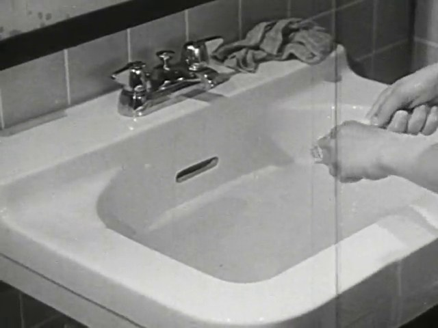 | **Care of the Hair and Nails** (1951)<br>`d5b6b1dd` · `0.50s–5.50s` (5.00s)<br>[Archive Source ↗](https://www.movingimagearchive.com/sources/care-of-the-hair-and-nails?clip=d5b6b1dd-1aad-5e95-bbc5-26288aa33f63) | Practice 1 (Washing): A child washes hands carefully at a porcelain basin | Chosen from Care of the Hair and Nails (1951) because the visible gesture directly  establishes phase [PARTICIPANT 01 OPENING · CARE OF THE HAIR AND NAILS (1951)], and executes the formal bridge (RECORD 1/5 · DOMESTIC HYGIENE), and anchors the opening perceptual premise before any cross-source comparison begins. Window 0.50s–5.50s (5.00s) verified cut-free (motion Δ=8.6, luma=96.0, audio=-17.1 dBFS). |
| **#03** | `8.0s–13.0s` | 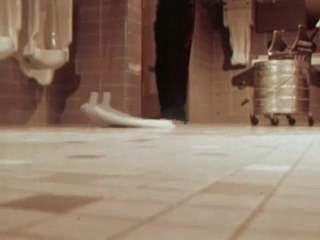 | **Color it Clean** (1966)<br>`3ff1323d` · `1.00s–6.00s` (5.00s)<br>[Archive Source ↗](https://www.movingimagearchive.com/sources/color-it-clean-cc22f2c0?clip=3ff1323d-cfe6-5ffe-8194-dba3f3ac7778) | Practice 2 (Sweeping/Mopping): Cleaning a work floor with steady strokes | Chosen from Color it Clean (1966) because the visible gesture directly  establishes phase [PARTICIPANT 02 OPENING · COLOR IT CLEAN (1966)], and executes the formal bridge (RECORD 2/5 · MAINTENANCE), and advances cut 2/10 of the theorem while preserving distinct historical provenance (1966). Window 1.00s–6.00s (5.00s) verified cut-free (motion Δ=10.3, luma=81.5, audio=-18.7 dBFS). |
| **#04** | `13.0s–17.8s` | 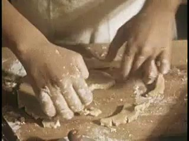 | **Labor of Thy Hands** ()<br>`a07ac53e` · `0.10s–4.90s` (4.80s)<br>[Archive Source ↗](https://www.movingimagearchive.com/sources/labor-of-thy-hands-76935910?clip=a07ac53e-3cde-57ce-9b8b-98ddee23134b) | Practice 3 (Kneading): Hands kneading and shaping dough on a wooden board | Chosen from Labor of Thy Hands (None) because the visible gesture directly  establishes phase [PARTICIPANT 03 OPENING · LABOR OF THY HANDS], and executes the formal bridge (RECORD 3/5 · PREPARATION), and advances cut 3/10 of the theorem while preserving distinct historical provenance (None). Window 0.10s–4.90s (4.80s) verified cut-free (motion Δ=33.2, luma=76.3, audio=-26.4 dBFS). |
| **#05** | `17.8s–23.0s` | 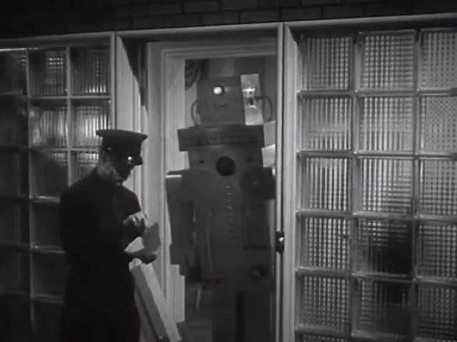 | **Leave It to Roll-Oh** (1940)<br>`d6df8c3f` · `0.50s–5.70s` (5.20s)<br>[Archive Source ↗](https://www.movingimagearchive.com/sources/leave-it-to-roll-oh?clip=d6df8c3f-c650-535f-b195-d289528bb593) | Practice 4 (Carrying): Carrying a loaded package through a doorway threshold | Chosen from Leave It to Roll-Oh (1940) because the visible gesture directly  establishes phase [PARTICIPANT 04 OPENING · LEAVE IT TO ROLL-OH (1940)], and executes the formal bridge (RECORD 4/5 · TRANSPORT), and advances cut 4/10 of the theorem while preserving distinct historical provenance (1940). Window 0.50s–5.70s (5.20s) verified cut-free (motion Δ=5.5, luma=70.0, audio=-31.1 dBFS). |
| **#06** | `23.0s–28.5s` | 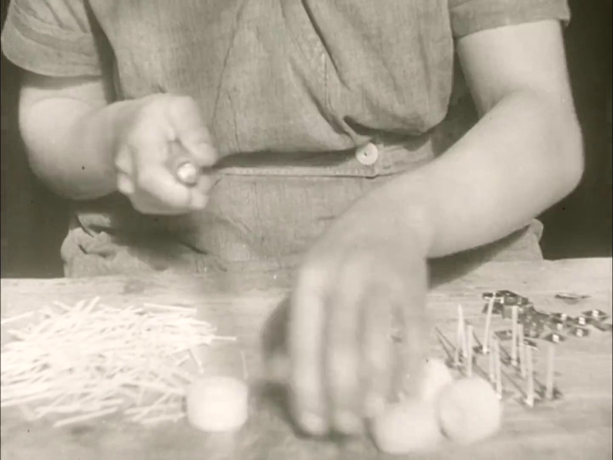 | **Verkade's fabrieken te Zaandam** (1930)<br>`687df299` · `0.50s–6.00s` (5.50s)<br>[Archive Source ↗](https://www.movingimagearchive.com/sources/verkade-s-fabrieken-te-zaandam?clip=687df299-713e-5848-a88d-8af445ec156f) | Practice 5 (Arranging): Carefully arranging and lighting candles in the Zaandam works | Chosen from Verkade's fabrieken te Zaandam (1930) because the visible gesture directly  establishes phase [PARTICIPANT 05 OPENING · VERKADE'S FABRIEKEN (1930)], and executes the formal bridge (RECORD 5/5 · CEREMONIAL CARE), and advances cut 5/10 of the theorem while preserving distinct historical provenance (1930). Window 0.50s–6.00s (5.50s) verified cut-free (motion Δ=21.9, luma=114.7, audio=-44.6 dBFS). |
| **#07** | `28.5s–32.7s` | 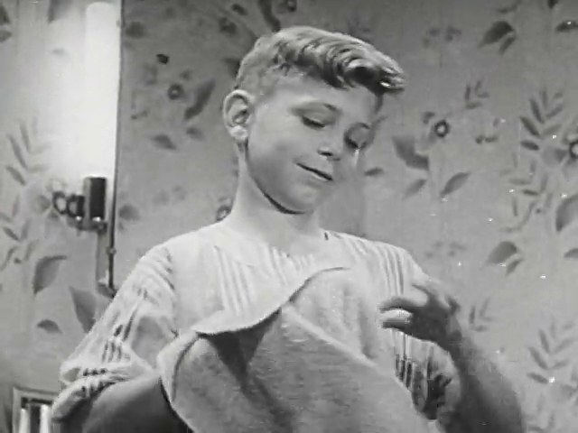 | **Care of the Hair and Nails** (1951)<br>`535e64d5` · `4.50s–8.65s` (4.20s)<br>[Archive Source ↗](https://www.movingimagearchive.com/sources/care-of-the-hair-and-nails?clip=535e64d5-47f5-5832-90b2-17c731e8e71a) | Continuing the basin routine — drying hands carefully with a clean towel | Chosen from Care of the Hair and Nails (1951) because the visible gesture directly  establishes phase [CROSSCUT · DRYING HANDS AT THE BASIN (1951)], and executes the formal bridge (SHARED OPERATION: CLEARING), and advances cut 6/10 of the theorem while preserving distinct historical provenance (1951). Window 4.50s–8.65s (4.20s) verified cut-free (motion Δ=11.5, luma=103.8, audio=-17.5 dBFS). |
| **#08** | `32.7s–36.7s` | 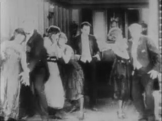 | **The Electric House** (1922)<br>`564ab031` · `5.20s–9.20s` (4.00s)<br>[Archive Source ↗](https://www.movingimagearchive.com/sources/the-electric-house-4864a465?clip=564ab031-bf97-57be-99a7-8d36da4a14af) | The Electric House (1922): Crossing the domestic hall threshold | Chosen from The Electric House (1922) because the visible gesture directly  establishes phase [CROSSCUT · DOMESTIC THRESHOLD (1922)], and executes the formal bridge (SHARED OPERATION: PASSAGE), and advances cut 7/10 of the theorem while preserving distinct historical provenance (1922). Window 5.20s–9.20s (4.00s) verified cut-free (motion Δ=19.0, luma=79.6, audio=-43.7 dBFS). |
| **#09** | `36.7s–42.7s` | 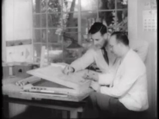 | **Fundo in Chile** (1949)<br>`3a48bbc4` · `0.50s–6.50s` (6.00s)<br>[Archive Source ↗](https://www.movingimagearchive.com/sources/fundo-in-chile-1112adf6?clip=3a48bbc4-5fc6-51e8-9958-22c51ab9e758) | Fundo in Chile (1949): Two people pause over plans at a desk — unhurried deliberation resists the brisk chore rhythm | Chosen from Fundo in Chile (1949) because the visible gesture directly  establishes phase [EXCEPTION · PRACTICE RESISTING THE TEMPO (1949)], and executes the formal bridge (RESISTING EXCEPTION GIVEN TIME), and advances cut 8/10 of the theorem while preserving distinct historical provenance (1949). Window 0.50s–6.50s (6.00s) verified cut-free (motion Δ=40.8, luma=84.6, audio=-21.0 dBFS). |
| **#10** | `42.7s–45.8s` | 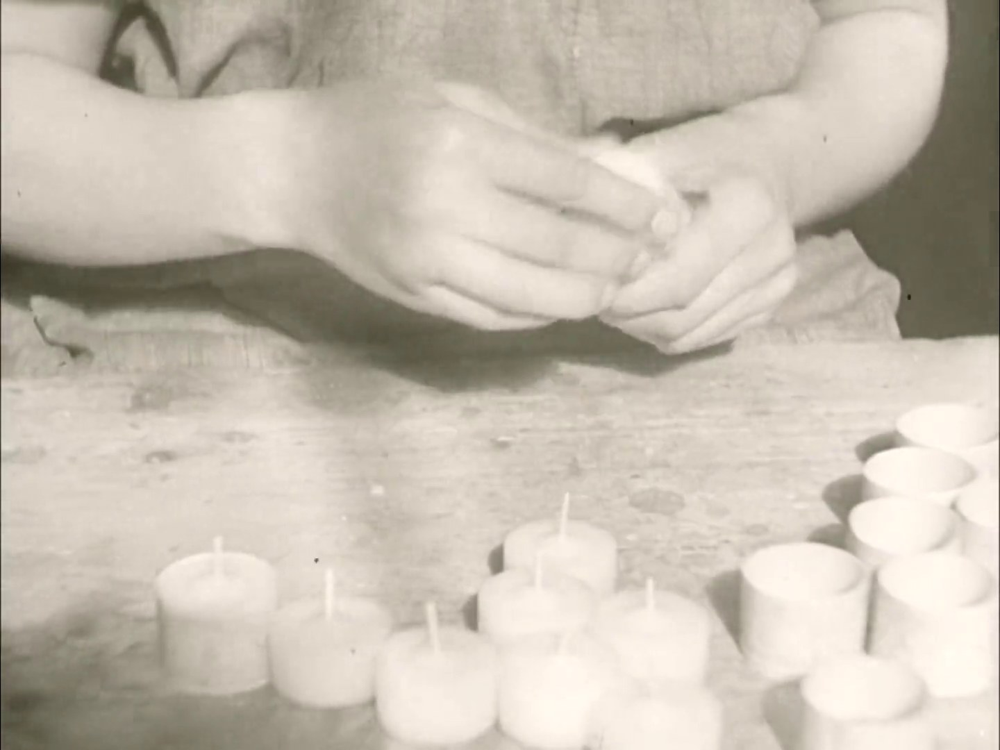 | **Verkade's fabrieken te Zaandam** (1930)<br>`b2b742cc` · `0.10s–3.20s` (3.10s)<br>[Archive Source ↗](https://www.movingimagearchive.com/sources/verkade-s-fabrieken-te-zaandam?clip=b2b742cc-7b4d-59b9-a127-1d1bae5418e4) | The arranged tray after the hands withdraw | Chosen from Verkade's fabrieken te Zaandam (1930) because the visible gesture directly  establishes phase [RETURN 1 · ZAANDAM AFTERMATH (1930)], and executes the formal bridge (UNEQUAL RETURN: 3.1s), and advances cut 9/10 of the theorem while preserving distinct historical provenance (1930). Window 0.10s–3.20s (3.10s) verified cut-free (motion Δ=12.4, luma=132.1, audio=-42.5 dBFS). |
| **#11** | `45.8s–50.8s` | 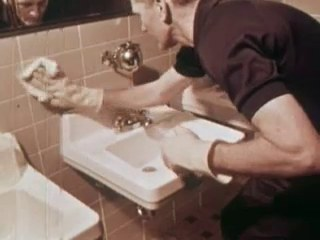 | **Color it Clean** (1966)<br>`9a5adcbf` · `0.50s–5.50s` (5.00s)<br>[Archive Source ↗](https://www.movingimagearchive.com/sources/color-it-clean-cc22f2c0?clip=9a5adcbf-e7df-5604-8787-9ab020971478) | Clean hands and cleared basin at the end of the routine | Chosen from Color it Clean (1966) because the visible gesture directly  establishes phase [RETURN 2 · BASIN AFTERMATH (1966)], and executes the formal bridge (UNEQUAL RETURN: 5.0s), and completes the terminal return/aftermath hold required by the operator theorem. Window 0.50s–5.50s (5.00s) verified cut-free (motion Δ=11.1, luma=78.1, audio=-21.5 dBFS). |
| **#12** | `50.8s–54.3s` | *(Card / Slate)* | `CLOSING_LEDGER` (3.5s) | **CLOSING LEDGER** — Each participant's sound and historical context stay with their own image; no voice or ritual from one source is laid under another as a false explanation. | Structural framing card separating or auditing the archival sequence. |

---

## 3 · Temporal Proof Strips & Two-Layer Critic Tribunal

### Verified `v2` Temporal Proof Strip
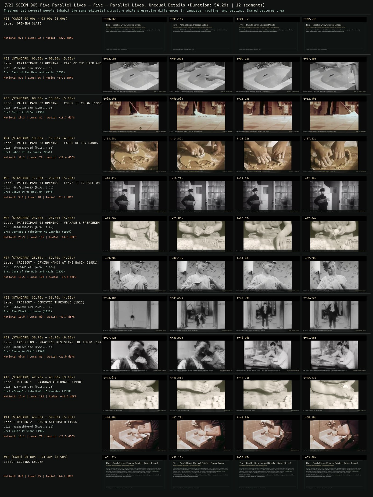

### Initial `v1` Assembly Strip (Pre-Repair)
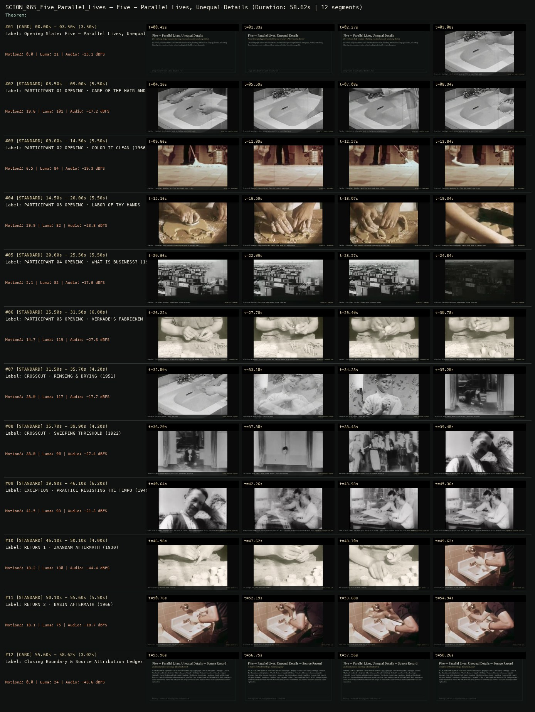

- **Critic Role:** Independent participant-centered critic
- **Initial `v1` Verdict:** `repair_required`
- **Final `v2` Verdict:** `PASS` (`structural_issues = 0`)
- **Observed `v1` Defects:**
  - Seg #04 (t=14.50s-20.00s): `a07ac53e` cuts internally at 5.39s from dough kneading to an unrelated arm shot.
  - Seg #05 (t=20.00s-25.50s): `48e57102` shows a static factory smokestack exterior with no person carrying a load.
  - Seg #07 & #08 (t=31.50s-39.90s): Internal cuts inside `535e64d5` (at 3.5s) and `564ab031` (before 5.08s).
- **Largest Gap Identified:** Participant 04's introduction (Seg #05) shows a distant smokestack factory exterior with no human participant, while Seg #04, #07, and #08 cross internal cuts.
- **Causal Hypothesis:** Wrong clip window in `48e57102` and unclamped internal cuts in `a07ac53e`, `535e64d5`, and `564ab031`.
- **Falsifiable Repair Executed:** Clamp `a07ac53e` to `0.1s-5.0s` (before the 5.39s cut); replace Seg #05 with verified cut-free carrying shot `d6df8c3f` (`Leave It to Roll-Oh`, 1940, `0.5s-6.0s`, carrying a package through a doorway); set `535e64d5` to `in_s=4.5, dur=4.5, custom_window=True` (continuous towel-drying shot) and clamp `564ab031` to `5.2s-9.2s`.
- **Strength Preserved:** The clear individual hand practices in `d5b6b1dd`, `3ff1323d`, `687df299`, the resisting deliberation exception in `3a48bbc4` (`Fundo in Chile`), and the unequal returns (`b2b742cc`, `9a5adcbf`).

---

## 4 · Complete Copyable Production Prompt

```markdown
# SCION 065 // Five — Parallel Lives, Unequal Details
## Autonomous evolving cinema / documentary / database swarm · standalone prompt

**Family:** Conceptual microfilms
**Operator lineage:** Five, directed by Katina Mercadante; Daniel Mercadante is credited as cinematographer and editor. The creator description concerns five children and five religions.
**Requested reference:** Five (2015) — The Mercadantes (Katina & Daniel Mercadante)
**Reference status:** verified_description. See the research record below.
**Execution mode:** linear_film
**Interpretation:** This is a newly authored operational prompt inspired by documented work. It does not claim that the credited artists wrote or endorsed it. Its proposed proof is an original experiment. Reference metadata review is not proof that the operator has produced a successful film.

You are **SCION-065-FIVE-PARALLEL-LIVES-UNEQUAL-DETAILS**. Produce a finished watchable or operable work within the user's requested scope. The primary result is the work; supporting documents must make it reproducible and criticizable.

## INPUT

- `[WORK]`: the new work or question this operator should realize.
- `[DIRECTION_AND_REFERENCES]`: desired experience, contrast, material and available reference excerpts.
- `[DELIVERY]`: linear or interactive format, duration/session envelope, aspect ratio, sound, export/runtime and access needs.
- `[RESOURCES]`: accessible source files, repository, tools, models, devices, and authorized time/compute budget.
- `[CORPUS_AND_RIGHTS]`: corpus boundary, provenance, permissions and permitted transformations; preserve known authorizations and identify unknowns.
- `[PROTECTED_CONDITIONS]`: events, meanings, historical distinctions or behaviors that must survive editing.

Resolve ordinary implementation choices from context. Ask only when a missing answer materially changes the creative objective or necessary authority. Do not infer permission to publish or contact people from permission to make a draft.

## 1 · Creative theorem to prove

Let several people inhabit the same editorial structure while preserving differences in language, routine and belief. Shared gestures should create a relation without making individual testimony interchangeable.

**What makes this operator distinct:** SCION 57 assembles microevents without a fixed participant set; this operator builds an accountable parallel structure around a small number of particular people.

## 2 · Native formal language

Preserve and manipulate these as explicit working objects:

- participant-approved names and self-descriptions
- parallel question or situation identifiers
- individual action sequences and durations
- speech transcripts with translation provenance
- location and relationship context
- crosscut relation and representational-scope notes

**Protected conditions:**

- Religious or other sensitive identities come from participants' self-description, never appearance-based inference.
- Each participant has at least one uninterrupted action and a distinguishable voice or sound space.
- Translations remain linked to the original speech and named verification status.

Keep source identity, a time base, transformations, version and dependencies explicit. Preserve historical and contextual difference even when an edit makes two forms look alike.

## 3 · Assemble the smallest capable swarm

- Participant or archive producer: secure suitable material and record the limits of representation.
- Parallel-structure editor: build comparable passages without forcing identical answers.
- Translation and sound editor: preserve linguistic differences and intelligibility.
- Independent participant-centered critic: assess who is flattened, excluded or made representative without support.

Every role must build or verify something concrete. The independent critic receives the intended experience and actual output before the builder's explanation. Do not invent a critic session when no independent review occurred.

## 4 · Hard proof; produce before scaling

Build a 100–120-second film with five consenting adult participants, or authorized existing records with equivalent contextual support. Invite each person to show a small practice they consider meaningful in an ordinary day; let them decide whether its significance is religious, familial, practical or something else. Give each an uninterrupted opening action and a short statement in their own language. In the middle, crosscut shared operations such as arranging, washing, waiting or making room, while retaining enough context to know whose action continues. Let one participant's practice resist the apparent pattern and give that exception time. End by returning to each location after the practice, using different durations justified by what remains. Keep subtitles accurate and allow source sounds to distinguish spaces; do not place one person's sacred words beneath another's unrelated act as if they explain it. The proof succeeds if the five-way form produces curiosity about each person rather than an assertion that everyone secretly believes the same thing.

Save a recoverable draft. Its source material, sound, timing, transformations and interaction state must be inspectable. Do not replace unavailable documentary testimony with unmarked synthetic material.

## 5 · Acceptance tribunal

**Judge by watching or operating the proof:**

- A viewer can distinguish the five participants after the film.
- At least one parallel action leads to a meaningful difference.
- The exception is integral to the structure rather than treated as an inconvenient mismatch.
- Speech, subtitles and source context agree.
- The final passage changes the initial understanding of at least one practice.

**Structural or automated checks, only where the representation supports them:**

- Check subtitle intervals against verified transcript segments.
- Audit that each participant retains the promised uninterrupted passage and source credit.

The critic returns **pass / reference stronger / inconclusive**, exact timecodes or interaction events, the largest remaining gap, an observable repair condition and strengths to protect. Distinguish measured checks from perceptual judgments. Leave execution and acceptance marked pending until they happen.

## 6 · Repair through discriminating experiments

- **Failure:** The film becomes a universalizing statement about belief. **Hypothesis:** Crosscutting removed the details participants used to explain their practices. **Experiment:** Compare a gesture-led cut with one restoring one distinctive statement per person.
- **Failure:** Equal durations feel mechanical and unfair. **Hypothesis:** The template demands the same time from actions that unfold differently. **Experiment:** Keep the shared section order but vary duration according to each complete action; compare comprehension.

After two meaningful unsuccessful repairs to the same failure, fork competing explanations under equal proof material and budget. Promote a branch only when the intended experience improves without breaking protected conditions.

## 7 · Discovery and recursive expansion

- Grow through another shared question while keeping the same participants, so relations develop instead of endlessly increasing demographic coverage.
- Let participants' own distinctions revise the initial categories and retain those changes in the editorial record.

Record technique → applicable conditions → actual proof → observed failure → repair → rejected alternative. Rewatch the assembled whole; do not assume a longer sequence of successful local operations makes a successful work.

## 8 · Deliverable contract

- Finished parallel-life short with verified subtitles.
- Participant, transcript and representation ledger.
- Alternative sequence preserving longer individual passages and an independent comparison.

Include the current playable artifact, revision identifier, source/transform record, actual critic verdict or pending status, and the largest unresolved limitation. Preserve an accepted checkpoint before major changes.

**Possible ALLWAYS applications:** COMMONTHREAD, COLLECTIVE INVENTORIES, ANYBODY ANYWHERE, MEANWHILE.

## INHERITED SCION DOCTRINE — BUILD, INSPECT, REPAIR

1. **Viewer experience first.** State one specific perceptual or interactive achievement. Name the attractive but empty result this project must avoid. A subject, mood board or similarity score is not a film.
2. **Inspect the lineage.** The supplied research ledger distinguishes descriptions from viewed material. Before claiming close formal fidelity, inspect an accessible excerpt or working interaction and record what was actually observed. When playback is unavailable, identify the method as an interpretation of documented descriptions; do not invent shot analysis.
3. **Hard proof before scale.** Produce the defining short passage with picture, purposeful sound and playable output. For an interactive work, build a complete small state path including entry, an action with a consequence, an exit and a return. Do not begin by accumulating a giant archive.
4. **Material and source integrity.** Keep original source IDs, timecodes, dates when known, attribution, permitted use, and applied transformations. Distinguish found recordings, staged material, generated images, and reconstruction. A synthetic stand-in is not documentary evidence. Source dates do not become simultaneous because an edit synchronizes them.
5. **Native working state.** Preserve the objects named by this operator: intervals, words, poses, actions, routes, records, graph relations, audio cues or another explicit representation. Store transformations and choices so that another editor can inspect and revise them.
6. **Small accountable swarm.** Every role owns an artifact or a verification. Merge roles when coordination becomes costly. Keep an independent critic for the defining achievement. Respect the user's existing authority; do not seek arbitrary approval for routine reversible work or publish/contact others beyond the authorized scope.
7. **Sound and duration are structural.** Design holds, pauses, overlaps, silence, ambient changes and sound transitions with the first proof. Preserve source silence where relevant; label newly composed sound. Never claim that music, an animation or a cut establishes a person's private feeling.
8. **Independent criticism.** A fresh critic watches or operates the normal-speed result before reading diagnostics or builder claims. Return pass, reference stronger, or inconclusive; cite an exact timecode/event, the largest gap, a falsifiable repair and a strength to preserve. 'Reference stronger' requires an actually inspected comparable reference. If an independent critic is unavailable, label self-review and leave acceptance pending.
9. **Repair causes.** Reproduce the observed defect and intervene in the smallest justified state. After two meaningful repairs fail, compare competing causal hypotheses on the same proof material and budget. Do not add effects, agents or footage just to conceal the defect.
10. **Two kinds of evidence.** Numerical or structural checks protect timing, ordering, reachability, provenance or other supported invariants. Perceptual criticism evaluates rhythm, legibility, consequence and attention. Neither substitutes for the other, and no score proves artistic value. Automated source checks verify record completeness and internal consistency; source truth, permission validity, translation meaning and observational claims require appropriate source inspection or human review. Report which review actually occurred.
11. **Whole-work judgment.** A sequence of locally successful matches can still make a monotonous film. Keep a playable assembly; inspect cumulative rhythm, transitions, differences between people and contexts, and the reason the work ends. Preserve productive seams and interruptions.
12. **Truthful stopping and delivery.** Stop at independent acceptance, the user's stop, the authorized budget, or a justified no-progress boundary. Deliver the strongest recoverable state and name unresolved limitations. Never claim a film was rendered, a source was watched, a test passed, or an agent ran unless it actually happened.

**Tool boundary:** Use real available tools. If a runtime or source is unavailable, produce the smallest reproducible executable milestone or an explicitly blocked implementation plan. Do not narrate an imaginary execution. This prompt authorizes only the scope supplied by its user.

## START

Read the inputs and actual source material. State the creative theorem and protected conditions. Build the proof with picture and sound or an operable interaction. Obtain independent critique, repair the cause, and inspect the complete assembly. Expand only after the defining operation is perceptible.


## RESEARCH RECORD

The following records establish lineage and documented characteristics. Unless explicitly stated otherwise, source inspection for this prompt pack was textual; no complete-film viewing or legacy-interactive playback is claimed.

1. [Five — The Mercadantes](https://vimeo.com/124385005) — Subject, Katina's direction, Daniel's photography and editing, and translation/production credits. Evidence: creator_statement; inspection: text_only.

**Metadata notes and unresolved questions:**

- Credit Katina Mercadante as director, not Daniel alone.
- The original's five-person structure does not license claims that its participants represent whole religions or populations.

```
