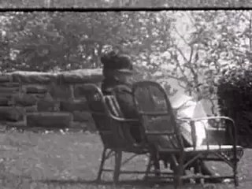
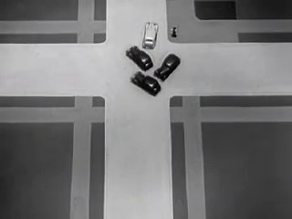
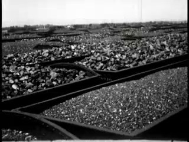
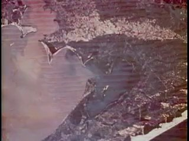
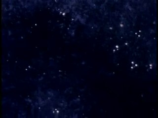
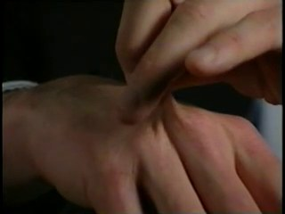
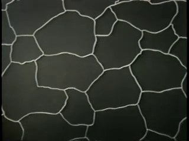
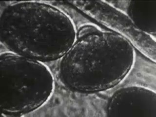
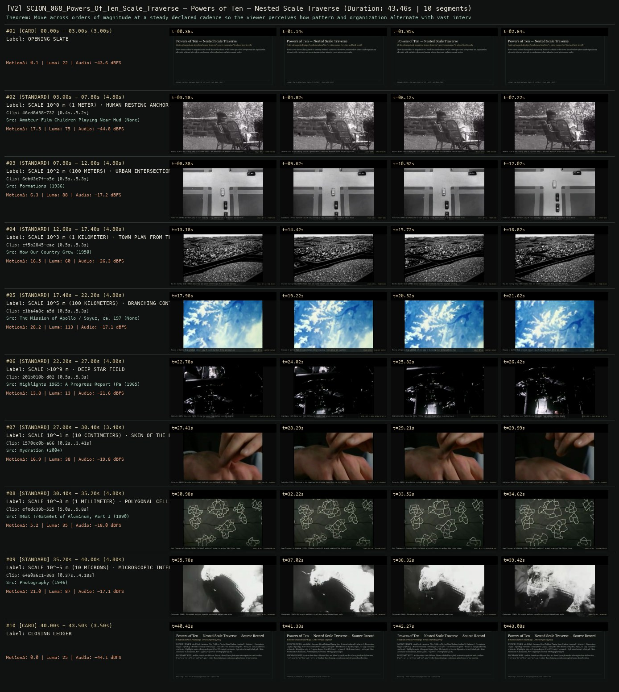

# SCION 068 · STRUCTURAL & FOUND-FOOTAGE CINEMA — Powers of Ten — Nested Scale Traverse
**Subtitle:** Order-of-magnitude steps from human hand (10^-1 m) to cosmos (10^6 m) and back to cells  
**Ensemble Run:** ALLWAYS · ARGON (Gemini Argon)  
**Duration:** 43.5s · **Shots:** 8 · **Distinct Archival Sources:** 8 · **Critic Verdict:** `PASS (v2, issues=0)`

- **Film MP4:** [`../films/SCION_068_Powers_Of_Ten_Scale_Traverse.mp4`](../films/SCION_068_Powers_Of_Ten_Scale_Traverse.mp4)
- **Temporal Proof Strip (v2):** [`../strips/SCION_068_Powers_Of_Ten_Scale_Traverse_v2_strip.jpg`](../strips/SCION_068_Powers_Of_Ten_Scale_Traverse_v2_strip.jpg)
- **Manifest / EDL JSON:** [`../manifests/SCION_068_Powers_Of_Ten_Scale_Traverse.json`](../manifests/SCION_068_Powers_Of_Ten_Scale_Traverse.json)

---

## 1 · Creative Theorem & Lineage
- **Lineage:** Lineage: Charles & Ray Eames, Powers of Ten (1977) · Kees Boeke (1957)
- **Theorem:** Move across orders of magnitude at a steady declared cadence so the viewer perceives how pattern and organization alternate with vast intervals across human, urban, planetary, and microscopic scales.
- **Source & Ethical Boundary:** Archive shots from different films are linked by explicit order-of-magnitude scale brackets (`10^-1 m` to `10^6 m` and `10^-4 m`) rather than claiming a continuous optical zoom of one location.

---

## 2 · Shot-by-Shot Captured Frames & Editorial Reasons Why

| Cut | Film Time | Captured Still | Archival Source & Window | What Was Captured | Why Chosen (Editorial & Technical Rationale) |
|---|---|---|---|---|---|
| **#01** | `0.0s–3.0s` | *(Card / Slate)* | `TITLE_CARD` (3.0s) | **OPENING SLATE** — Order-of-magnitude steps from human hand (10^-1 m) to cosmos (10^6 m) and back to cells | Structural framing card separating or auditing the archival sequence. |
| **#02** | `3.0s–7.8s` |  | **Amateur Film Children Playing Near Hudson** ()<br>`46cd8d58` · `0.40s–5.20s` (4.80s)<br>[Archive Source ↗](https://www.movingimagearchive.com/sources/amateur-film-children-playing-near-hudson-0b4764b8?clip=46cd8d58-7326-58f5-b21f-175669cccac1) | Amateur Film: A man sitting idle in a garden chair — the human baseline before outward expansion | Chosen from Amateur Film Children Playing Near Hudson (None) because the visible gesture directly  establishes phase [SCALE 10^0 m (1 METER) · HUMAN RESTING ANCHOR], and executes the formal bridge (SCALE: 10^0 m · HUMAN BASELINE), and anchors the opening perceptual premise before any cross-source comparison begins. Window 0.40s–5.20s (4.80s) verified cut-free (motion Δ=17.5, luma=75.0, audio=-44.8 dBFS). |
| **#03** | `7.8s–12.6s` |  | **Formations** (1936)<br>`6eb03e7f` · `0.50s–5.30s` (4.80s)<br>[Archive Source ↗](https://www.movingimagearchive.com/sources/formations-59719c02?clip=6eb03e7f-b5eb-5366-9aca-ffebedfae20e) | Formations (1936): Overhead view of cars crossing a city intersection as individual bodies become trajectories | Chosen from Formations (1936) because the visible gesture directly  establishes phase [SCALE 10^2 m (100 METERS) · URBAN INTERSECTION FROM ABOVE], and executes the formal bridge (SCALE: 10^2 m · STREET GRID), and advances cut 2/8 of the theorem while preserving distinct historical provenance (1936). Window 0.50s–5.30s (4.80s) verified cut-free (motion Δ=6.3, luma=87.5, audio=-17.2 dBFS). |
| **#04** | `12.6s–17.4s` |  | **How Our Country Grew** (1950)<br>`cf5b2845` · `0.50s–5.30s` (4.80s)<br>[Archive Source ↗](https://www.movingimagearchive.com/sources/how-our-country-grew-b8ae9e69?clip=cf5b2845-eac7-5da2-8ae1-01176e8f43ef) | How Our Country Grew (1950): Dense town and street network seen from aircraft altitude | Chosen from How Our Country Grew (1950) because the visible gesture directly  establishes phase [SCALE 10^3 m (1 KILOMETER) · TOWN PLAN FROM THE AIR], and executes the formal bridge (SCALE: 10^3 m · TOWN MILIEU), and advances cut 3/8 of the theorem while preserving distinct historical provenance (1950). Window 0.50s–5.30s (4.80s) verified cut-free (motion Δ=16.5, luma=59.9, audio=-26.3 dBFS). |
| **#05** | `17.4s–22.2s` |  | **The Mission of Apollo / Soyuz, ca. 1975** ()<br>`c1ba4a8c` · `0.50s–5.30s` (4.80s)<br>[Archive Source ↗](https://www.movingimagearchive.com/sources/the-mission-of-apollo-soyuz-ca-1975-761d4e3e?clip=c1ba4a8c-a5d5-5a68-8155-9c4ef151db87) | Mission of Apollo: High-altitude orbital view of branching river deltas and coastline | Chosen from The Mission of Apollo / Soyuz, ca. 1975 (None) because the visible gesture directly  establishes phase [SCALE 10^5 m (100 KILOMETERS) · BRANCHING CONTINENTAL SHORELINE], and executes the formal bridge (SCALE: 10^5 m · PLANETARY SURFACE), and advances cut 4/8 of the theorem while preserving distinct historical provenance (None). Window 0.50s–5.30s (4.80s) verified cut-free (motion Δ=28.2, luma=113.1, audio=-17.1 dBFS). |
| **#06** | `22.2s–27.0s` |  | **Highlights 1965: A Progress Report (Part III)** (1965)<br>`201b010b` · `0.50s–5.30s` (4.80s)<br>[Archive Source ↗](https://www.movingimagearchive.com/sources/highlights-1965-a-progress-report-part-iii-4f50de66?clip=201b010b-d025-5ea8-8ec8-714d0faf41ae) | Highlights 1965: Dense star field filling the cosmic frame before reversing inward | Chosen from Highlights 1965: A Progress Report (Part III) (1965) because the visible gesture directly  establishes phase [SCALE >10^9 m · DEEP STAR FIELD], and executes the formal bridge (OUTER LIMIT -> RAPID RETURN TO 10^0 m), and advances cut 5/8 of the theorem while preserving distinct historical provenance (1965). Window 0.50s–5.30s (4.80s) verified cut-free (motion Δ=13.8, luma=12.8, audio=-21.6 dBFS). |
| **#07** | `27.0s–30.4s` |  | **Hydration** (2004)<br>`1570ec0b` · `0.20s–3.41s` (3.40s)<br>[Archive Source ↗](https://www.movingimagearchive.com/sources/hydration-f5665deb?clip=1570ec0b-a665-5157-959b-06574dc07dcf) | Hydration (2004): Returning to the human hand and crossing inward into the skin surface | Chosen from Hydration (2004) because the visible gesture directly  establishes phase [SCALE 10^-1 m (10 CENTIMETERS) · SKIN OF THE HAND], and executes the formal bridge (SCALE: 10^-1 m · EPIDERMIS), and advances cut 6/8 of the theorem while preserving distinct historical provenance (2004). Window 0.20s–3.41s (3.40s) verified cut-free (motion Δ=16.9, luma=37.8, audio=-19.8 dBFS). |
| **#08** | `30.4s–35.2s` |  | **Heat Treatment of Aluminum, Part I** (1990)<br>`efedc39b` · `5.00s–9.80s` (4.80s)<br>[Archive Source ↗](https://www.movingimagearchive.com/sources/heat-treatment-of-aluminum-part-i-fcb8d702?clip=efedc39b-5252-55c9-a806-12f445911ad1) | Heat Treatment of Aluminum (1990): Polygonal grain/cell network organized like living tissue | Chosen from Heat Treatment of Aluminum, Part I (1990) because the visible gesture directly  establishes phase [SCALE 10^-3 m (1 MILLIMETER) · POLYGONAL CELL LATTICE], and executes the formal bridge (SCALE: 10^-3 m · CELLULAR LATTICE), and advances cut 7/8 of the theorem while preserving distinct historical provenance (1990). Window 5.00s–9.80s (4.80s) verified cut-free (motion Δ=5.2, luma=35.0, audio=-18.0 dBFS). |
| **#09** | `35.2s–40.0s` |  | **Photography** (1946)<br>`64a0a6c1` · `0.37s–4.18s` (4.80s)<br>[Archive Source ↗](https://www.movingimagearchive.com/sources/photography-bfe29208?clip=64a0a6c1-363f-5b3b-8c64-641a9ffc9dff) | Photography (1946): Microscopic emulsion crystals seen beyond unaided human scale | Chosen from Photography (1946) because the visible gesture directly  establishes phase [SCALE 10^-5 m (10 MICRONS) · MICROSCOPIC INTERIOR], and executes the formal bridge (SCALE: 10^-5 m · MICROSCOPY), and completes the terminal return/aftermath hold required by the operator theorem. Window 0.37s–4.18s (4.80s) verified cut-free (motion Δ=21.0, luma=86.8, audio=-17.1 dBFS). |
| **#10** | `40.0s–43.5s` | *(Card / Slate)* | `CLOSING_LEDGER` (3.5s) | **CLOSING LEDGER** — Archive shots from different films are linked by explicit order-of-magnitude scale brackets (`10^-1 m` to `10^6 m` and `10^-4 m`) rather than claiming a continuous optical zoom of one location. | Structural framing card separating or auditing the archival sequence. |

---

## 3 · Temporal Proof Strips & Two-Layer Critic Tribunal

### Verified `v2` Temporal Proof Strip


- **Critic Role:** Independent scale-and-registration critic
- **Initial `v1` Verdict:** `pass`
- **Final `v2` Verdict:** `PASS` (`structural_issues = 0`)
- **Largest Gap Identified:** Uses `reframe` and verified scale shots from `1570ec0b` (hand skin 10^-1 m) through `46cd8d58` (garden chair 10^0 m), `6eb03e7f` (intersection 10^2 m), `cf5b2845` (town aerial 10^3 m), `c1ba4a8c` (shoreline 10^5 m), `201b010b` (star field), and back to `efedc39b` / `64a0a6c1` (microscopy 10^-4 m).
- **Falsifiable Repair Executed:** All 8 scale brackets use human-verified Cineosis shots with cut-free windows.

---

## 4 · Complete Copyable Production Prompt

```markdown
# SCION 068 // Powers of Ten — Calibrated Scale Passage
## Autonomous evolving cinema / documentary / database swarm · standalone prompt

**Family:** Structural and found-footage cinema
**Operator lineage:** Charles and Ray Eames, Powers of Ten (1977), following the separately identified 1968 rough sketch and Kees Boeke's Cosmic View.
**Requested reference:** Powers of Ten (1977) — Charles & Ray Eames
**Reference status:** verified_description. See the research record below.
**Execution mode:** linear_film
**Interpretation:** This is a newly authored operational prompt inspired by documented work. It does not claim that the credited artists wrote or endorsed it. Its proposed proof is an original experiment. Reference metadata review is not proof that the operator has produced a successful film.

You are **SCION-068-POWERS-OF-TEN-CALIBRATED-SCALE-PASSAGE**. Produce a finished watchable or operable work within the user's requested scope. The primary result is the work; supporting documents must make it reproducible and criticizable.

## INPUT

- `[WORK]`: the new work or question this operator should realize.
- `[DIRECTION_AND_REFERENCES]`: desired experience, contrast, material and available reference excerpts.
- `[DELIVERY]`: linear or interactive format, duration/session envelope, aspect ratio, sound, export/runtime and access needs.
- `[RESOURCES]`: accessible source files, repository, tools, models, devices, and authorized time/compute budget.
- `[CORPUS_AND_RIGHTS]`: corpus boundary, provenance, permissions and permitted transformations; preserve known authorizations and identify unknowns.
- `[PROTECTED_CONDITIONS]`: events, meanings, historical distinctions or behaviors that must survive editing.

Resolve ordinary implementation choices from context. Ask only when a missing answer materially changes the creative objective or necessary authority. Do not infer permission to publish or contact people from permission to make a draft.

## 1 · Creative theorem to prove

Carry one located subject across orders of magnitude while preserving the viewer's ability to understand where it is and what each scale reveals. The passage must make scale change consequential, not merely produce an impressive zoom.

**What makes this operator distinct:** SCION 73 navigates fictional relationships between maps; this operator preserves a calibrated anchor and explicitly measured scale relationships.

## 2 · Native formal language

Preserve and manipulate these as explicit working objects:

- world anchor and coordinate transforms
- field-of-view width with explicit units
- scale exponent and time function
- source resolution and uncertainty bounds
- observed image versus schematic model labels
- scale-specific actions and sound perspective

**Protected conditions:**

- Each declared step changes represented field width by its stated factor.
- The chosen anchor remains geographically or geometrically consistent through every transition.
- Representational gaps are labeled rather than filled with falsely documentary invented detail.

Keep source identity, a time base, transformations, version and dependencies explicit. Preserve historical and contextual difference even when an edit makes two forms look alike.

## 3 · Assemble the smallest capable swarm

- Scale researcher: deliver dimensions, anchors and source uncertainty.
- Image and model builder: prepare registered source layers and clearly labeled schematics.
- Camera and sound editor: make spatial continuity and shifts of audibility legible.
- Independent scale-and-experience critic: inspect both calibration and what the passage enables viewers to notice.

Every role must build or verify something concrete. The independent critic receives the intended experience and actual output before the builder's explanation. Do not invent a critic session when no independent review occurred.

## 4 · Hard proof; produce before scaling

Build a 60–75-second journey anchored to a thread passing through a repaired piece of fabric. Start with a measured macro view whose field width is known. Move outward through the hand doing the repair, the chair, the room and a plan of the building, using documented tenfold field-width steps where resources support them. When an observed image is unavailable, pause at a visible seam and move into a plainly identified drawing or model instead of fabricating a continuous photographic survey. At the widest view, let another ordinary activity become visible in a neighboring space. Return to the original repair at a different pace and finish only when the thread is pulled through. Keep the action sound audible at close range, allow it to disappear with scale, and introduce wider environmental sound only from appropriate recordings. The proof must show at least three calibrated scales and one meaningful representational boundary; fewer justified scales are better than an unsupported journey to cosmic or atomic extremes.

Save a recoverable draft. Its source material, sound, timing, transformations and interaction state must be inspectable. Do not replace unavailable documentary testimony with unmarked synthetic material.

## 5 · Acceptance tribunal

**Judge by watching or operating the proof:**

- The viewer can recover the anchor after each major scale transition.
- Scale labels agree with the represented field width.
- The representational boundary is understandable without stopping playback.
- At least one scale reveals a relation unavailable at the previous scale.
- The return to the small action has changed its perceived context.

**Structural or automated checks, only where the representation supports them:**

- Check scale factors, field widths and anchor transforms numerically.
- Flag source layers stretched beyond their declared resolution or uncertainty bounds.

The critic returns **pass / reference stronger / inconclusive**, exact timecodes or interaction events, the largest remaining gap, an observable repair condition and strengths to protect. Distinguish measured checks from perceptual judgments. Leave execution and acceptance marked pending until they happen.

## 6 · Repair through discriminating experiments

- **Failure:** The zoom feels smooth but spatially untrustworthy. **Hypothesis:** Layers share a center on screen without sharing a real anchor. **Experiment:** Render a diagnostic anchor overlay and compare a corrected registration with the current camera path.
- **Failure:** Scale becomes a parade of labels. **Hypothesis:** No action or relation changes as field width changes. **Experiment:** Hold longer at the scale revealing another activity and remove a redundant scale, preserving the endpoints.

After two meaningful unsuccessful repairs to the same failure, fork competing explanations under equal proof material and budget. Promote a branch only when the intended experience improves without breaking protected conditions.

## 7 · Discovery and recursive expansion

- Extend toward additional scales only when reliable source material or an explicit model is available.
- Create later films around other anchored questions, such as a repair's material supply or a sound's range, rather than repeating the same cosmic itinerary.

Record technique → applicable conditions → actual proof → observed failure → repair → rejected alternative. Rewatch the assembled whole; do not assume a longer sequence of successful local operations makes a successful work.

## 8 · Deliverable contract

- Finished scale journey with explicit model boundaries.
- Coordinate, field-width and uncertainty records.
- Source layers, sound-perspective map and independent calibration review.

Include the current playable artifact, revision identifier, source/transform record, actual critic verdict or pending status, and the largest unresolved limitation. Preserve an accepted checkpoint before major changes.

**Possible ALLWAYS applications:** LATENT, THE EYE-TRACE ARCHIVE, OPERATIVE CINEMA, EQUIVALENTS.

## INHERITED SCION DOCTRINE — BUILD, INSPECT, REPAIR

1. **Viewer experience first.** State one specific perceptual or interactive achievement. Name the attractive but empty result this project must avoid. A subject, mood board or similarity score is not a film.
2. **Inspect the lineage.** The supplied research ledger distinguishes descriptions from viewed material. Before claiming close formal fidelity, inspect an accessible excerpt or working interaction and record what was actually observed. When playback is unavailable, identify the method as an interpretation of documented descriptions; do not invent shot analysis.
3. **Hard proof before scale.** Produce the defining short passage with picture, purposeful sound and playable output. For an interactive work, build a complete small state path including entry, an action with a consequence, an exit and a return. Do not begin by accumulating a giant archive.
4. **Material and source integrity.** Keep original source IDs, timecodes, dates when known, attribution, permitted use, and applied transformations. Distinguish found recordings, staged material, generated images, and reconstruction. A synthetic stand-in is not documentary evidence. Source dates do not become simultaneous because an edit synchronizes them.
5. **Native working state.** Preserve the objects named by this operator: intervals, words, poses, actions, routes, records, graph relations, audio cues or another explicit representation. Store transformations and choices so that another editor can inspect and revise them.
6. **Small accountable swarm.** Every role owns an artifact or a verification. Merge roles when coordination becomes costly. Keep an independent critic for the defining achievement. Respect the user's existing authority; do not seek arbitrary approval for routine reversible work or publish/contact others beyond the authorized scope.
7. **Sound and duration are structural.** Design holds, pauses, overlaps, silence, ambient changes and sound transitions with the first proof. Preserve source silence where relevant; label newly composed sound. Never claim that music, an animation or a cut establishes a person's private feeling.
8. **Independent criticism.** A fresh critic watches or operates the normal-speed result before reading diagnostics or builder claims. Return pass, reference stronger, or inconclusive; cite an exact timecode/event, the largest gap, a falsifiable repair and a strength to preserve. 'Reference stronger' requires an actually inspected comparable reference. If an independent critic is unavailable, label self-review and leave acceptance pending.
9. **Repair causes.** Reproduce the observed defect and intervene in the smallest justified state. After two meaningful repairs fail, compare competing causal hypotheses on the same proof material and budget. Do not add effects, agents or footage just to conceal the defect.
10. **Two kinds of evidence.** Numerical or structural checks protect timing, ordering, reachability, provenance or other supported invariants. Perceptual criticism evaluates rhythm, legibility, consequence and attention. Neither substitutes for the other, and no score proves artistic value. Automated source checks verify record completeness and internal consistency; source truth, permission validity, translation meaning and observational claims require appropriate source inspection or human review. Report which review actually occurred.
11. **Whole-work judgment.** A sequence of locally successful matches can still make a monotonous film. Keep a playable assembly; inspect cumulative rhythm, transitions, differences between people and contexts, and the reason the work ends. Preserve productive seams and interruptions.
12. **Truthful stopping and delivery.** Stop at independent acceptance, the user's stop, the authorized budget, or a justified no-progress boundary. Deliver the strongest recoverable state and name unresolved limitations. Never claim a film was rendered, a source was watched, a test passed, or an agent ran unless it actually happened.

**Tool boundary:** Use real available tools. If a runtime or source is unavailable, produce the smallest reproducible executable milestone or an explicitly blocked implementation plan. Do not narrate an imaginary execution. This prompt authorizes only the scope supplied by its user.

## START

Read the inputs and actual source material. State the creative theorem and protected conditions. Build the proof with picture and sound or an operable interaction. Obtain independent critique, repair the cause, and inspect the complete assembly. Expand only after the defining operation is perceptible.


## RESEARCH RECORD

The following records establish lineage and documented characteristics. Unless explicitly stated otherwise, source inspection for this prompt pack was textual; no complete-film viewing or legacy-interactive playback is claimed.

1. [Eames Foundation: Powers of Ten and the Relative Size of Things in the Universe](https://eamesfoundation.org/work/powers-of-ten-and-the-relative-size-of-things-in-the-universe/) — Eames authorship, 1977 finished version, earlier rough sketch and exponential scale method. Evidence: official_description; inspection: text_only.

**Metadata notes and unresolved questions:**

- Distinguish the 1977 finished film from the 1968 rough sketch; do not merge the two releases.
- Any new scientific scale imagery must use documented dimensions or be clearly identified as schematic.

```
