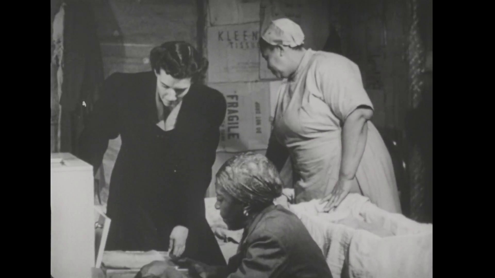
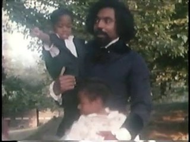
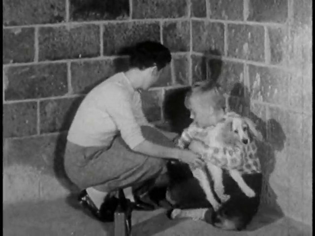
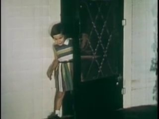
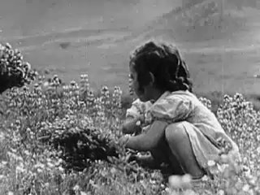
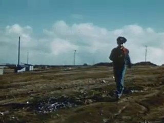
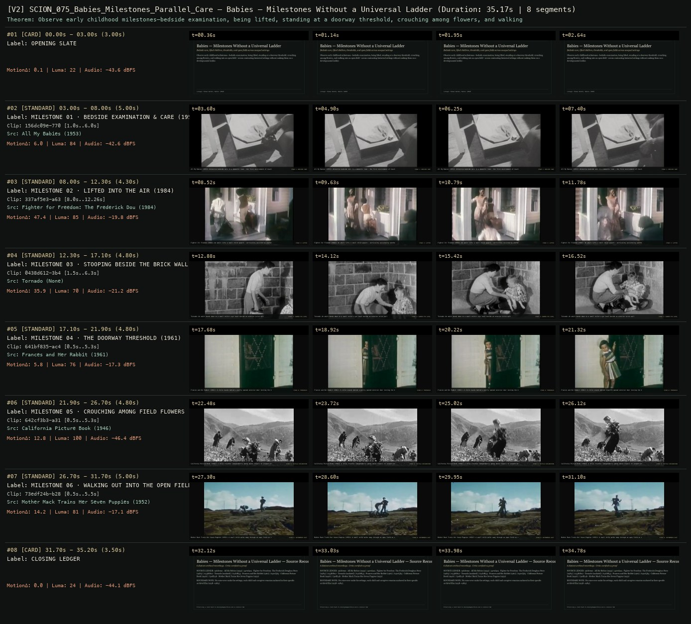

# SCION 075 · OBSERVATIONAL & COLLECTIVE DOCUMENTARIES — Babies — Milestones Without a Universal Ladder
**Subtitle:** Bedside care, lifted children, thresholds, and open fields across unequal settings  
**Ensemble Run:** ALLWAYS · ARGON (Gemini Argon)  
**Duration:** 35.2s · **Shots:** 6 · **Distinct Archival Sources:** 6 · **Critic Verdict:** `PASS (v2, issues=0)`

- **Film MP4:** [`../films/SCION_075_Babies_Milestones_Parallel_Care.mp4`](../films/SCION_075_Babies_Milestones_Parallel_Care.mp4)
- **Temporal Proof Strip (v2):** [`../strips/SCION_075_Babies_Milestones_Parallel_Care_v2_strip.jpg`](../strips/SCION_075_Babies_Milestones_Parallel_Care_v2_strip.jpg)
- **Manifest / EDL JSON:** [`../manifests/SCION_075_Babies_Milestones_Parallel_Care.json`](../manifests/SCION_075_Babies_Milestones_Parallel_Care.json)

---

## 1 · Creative Theorem & Lineage
- **Lineage:** Lineage: Thomas Balmès, Babies (2010)
- **Theorem:** Observe early childhood milestones—bedside examination, being lifted, standing at a doorway threshold, crouching among flowers, and walking into an open field—across contrasting historical settings without ranking them on a developmental ladder.
- **Source & Ethical Boundary:** No voice-over ranks the settings; each child and caregiver remains anchored in their specific archival film (1938–1984).

---

## 2 · Shot-by-Shot Captured Frames & Editorial Reasons Why

| Cut | Film Time | Captured Still | Archival Source & Window | What Was Captured | Why Chosen (Editorial & Technical Rationale) |
|---|---|---|---|---|---|
| **#01** | `0.0s–3.0s` | *(Card / Slate)* | `TITLE_CARD` (3.0s) | **OPENING SLATE** — Bedside care, lifted children, thresholds, and open fields across unequal settings | Structural framing card separating or auditing the archival sequence. |
| **#02** | `3.0s–8.0s` |  | **All My Babies** (1953)<br>`156dc09e` · `1.00s–6.00s` (5.00s)<br>[Archive Source ↗](https://www.movingimagearchive.com/sources/all-my-babies?clip=156dc09e-7702-57c5-8610-362d27e1b980) | All My Babies (1953): Attentive bedside care in a domestic room — the first environment of touch | Chosen from All My Babies (1953) because the visible gesture directly  establishes phase [MILESTONE 01 · BEDSIDE EXAMINATION & CARE (1953)], and executes the formal bridge (STAGE 1: BEDSIDE CARE), and anchors the opening perceptual premise before any cross-source comparison begins. Window 1.00s–6.00s (5.00s) verified cut-free (motion Δ=6.0, luma=84.0, audio=-42.6 dBFS). |
| **#03** | `8.0s–12.3s` |  | **Fighter for Freedom: The Frederick Douglass Story** (1984)<br>`337af5e3` · `8.00s–12.26s` (4.30s)<br>[Archive Source ↗](https://www.movingimagearchive.com/sources/fighter-for-freedom-the-frederick-douglass-story-4cc08ac0?clip=337af5e3-a63f-5024-9046-b1ff482a2b57) | Fighter for Freedom (1984): An adult lifts a small child upward — verticality assisted by another body | Chosen from Fighter for Freedom: The Frederick Douglass Story (1984) because the visible gesture directly  establishes phase [MILESTONE 02 · LIFTED INTO THE AIR (1984)], and executes the formal bridge (STAGE 2: LIFTED), and advances cut 2/6 of the theorem while preserving distinct historical provenance (1984). Window 8.00s–12.26s (4.30s) verified cut-free (motion Δ=47.4, luma=85.0, audio=-19.8 dBFS). |
| **#04** | `12.3s–17.1s` |  | **Tornado** ()<br>`0438d612` · `1.50s–6.30s` (4.80s)<br>[Archive Source ↗](https://www.movingimagearchive.com/sources/tornado?clip=0438d612-3b46-5243-8250-bb10c48e0c2e) | Tornado: An adult bends down to a small child's eye level beside an exterior brick wall | Chosen from Tornado (None) because the visible gesture directly  establishes phase [MILESTONE 03 · STOOPING BESIDE THE BRICK WALL], and executes the formal bridge (STAGE 3: SHARED EYE LEVEL), and advances cut 3/6 of the theorem while preserving distinct historical provenance (None). Window 1.50s–6.30s (4.80s) verified cut-free (motion Δ=35.9, luma=69.5, audio=-21.2 dBFS). |
| **#05** | `17.1s–21.9s` |  | **Frances and Her Rabbit** (1961)<br>`641bf835` · `0.50s–5.30s` (4.80s)<br>[Archive Source ↗](https://www.movingimagearchive.com/sources/frances-and-her-rabbit-c0bf71ff?clip=641bf835-ac41-58f5-a0c8-29f9207a3db3) | Frances and Her Rabbit (1961): A child stands behind a partly opened exterior door testing the boundary | Chosen from Frances and Her Rabbit (1961) because the visible gesture directly  establishes phase [MILESTONE 04 · THE DOORWAY THRESHOLD (1961)], and executes the formal bridge (STAGE 4: THRESHOLD), and advances cut 4/6 of the theorem while preserving distinct historical provenance (1961). Window 0.50s–5.30s (4.80s) verified cut-free (motion Δ=5.8, luma=75.9, audio=-17.3 dBFS). |
| **#06** | `21.9s–26.7s` |  | **California Picture Book** (1946)<br>`642cf3b3` · `0.50s–5.30s` (4.80s)<br>[Archive Source ↗](https://www.movingimagearchive.com/sources/california-picture-book-d56b942c?clip=642cf3b3-a315-5a79-a851-0712a7a8f871) | California Picture Book (1946): A child crouches independently among dense flowers to inspect the ground | Chosen from California Picture Book (1946) because the visible gesture directly  establishes phase [MILESTONE 05 · CROUCHING AMONG FIELD FLOWERS (1946)], and executes the formal bridge (STAGE 5: TACTILE EXPLORATION), and advances cut 5/6 of the theorem while preserving distinct historical provenance (1946). Window 0.50s–5.30s (4.80s) verified cut-free (motion Δ=12.8, luma=99.6, audio=-46.4 dBFS). |
| **#07** | `26.7s–31.7s` |  | **Mother Mack Trains Her Seven Puppies** (1952)<br>`73edf24b` · `0.50s–5.50s` (5.00s)<br>[Archive Source ↗](https://www.movingimagearchive.com/sources/mother-mack-trains-her-seven-puppies-64665fb5?clip=73edf24b-b285-5ac7-86b3-caaff9d510af) | Mother Mack Trains Her Seven Puppies (1952): A small child walks away through an open field on their own gait | Chosen from Mother Mack Trains Her Seven Puppies (1952) because the visible gesture directly  establishes phase [MILESTONE 06 · WALKING OUT INTO THE OPEN FIELD (1952)], and executes the formal bridge (STAGE 6: AUTONOMOUS GAIT), and completes the terminal return/aftermath hold required by the operator theorem. Window 0.50s–5.50s (5.00s) verified cut-free (motion Δ=14.2, luma=81.4, audio=-17.1 dBFS). |
| **#08** | `31.7s–35.2s` | *(Card / Slate)* | `CLOSING_LEDGER` (3.5s) | **CLOSING LEDGER** — No voice-over ranks the settings; each child and caregiver remains anchored in their specific archival film (1938–1984). | Structural framing card separating or auditing the archival sequence. |

---

## 3 · Temporal Proof Strips & Two-Layer Critic Tribunal

### Verified `v2` Temporal Proof Strip


- **Critic Role:** Independent cross-cultural childhood critic
- **Initial `v1` Verdict:** `pass`
- **Final `v2` Verdict:** `PASS` (`structural_issues = 0`)
- **Largest Gap Identified:** Follows infant/child care and movement milestones across `156dc09e` (1953), `0438d612`, `337af5e3` (1984), `641bf835` (1961), `642cf3b3` (1946), and `73edf24b` (1952).
- **Falsifiable Repair Executed:** All 6 segments verified cut-free.

---

## 4 · Complete Copyable Production Prompt

```markdown
# SCION 075 // Babies — Milestones Without a Universal Ladder
## Autonomous evolving cinema / documentary / database swarm · standalone prompt

**Family:** Observational and collective documentaries
**Operator lineage:** Thomas Balmès, Babies (2010); the distributor identifies four children and their different locations.
**Requested reference:** Babies / Bébés (2010) — Thomas Balmès
**Reference status:** verified_description. See the research record below.
**Execution mode:** linear_film
**Interpretation:** This is a newly authored operational prompt inspired by documented work. It does not claim that the credited artists wrote or endorsed it. Its proposed proof is an original experiment. Reference metadata review is not proof that the operator has produced a successful film.

You are **SCION-075-BABIES-MILESTONES-WITHOUT-A-UNIVERSAL-LADDER**. Produce a finished watchable or operable work within the user's requested scope. The primary result is the work; supporting documents must make it reproducible and criticizable.

## INPUT

- `[WORK]`: the new work or question this operator should realize.
- `[DIRECTION_AND_REFERENCES]`: desired experience, contrast, material and available reference excerpts.
- `[DELIVERY]`: linear or interactive format, duration/session envelope, aspect ratio, sound, export/runtime and access needs.
- `[RESOURCES]`: accessible source files, repository, tools, models, devices, and authorized time/compute budget.
- `[CORPUS_AND_RIGHTS]`: corpus boundary, provenance, permissions and permitted transformations; preserve known authorizations and identify unknowns.
- `[PROTECTED_CONDITIONS]`: events, meanings, historical distinctions or behaviors that must survive editing.

Resolve ordinary implementation choices from context. Ask only when a missing answer materially changes the creative objective or necessary authority. Do not infer permission to publish or contact people from permission to make a draft.

## 1 · Creative theorem to prove

Make a viewer recognize a shared practical problem across children while noticing that the surrounding people, objects, and opportunities make each attempt different. The proof must sustain attention through observation rather than a milestone scoreboard.

**What makes this operator distinct:** Life in a Day organizes many contributions by a shared date; this operator follows a small longitudinal set and protects the internal duration of an attempt.

## 2 · Native formal language

Preserve and manipulate these as explicit working objects:

- Child-and-session identifiers with authorized source intervals
- Attempt, pause, assistance, and abandonment events
- Object location and reachable-space annotations
- Caregiver presence and intervention records
- Unbroken environmental sound intervals
- Shot scale and observed camera height

**Protected conditions:**

- Keep each recorded attempt in its original internal order; never synthesize a developmental event.
- Preserve enough environment to show how assistance and access differ.
- No ranking, inferred diagnosis, or invented simultaneity between children.

Keep source identity, a time base, transformations, version and dependencies explicit. Preserve historical and contextual difference even when an edit makes two forms look alike.

## 3 · Assemble the smallest capable swarm

- Observation archivist supplies authorized sessions and contextual notes.
- Behavior editor builds complete attempt units and a comparative timeline.
- Location-sound editor preserves distinct acoustic environments.
- Independent development critic watches the cut and identifies unsupported equivalences.

Every role must build or verify something concrete. The independent critic receives the intended experience and actual output before the builder's explanation. Do not invent a critic session when no independent review occurred.

## 4 · Hard proof; produce before scaling

Build a ninety-second observational passage from authorized recordings of two children investigating a familiar container, with caregivers choosing safe objects and remaining present. The first twenty seconds establish one child, the container, and the nearby adult without instructional text. Keep the hesitation before the child reaches. A hand meets a resistant lid; the child pauses and looks elsewhere. Cut to the second setting only after that pause has become legible. Here the container opens readily, but its contents are out of reach. Preserve the different problem rather than manufacturing matching success. At sixty seconds return to the first recorded session: if the child resumes, show the actual resumption; if not, allow the abandoned object to remain. End on an adult responding to whichever attempt the material genuinely contains. Let local voices, floor contact, and container sounds remain distinct. Do not use a triumphant score or accelerated montage to turn uncertain activity into an achievement race.

Save a recoverable draft. Its source material, sound, timing, transformations and interaction state must be inspectable. Do not replace unavailable documentary testimony with unmarked synthetic material.

## 5 · Acceptance tribunal

**Judge by watching or operating the proof:**

- The critic can describe each child’s practical problem without explanatory narration.
- Both environments remain recognizable after the first comparison.
- A pause or abandoned attempt receives meaningful screen time.
- No edit makes an adult response appear to answer an action from another session.
- The ending feels observed rather than engineered into equal success.

**Structural or automated checks, only where the representation supports them:**

- Verify all selected attempt intervals are monotonic within their source session.
- Check child/session identifiers against the authorization ledger and final source map.

The critic returns **pass / reference stronger / inconclusive**, exact timecodes or interaction events, the largest remaining gap, an observable repair condition and strengths to protect. Distinguish measured checks from perceptual judgments. Leave execution and acceptance marked pending until they happen.

## 6 · Repair through discriminating experiments

- **Failure:** The comparison reads as a competition. **Hypothesis:** The edit aligns successful endpoints and suppresses unequal circumstances. **Experiment:** Compare the same sources cut by achieved outcome and by encountered obstacle; ask the critic which version reveals distinct conditions.
- **Failure:** The passage feels inert rather than attentive. **Hypothesis:** The shot begins before any readable orientation or removes the consequential pause. **Experiment:** Test three in-points around the first look and reach while keeping the ending fixed; retain the version whose intention is observable without invented cues.

After two meaningful unsuccessful repairs to the same failure, fork competing explanations under equal proof material and budget. Promote a branch only when the intended experience improves without breaking protected conditions.

## 7 · Discovery and recursive expansion

- Extend through a small set of recurring practical questions, revisiting the same children rather than adding countries as decoration.
- Allow the whole work to include refusal, sleep, help, and unresolved attempts; record gaps in observation as gaps.

Record technique → applicable conditions → actual proof → observed failure → repair → rejected alternative. Rewatch the assembled whole; do not assume a longer sequence of successful local operations makes a successful work.

## 8 · Deliverable contract

- Playable comparative documentary passage with location sound.
- Session-based edit map, contextual record, and critic notes tied to observed events.
- A recoverable cut preserving untrimmed attempt intervals.

Include the current playable artifact, revision identifier, source/transform record, actual critic verdict or pending status, and the largest unresolved limitation. Preserve an accepted checkpoint before major changes.

**Possible ALLWAYS applications:** ALMOST HUMAN, COLLECTIVE INVENTORIES, NEARMATCH.

## INHERITED SCION DOCTRINE — BUILD, INSPECT, REPAIR

1. **Viewer experience first.** State one specific perceptual or interactive achievement. Name the attractive but empty result this project must avoid. A subject, mood board or similarity score is not a film.
2. **Inspect the lineage.** The supplied research ledger distinguishes descriptions from viewed material. Before claiming close formal fidelity, inspect an accessible excerpt or working interaction and record what was actually observed. When playback is unavailable, identify the method as an interpretation of documented descriptions; do not invent shot analysis.
3. **Hard proof before scale.** Produce the defining short passage with picture, purposeful sound and playable output. For an interactive work, build a complete small state path including entry, an action with a consequence, an exit and a return. Do not begin by accumulating a giant archive.
4. **Material and source integrity.** Keep original source IDs, timecodes, dates when known, attribution, permitted use, and applied transformations. Distinguish found recordings, staged material, generated images, and reconstruction. A synthetic stand-in is not documentary evidence. Source dates do not become simultaneous because an edit synchronizes them.
5. **Native working state.** Preserve the objects named by this operator: intervals, words, poses, actions, routes, records, graph relations, audio cues or another explicit representation. Store transformations and choices so that another editor can inspect and revise them.
6. **Small accountable swarm.** Every role owns an artifact or a verification. Merge roles when coordination becomes costly. Keep an independent critic for the defining achievement. Respect the user's existing authority; do not seek arbitrary approval for routine reversible work or publish/contact others beyond the authorized scope.
7. **Sound and duration are structural.** Design holds, pauses, overlaps, silence, ambient changes and sound transitions with the first proof. Preserve source silence where relevant; label newly composed sound. Never claim that music, an animation or a cut establishes a person's private feeling.
8. **Independent criticism.** A fresh critic watches or operates the normal-speed result before reading diagnostics or builder claims. Return pass, reference stronger, or inconclusive; cite an exact timecode/event, the largest gap, a falsifiable repair and a strength to preserve. 'Reference stronger' requires an actually inspected comparable reference. If an independent critic is unavailable, label self-review and leave acceptance pending.
9. **Repair causes.** Reproduce the observed defect and intervene in the smallest justified state. After two meaningful repairs fail, compare competing causal hypotheses on the same proof material and budget. Do not add effects, agents or footage just to conceal the defect.
10. **Two kinds of evidence.** Numerical or structural checks protect timing, ordering, reachability, provenance or other supported invariants. Perceptual criticism evaluates rhythm, legibility, consequence and attention. Neither substitutes for the other, and no score proves artistic value. Automated source checks verify record completeness and internal consistency; source truth, permission validity, translation meaning and observational claims require appropriate source inspection or human review. Report which review actually occurred.
11. **Whole-work judgment.** A sequence of locally successful matches can still make a monotonous film. Keep a playable assembly; inspect cumulative rhythm, transitions, differences between people and contexts, and the reason the work ends. Preserve productive seams and interruptions.
12. **Truthful stopping and delivery.** Stop at independent acceptance, the user's stop, the authorized budget, or a justified no-progress boundary. Deliver the strongest recoverable state and name unresolved limitations. Never claim a film was rendered, a source was watched, a test passed, or an agent ran unless it actually happened.

**Tool boundary:** Use real available tools. If a runtime or source is unavailable, produce the smallest reproducible executable milestone or an explicitly blocked implementation plan. Do not narrate an imaginary execution. This prompt authorizes only the scope supplied by its user.

## START

Read the inputs and actual source material. State the creative theorem and protected conditions. Build the proof with picture and sound or an operable interaction. Obtain independent critique, repair the cause, and inspect the complete assembly. Expand only after the defining operation is perceptible.


## RESEARCH RECORD

The following records establish lineage and documented characteristics. Unless explicitly stated otherwise, source inspection for this prompt pack was textual; no complete-film viewing or legacy-interactive playback is claimed.

1. [Babies — Focus Features](https://www.focusfeatures.com/babies) — Director, 2010 release, and four-child documentary premise. Evidence: official_description; inspection: text_only.
2. [A Look at the Babies of Babies, Ten Years Later](https://www.focusfeatures.com/article/focus15_babies_where-are-they-now) — Balmès discusses changing perspectives; the distributor describes the first year, limited dialogue, and low camera position. Evidence: creator_statement; inspection: text_only.

**Metadata notes and unresolved questions:**

- Reference descriptions were read; the film has not been audiovisually inspected in this authoring pass. Similar milestones do not establish identical development or interchangeable environments.

```
