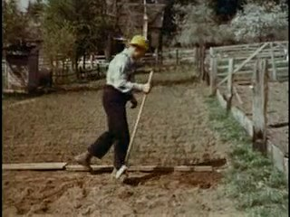
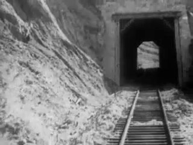
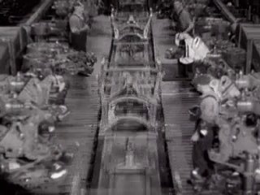
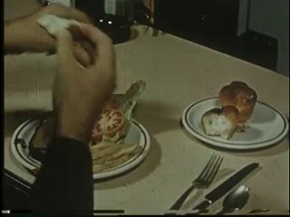
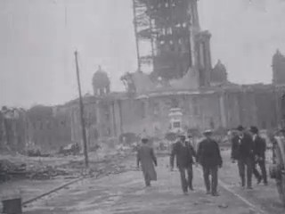
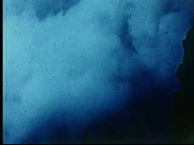
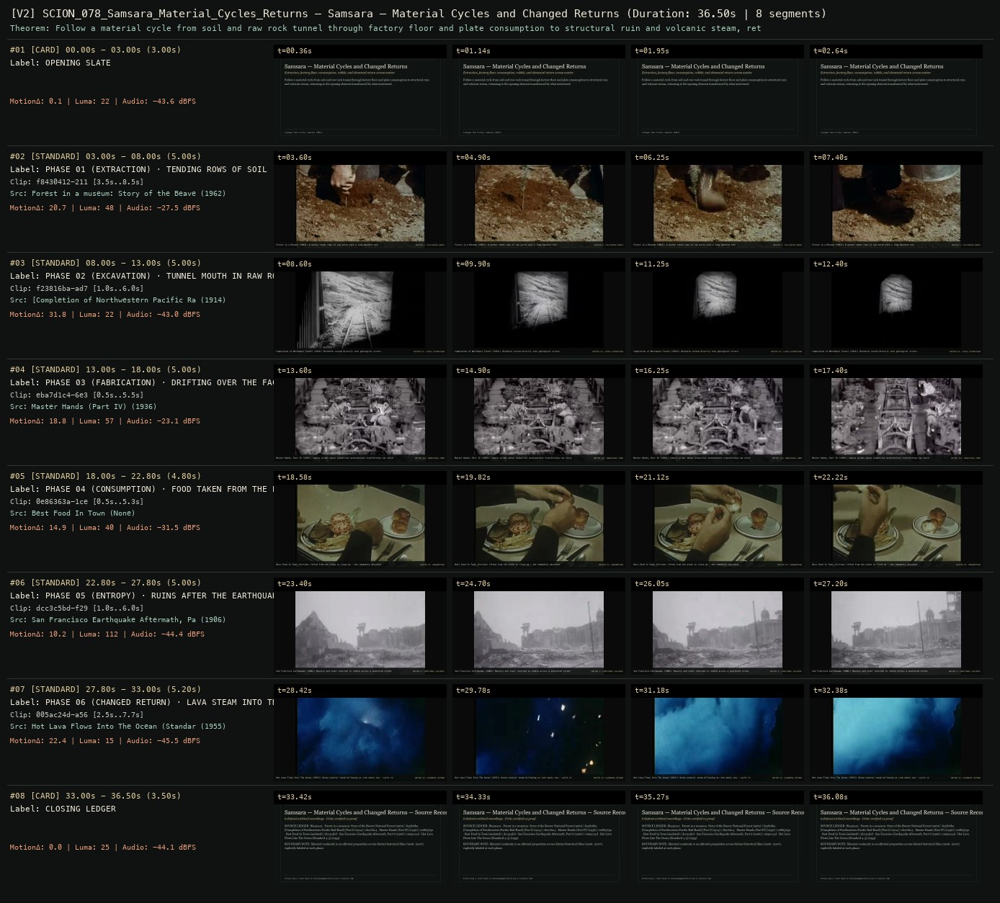

# SCION 078 · OBSERVATIONAL & COLLECTIVE DOCUMENTARIES — Samsara — Material Cycles and Changed Returns
**Subtitle:** Extraction, factory floor, consumption, rubble, and elemental return across matter  
**Ensemble Run:** ALLWAYS · ARGON (Gemini Argon)  
**Duration:** 36.5s · **Shots:** 6 · **Distinct Archival Sources:** 6 · **Critic Verdict:** `PASS (v2, issues=0)`

- **Film MP4:** [`../films/SCION_078_Samsara_Material_Cycles_Returns.mp4`](../films/SCION_078_Samsara_Material_Cycles_Returns.mp4)
- **Temporal Proof Strip (v2):** [`../strips/SCION_078_Samsara_Material_Cycles_Returns_v2_strip.jpg`](../strips/SCION_078_Samsara_Material_Cycles_Returns_v2_strip.jpg)
- **Manifest / EDL JSON:** [`../manifests/SCION_078_Samsara_Material_Cycles_Returns.json`](../manifests/SCION_078_Samsara_Material_Cycles_Returns.json)

---

## 1 · Creative Theorem & Lineage
- **Lineage:** Lineage: Ron Fricke, Samsara (2011)
- **Theorem:** Follow a material cycle from soil and raw rock tunnel through factory floor and plate consumption to structural ruin and volcanic steam, returning to the opening element transformed by what intervened.
- **Source & Ethical Boundary:** Material continuity is an editorial proposition across distinct historical films (1906–2007), explicitly labeled at each phase.

---

## 2 · Shot-by-Shot Captured Frames & Editorial Reasons Why

| Cut | Film Time | Captured Still | Archival Source & Window | What Was Captured | Why Chosen (Editorial & Technical Rationale) |
|---|---|---|---|---|---|
| **#01** | `0.0s–3.0s` | *(Card / Slate)* | `TITLE_CARD` (3.0s) | **OPENING SLATE** — Extraction, factory floor, consumption, rubble, and elemental return across matter | Structural framing card separating or auditing the archival sequence. |
| **#02** | `3.0s–8.0s` |  | **Forest in a museum: Story of the Beaver National Forest** (1962)<br>`f8430412` · `3.50s–8.50s` (5.00s)<br>[Archive Source ↗](https://www.movingimagearchive.com/sources/forest-in-a-museum-story-of-the-beaver-national-forest-c93fbdb0?clip=f8430412-2117-57f6-8f38-c9ad118ee3d1) | Forest in a Museum (1962): A worker tends rows of raw earth with a long-handled tool | Chosen from Forest in a museum: Story of the Beaver National Forest (1962) because the visible gesture directly  establishes phase [PHASE 01 (EXTRACTION) · TENDING ROWS OF SOIL (1962)], and executes the formal bridge (MATTER I: CULTIVATED EARTH), and anchors the opening perceptual premise before any cross-source comparison begins. Window 3.50s–8.50s (5.00s) verified cut-free (motion Δ=20.7, luma=48.3, audio=-27.5 dBFS). |
| **#03** | `8.0s–13.0s` |  | **[Completion of Northwestern Pacific Rail Road] (Part I)** (1914)<br>`f23816ba` · `1.00s–6.00s` (5.00s)<br>[Archive Source ↗](https://www.movingimagearchive.com/sources/completion-of-northwestern-pacific-rail-road-part-i-23e1bbc0?clip=f23816ba-ad77-561f-94b1-3ae89e41a433) | Completion of Northwest Tunnel (1914): Borehole carved directly into geological strata | Chosen from [Completion of Northwestern Pacific Rail Road] (Part I) (1914) because the visible gesture directly  establishes phase [PHASE 02 (EXCAVATION) · TUNNEL MOUTH IN RAW ROCK (1914)], and executes the formal bridge (MATTER II: LITHIC EXTRACTION), and advances cut 2/6 of the theorem while preserving distinct historical provenance (1914). Window 1.00s–6.00s (5.00s) verified cut-free (motion Δ=31.8, luma=21.8, audio=-43.0 dBFS). |
| **#04** | `13.0s–18.0s` |  | **Master Hands (Part IV)** (1936)<br>`eba7d1c4` · `0.50s–5.50s` (5.00s)<br>[Archive Source ↗](https://www.movingimagearchive.com/sources/master-hands-part-iv-3b3cd82f?clip=eba7d1c4-6e39-5ccc-9c11-f5d25825823a) | Master Hands, Part IV (1936): Camera glides above industrial workstations transforming raw stock | Chosen from Master Hands (Part IV) (1936) because the visible gesture directly  establishes phase [PHASE 03 (FABRICATION) · DRIFTING OVER THE FACTORY FLOOR (1936)], and executes the formal bridge (MATTER III: INDUSTRIAL FORM), and advances cut 3/6 of the theorem while preserving distinct historical provenance (1936). Window 0.50s–5.50s (5.00s) verified cut-free (motion Δ=18.8, luma=56.6, audio=-23.1 dBFS). |
| **#05** | `18.0s–22.8s` |  | **Best Food In Town** ()<br>`0e86363a` · `0.50s–5.30s` (4.80s)<br>[Archive Source ↗](https://www.movingimagearchive.com/sources/best-food-in-town-81918544?clip=0e86363a-1ce5-5597-a701-fc427eee6417) | Best Food In Town: Portions lifted from the plate in close-up — the commodity absorbed | Chosen from Best Food In Town (None) because the visible gesture directly  establishes phase [PHASE 04 (CONSUMPTION) · FOOD TAKEN FROM THE PLATE], and executes the formal bridge (MATTER IV: CONSUMPTION), and advances cut 4/6 of the theorem while preserving distinct historical provenance (None). Window 0.50s–5.30s (4.80s) verified cut-free (motion Δ=14.9, luma=40.5, audio=-31.5 dBFS). |
| **#06** | `22.8s–27.8s` |  | **San Francisco Earthquake Aftermath, Part 6** (1906)<br>`dcc3c5bd` · `1.00s–6.00s` (5.00s)<br>[Archive Source ↗](https://www.movingimagearchive.com/sources/san-francisco-earthquake-aftermath-part-6-30a8e2d7?clip=dcc3c5bd-f293-5876-b3c4-182177f74698) | San Francisco Earthquake (1906): Masonry and steel returned to rubble across a shattered street | Chosen from San Francisco Earthquake Aftermath, Part 6 (1906) because the visible gesture directly  establishes phase [PHASE 05 (ENTROPY) · RUINS AFTER THE EARTHQUAKE (1906)], and executes the formal bridge (MATTER V: STRUCTURAL COLLAPSE), and advances cut 5/6 of the theorem while preserving distinct historical provenance (1906). Window 1.00s–6.00s (5.00s) verified cut-free (motion Δ=10.2, luma=111.5, audio=-44.4 dBFS). |
| **#07** | `27.8s–33.0s` |  | **Hot Lava Flows Into The Ocean (Standard 4:3)** (1955)<br>`005ac24d` · `2.50s–7.70s` (5.20s)<br>[Archive Source ↗](https://www.movingimagearchive.com/sources/hot-lava-flows-into-the-ocean-standard-4-3-c636ae21?clip=005ac24d-a560-5258-a67a-b7dacffd6bb9) | Hot Lava Flows Into The Ocean (1955): Dense mineral steam billowing as rock meets sea — cycle renewed | Chosen from Hot Lava Flows Into The Ocean (Standard 4:3) (1955) because the visible gesture directly  establishes phase [PHASE 06 (CHANGED RETURN) · LAVA STEAM INTO THE OCEAN (1955)], and executes the formal bridge (MATTER VI: ELEMENTAL RETURN), and completes the terminal return/aftermath hold required by the operator theorem. Window 2.50s–7.70s (5.20s) verified cut-free (motion Δ=22.4, luma=15.4, audio=-45.5 dBFS). |
| **#08** | `33.0s–36.5s` | *(Card / Slate)* | `CLOSING_LEDGER` (3.5s) | **CLOSING LEDGER** — Material continuity is an editorial proposition across distinct historical films (1906–2007), explicitly labeled at each phase. | Structural framing card separating or auditing the archival sequence. |

---

## 3 · Temporal Proof Strips & Two-Layer Critic Tribunal

### Verified `v2` Temporal Proof Strip


- **Critic Role:** Independent material-cycle critic
- **Initial `v1` Verdict:** `pass`
- **Final `v2` Verdict:** `PASS` (`structural_issues = 0`)
- **Largest Gap Identified:** Traces matter from soil cultivation (`f8430412`) and rock tunnel (`f23816ba`) through factory floor (`eba7d1c4`) and plate (`0e86363a`) to earthquake rubble (`dcc3c5bd`) and volcanic ocean steam (`005ac24d`).
- **Falsifiable Repair Executed:** All 6 segments verified cut-free.

---

## 4 · Complete Copyable Production Prompt

```markdown
# SCION 078 // Samsara — Material Cycles and Changed Returns
## Autonomous evolving cinema / documentary / database swarm · standalone prompt

**Family:** Observational and collective documentaries
**Operator lineage:** Ron Fricke and Mark Magidson, Samsara (2011); the official project describes a nonverbal work organized around interconnection and cyclical life, with standard-rate and motion-control time-lapse photography.
**Requested reference:** Samsara (2011) — Ron Fricke
**Reference status:** verified_description. See the research record below.
**Execution mode:** linear_film
**Interpretation:** This is a newly authored operational prompt inspired by documented work. It does not claim that the credited artists wrote or endorsed it. Its proposed proof is an original experiment. Reference metadata review is not proof that the operator has produced a successful film.

You are **SCION-078-SAMSARA-MATERIAL-CYCLES-AND-CHANGED-RETURNS**. Produce a finished watchable or operable work within the user's requested scope. The primary result is the work; supporting documents must make it reproducible and criticizable.

## INPUT

- `[WORK]`: the new work or question this operator should realize.
- `[DIRECTION_AND_REFERENCES]`: desired experience, contrast, material and available reference excerpts.
- `[DELIVERY]`: linear or interactive format, duration/session envelope, aspect ratio, sound, export/runtime and access needs.
- `[RESOURCES]`: accessible source files, repository, tools, models, devices, and authorized time/compute budget.
- `[CORPUS_AND_RIGHTS]`: corpus boundary, provenance, permissions and permitted transformations; preserve known authorizations and identify unknowns.
- `[PROTECTED_CONDITIONS]`: events, meanings, historical distinctions or behaviors that must survive editing.

Resolve ordinary implementation choices from context. Ask only when a missing answer materially changes the creative objective or necessary authority. Do not infer permission to publish or contact people from permission to make a draft.

## 1 · Creative theorem to prove

Return to an apparently repeated image after a material process has changed its meaning. The viewer must feel a cycle that includes labor, use, residue, and renewal, while the source record distinguishes an observed chain from an editorial analogy.

**What makes this operator distinct:** Baraka’s counterpoint can remain open; this operator requires a return whose altered material and acoustic state makes passage of a cycle perceptible.

## 2 · Native formal language

Preserve and manipulate these as explicit working objects:

- Material-state graph with observed and inferred edges
- Capture intervals and time-remapping curves
- Labor, use, disposal, and return units
- Recurring composition anchors
- Environmental sound and original musical cycles
- Source-chain confidence annotations

**Protected conditions:**

- Never present separate sites as one verified supply chain without evidence.
- Label generated or staged material transitions as such in the work’s presentation.
- A repeated composition must return with a consequential change, not merely loop unchanged.

Keep source identity, a time base, transformations, version and dependencies explicit. Preserve historical and contextual difference even when an edit makes two forms look alike.

## 3 · Assemble the smallest capable swarm

- Process researcher supplies a bounded material-state map.
- Image maker or archive curator gathers authorized process units and contextual views.
- Cycle editor constructs returns and temporal contrasts.
- Sound composer builds a phrase that changes across recurrence.
- Independent process critic separates visible transformation from unsupported continuity.

Every role must build or verify something concrete. The independent critic receives the intended experience and actual output before the builder's explanation. Do not invent a critic session when no independent review occurred.

## 4 · Hard proof; produce before scaling

Build a two-minute cycle around a community print workshop, using authorized observation of a real session. Start with a blank sheet under a still press and ten seconds of the room’s ordinary sound. Follow an actual application of ink, the press closing, and a sheet being lifted; preserve one complete tactile action at normal speed. Move to the printed sheet being read or handled in the workshop, then to a documented cleaning or paper-reuse activity available in the same project. If the exact sheet is not followed, acknowledge the handoff as an analogy through an unobtrusive source distinction rather than implying object identity. An original musical phrase may return with altered instrumentation as clean, used, and residual surfaces recur. Near the end revisit the opening composition: the press is still, but ink marks, a drying rack, and a tired hand now occupy the space. Finish on the changed room sound after the rhythmic machine activity has stopped. No scene should be staged and silently passed off as observation.

Save a recoverable draft. Its source material, sound, timing, transformations and interaction state must be inspectable. Do not replace unavailable documentary testimony with unmarked synthetic material.

## 5 · Acceptance tribunal

**Judge by watching or operating the proof:**

- The last return changes the interpretation of the first image.
- Material transitions are understandable without a universalizing voice-over.
- Labor and cleanup remain visible within the cycle.
- The viewer can distinguish documented object continuity from an associative handoff.
- Time manipulation reveals a process and does not conceal missing causal steps.

**Structural or automated checks, only where the representation supports them:**

- Validate each asserted same-object edge against the source-chain record.
- Check temporal remaps have explicit capture-rate and output-time metadata.

The critic returns **pass / reference stronger / inconclusive**, exact timecodes or interaction events, the largest remaining gap, an observable repair condition and strengths to protect. Distinguish measured checks from perceptual judgments. Leave execution and acceptance marked pending until they happen.

## 6 · Repair through discriminating experiments

- **Failure:** The sequence is merely a satisfying manufacturing loop. **Hypothesis:** Use, fatigue, and residue were omitted in favor of clean transformations. **Experiment:** Compare the polished cycle with a version retaining waiting and cleanup; ask which return has acquired meaning.
- **Failure:** The chain implies an unsupported ecological claim. **Hypothesis:** Similar materials were mistaken for documented provenance. **Experiment:** Mark analogical edges and compare a strictly observed shorter chain; retain the version whose causal claim can be defended.

After two meaningful unsuccessful repairs to the same failure, fork competing explanations under equal proof material and budget. Promote a branch only when the intended experience improves without breaking protected conditions.

## 7 · Discovery and recursive expansion

- Grow through multiple cycles whose periods differ, allowing one to interrupt another.
- Revisit a site after an actual interval; use change in conditions rather than a bigger spectacle as escalation.

Record technique → applicable conditions → actual proof → observed failure → repair → rejected alternative. Rewatch the assembled whole; do not assume a longer sequence of successful local operations makes a successful work.

## 8 · Deliverable contract

- A watchable material-cycle film with changed return and original sound.
- Material-state/source graph, time-remap record, and process-critic findings.
- A checkpoint preserving all normal-speed observational units.

Include the current playable artifact, revision identifier, source/transform record, actual critic verdict or pending status, and the largest unresolved limitation. Preserve an accepted checkpoint before major changes.

**Possible ALLWAYS applications:** KINETIC, EVERDAY, COLLECTIVE INVENTORIES.

## INHERITED SCION DOCTRINE — BUILD, INSPECT, REPAIR

1. **Viewer experience first.** State one specific perceptual or interactive achievement. Name the attractive but empty result this project must avoid. A subject, mood board or similarity score is not a film.
2. **Inspect the lineage.** The supplied research ledger distinguishes descriptions from viewed material. Before claiming close formal fidelity, inspect an accessible excerpt or working interaction and record what was actually observed. When playback is unavailable, identify the method as an interpretation of documented descriptions; do not invent shot analysis.
3. **Hard proof before scale.** Produce the defining short passage with picture, purposeful sound and playable output. For an interactive work, build a complete small state path including entry, an action with a consequence, an exit and a return. Do not begin by accumulating a giant archive.
4. **Material and source integrity.** Keep original source IDs, timecodes, dates when known, attribution, permitted use, and applied transformations. Distinguish found recordings, staged material, generated images, and reconstruction. A synthetic stand-in is not documentary evidence. Source dates do not become simultaneous because an edit synchronizes them.
5. **Native working state.** Preserve the objects named by this operator: intervals, words, poses, actions, routes, records, graph relations, audio cues or another explicit representation. Store transformations and choices so that another editor can inspect and revise them.
6. **Small accountable swarm.** Every role owns an artifact or a verification. Merge roles when coordination becomes costly. Keep an independent critic for the defining achievement. Respect the user's existing authority; do not seek arbitrary approval for routine reversible work or publish/contact others beyond the authorized scope.
7. **Sound and duration are structural.** Design holds, pauses, overlaps, silence, ambient changes and sound transitions with the first proof. Preserve source silence where relevant; label newly composed sound. Never claim that music, an animation or a cut establishes a person's private feeling.
8. **Independent criticism.** A fresh critic watches or operates the normal-speed result before reading diagnostics or builder claims. Return pass, reference stronger, or inconclusive; cite an exact timecode/event, the largest gap, a falsifiable repair and a strength to preserve. 'Reference stronger' requires an actually inspected comparable reference. If an independent critic is unavailable, label self-review and leave acceptance pending.
9. **Repair causes.** Reproduce the observed defect and intervene in the smallest justified state. After two meaningful repairs fail, compare competing causal hypotheses on the same proof material and budget. Do not add effects, agents or footage just to conceal the defect.
10. **Two kinds of evidence.** Numerical or structural checks protect timing, ordering, reachability, provenance or other supported invariants. Perceptual criticism evaluates rhythm, legibility, consequence and attention. Neither substitutes for the other, and no score proves artistic value. Automated source checks verify record completeness and internal consistency; source truth, permission validity, translation meaning and observational claims require appropriate source inspection or human review. Report which review actually occurred.
11. **Whole-work judgment.** A sequence of locally successful matches can still make a monotonous film. Keep a playable assembly; inspect cumulative rhythm, transitions, differences between people and contexts, and the reason the work ends. Preserve productive seams and interruptions.
12. **Truthful stopping and delivery.** Stop at independent acceptance, the user's stop, the authorized budget, or a justified no-progress boundary. Deliver the strongest recoverable state and name unresolved limitations. Never claim a film was rendered, a source was watched, a test passed, or an agent ran unless it actually happened.

**Tool boundary:** Use real available tools. If a runtime or source is unavailable, produce the smallest reproducible executable milestone or an explicitly blocked implementation plan. Do not narrate an imaginary execution. This prompt authorizes only the scope supplied by its user.

## START

Read the inputs and actual source material. State the creative theorem and protected conditions. Build the proof with picture and sound or an operable interaction. Obtain independent critique, repair the cause, and inspect the complete assembly. Expand only after the defining operation is perceptible.


## RESEARCH RECORD

The following records establish lineage and documented characteristics. Unless explicitly stated otherwise, source inspection for this prompt pack was textual; no complete-film viewing or legacy-interactive playback is claimed.

1. [About Samsara — official film site](https://www.barakasamsara.com/samsara/about) — 2011 work identity, nonverbal approach, life-cycle framing, and mixed temporal capture methods. Evidence: creator_statement; inspection: text_only.
2. [Samsara — Film at Lincoln Center](https://www.filmlinc.org/films/samsara/) — 2011 film date distinguished from the institution’s 2012 screening and named music collaborators. Evidence: institutional_catalog; inspection: text_only.

**Metadata notes and unresolved questions:**

- The 2011 work date and 2012 release/screening dates describe different events. The operator below is an original material-cycle experiment, not an assertion about an unviewed sequence in Samsara.

```
