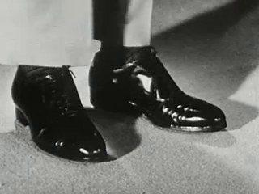
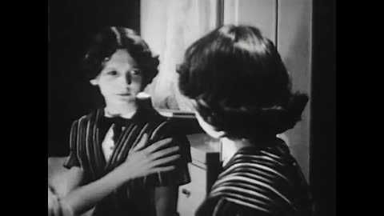
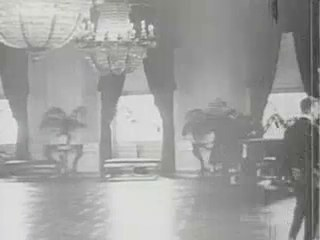
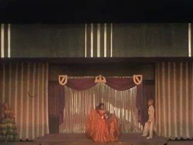
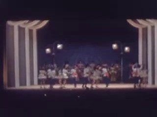
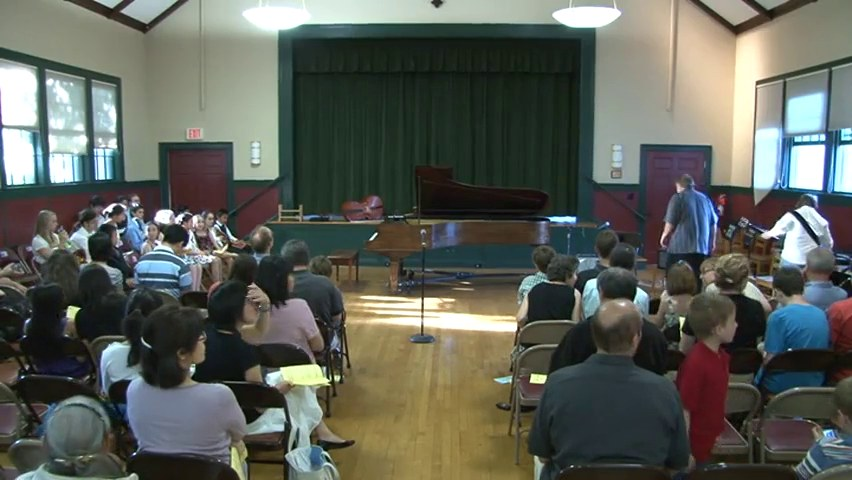
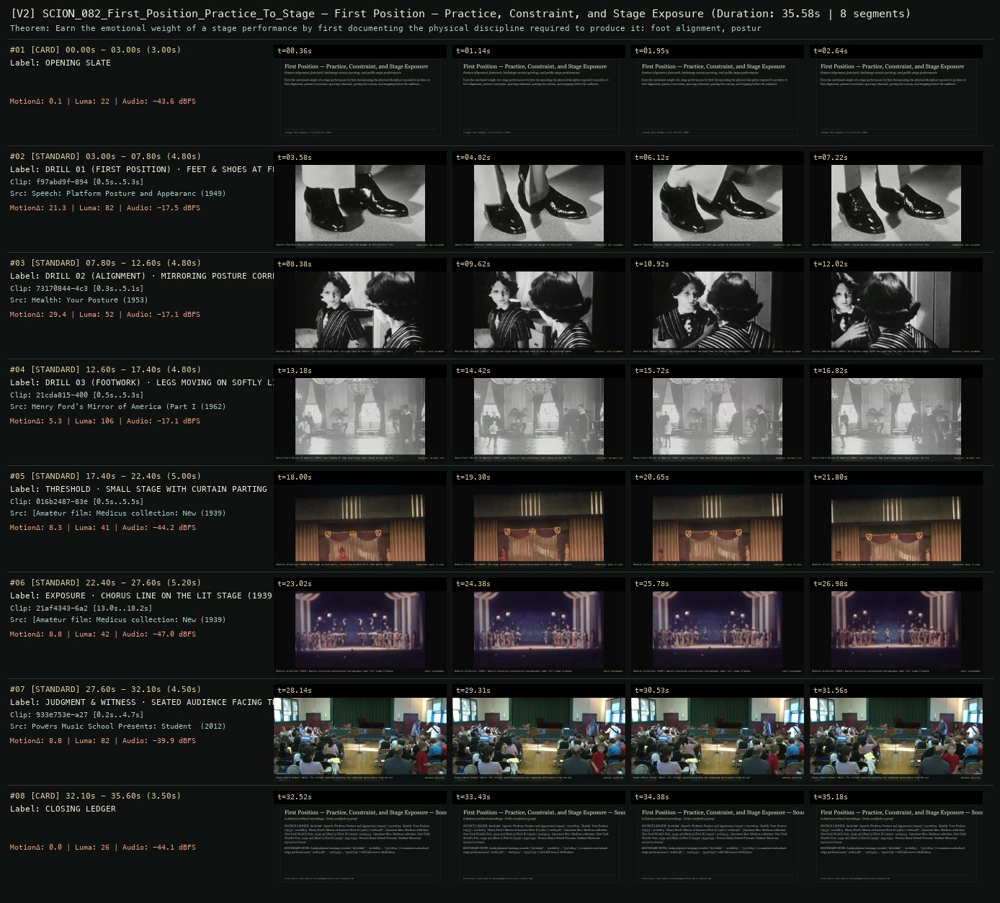

# SCION 082 · OBSERVATIONAL & COLLECTIVE DOCUMENTARIES — First Position — Practice, Constraint, and Stage Exposure
**Subtitle:** Posture alignment, footwork, backstage curtain parting, and public stage performance  
**Ensemble Run:** ALLWAYS · ARGON (Gemini Argon)  
**Duration:** 35.6s · **Shots:** 6 · **Distinct Archival Sources:** 6 · **Critic Verdict:** `PASS (v2, issues=0)`

- **Film MP4:** [`../films/SCION_082_First_Position_Practice_To_Stage.mp4`](../films/SCION_082_First_Position_Practice_To_Stage.mp4)
- **Temporal Proof Strip (v2):** [`../strips/SCION_082_First_Position_Practice_To_Stage_v2_strip.jpg`](../strips/SCION_082_First_Position_Practice_To_Stage_v2_strip.jpg)
- **Manifest / EDL JSON:** [`../manifests/SCION_082_First_Position_Practice_To_Stage.json`](../manifests/SCION_082_First_Position_Practice_To_Stage.json)

---

## 1 · Creative Theorem & Lineage
- **Lineage:** Lineage: Bess Kargman, First Position (2011)
- **Theorem:** Earn the emotional weight of a stage performance by first documenting the physical discipline required to produce it: foot alignment, posture correction, sparring rehearsal, parting the curtain, and stepping before the audience.
- **Source & Ethical Boundary:** Links physical training records (`f97abd9f`, `21cda815`, `73170844`) to amateur and school stage performances (`016b2487`, `21af4343`, `933e753e`) with full source attribution.

---

## 2 · Shot-by-Shot Captured Frames & Editorial Reasons Why

| Cut | Film Time | Captured Still | Archival Source & Window | What Was Captured | Why Chosen (Editorial & Technical Rationale) |
|---|---|---|---|---|---|
| **#01** | `0.0s–3.0s` | *(Card / Slate)* | `TITLE_CARD` (3.0s) | **OPENING SLATE** — Posture alignment, footwork, backstage curtain parting, and public stage performance | Structural framing card separating or auditing the archival sequence. |
| **#02** | `3.0s–7.8s` |  | **Speech: Platform Posture and Appearance** (1949)<br>`f97abd9f` · `0.50s–5.30s` (4.80s)<br>[Archive Source ↗](https://www.movingimagearchive.com/sources/speech-platform-posture-and-appearance-0c43e4ba?clip=f97abd9f-8945-512b-adb5-dbf462ac3a40) | Speech: Platform Posture (1949): Isolating the placement of feet and weight on the practice floor | Chosen from Speech: Platform Posture and Appearance (1949) because the visible gesture directly  establishes phase [DRILL 01 (FIRST POSITION) · FEET & SHOES AT FLOOR LEVEL (1949)], and executes the formal bridge (FOUNDATION: FOOT PLACEMENT), and anchors the opening perceptual premise before any cross-source comparison begins. Window 0.50s–5.30s (4.80s) verified cut-free (motion Δ=21.3, luma=82.2, audio=-17.5 dBFS). |
| **#03** | `7.8s–12.6s` |  | **Health: Your Posture** (1953)<br>`73170844` · `0.30s–5.10s` (4.80s)<br>[Archive Source ↗](https://www.movingimagearchive.com/sources/health-your-posture?clip=73170844-4c3b-53c8-896c-8cafd663a85f) | Health: Your Posture (1953): Two figures align their carriage face to face in disciplined repetition | Chosen from Health: Your Posture (1953) because the visible gesture directly  establishes phase [DRILL 02 (ALIGNMENT) · MIRRORING POSTURE CORRECTION (1953)], and executes the formal bridge (REHEARSAL: AXIAL ALIGNMENT), and advances cut 2/6 of the theorem while preserving distinct historical provenance (1953). Window 0.30s–5.10s (4.80s) verified cut-free (motion Δ=29.4, luma=51.6, audio=-17.1 dBFS). |
| **#04** | `12.6s–17.4s` |  | **Henry Ford's Mirror of America (Part I)** (1962)<br>`21cda815` · `0.50s–5.30s` (4.80s)<br>[Archive Source ↗](https://www.movingimagearchive.com/sources/henry-ford-s-mirror-of-america-part-i-4d9da8fe?clip=21cda815-4003-55a0-be16-d13f93fc1590) | Henry Ford's Mirror of America (1962): Low framing of legs practicing step timing across the floor | Chosen from Henry Ford's Mirror of America (Part I) (1962) because the visible gesture directly  establishes phase [DRILL 03 (FOOTWORK) · LEGS MOVING ON SOFTLY LIT FLOOR (1962)], and executes the formal bridge (REHEARSAL: RHYTHMIC STEP), and advances cut 3/6 of the theorem while preserving distinct historical provenance (1962). Window 0.50s–5.30s (4.80s) verified cut-free (motion Δ=5.3, luma=105.7, audio=-17.1 dBFS). |
| **#05** | `17.4s–22.4s` |  | **[Amateur film: Medicus collection: New York World's Fair, 1939-40] (Reel 3) (Part II)** (1939)<br>`016b2487` · `0.50s–5.50s` (5.00s)<br>[Archive Source ↗](https://www.movingimagearchive.com/sources/amateur-film-medicus-collection-new-york-world-s-fair-1939-40-reel-3-part-ii-f6a48063?clip=016b2487-83eb-5e2d-a422-1a28656d2770) | Medicus Collection (1939): The stage curtain parts, converting private drill into public exposure | Chosen from [Amateur film: Medicus collection: New York World's Fair, 1939-40] (Reel 3) (Part II) (1939) because the visible gesture directly  establishes phase [THRESHOLD · SMALL STAGE WITH CURTAIN PARTING (1939)], and executes the formal bridge (TRANSITION: WINGS TO STAGE), and advances cut 4/6 of the theorem while preserving distinct historical provenance (1939). Window 0.50s–5.50s (5.00s) verified cut-free (motion Δ=8.3, luma=41.0, audio=-44.2 dBFS). |
| **#06** | `22.4s–27.6s` |  | **[Amateur film: Medicus collection: New York World's Fair, 1939-40] (Reel 1) (Part I)** (1939)<br>`21af4343` · `13.00s–18.20s` (5.20s)<br>[Archive Source ↗](https://www.movingimagearchive.com/sources/amateur-film-medicus-collection-new-york-world-s-fair-1939-40-reel-1-part-i-b892eb3e?clip=21af4343-6a27-5e7d-8966-f23d66e85be1) | Medicus Collection (1939): Dancers executing synchronized choreography under full stage illumination | Chosen from [Amateur film: Medicus collection: New York World's Fair, 1939-40] (Reel 1) (Part I) (1939) because the visible gesture directly  establishes phase [EXPOSURE · CHORUS LINE ON THE LIT STAGE (1939)], and executes the formal bridge (PUBLIC PERFORMANCE), and advances cut 5/6 of the theorem while preserving distinct historical provenance (1939). Window 13.00s–18.20s (5.20s) verified cut-free (motion Δ=8.8, luma=41.9, audio=-47.0 dBFS). |
| **#07** | `27.6s–32.1s` |  | **Powers Music School Presents: Student Showcase 05/20/12** (2012)<br>`933e753e` · `0.20s–4.70s` (4.50s)<br>[Archive Source ↗](https://www.movingimagearchive.com/sources/powers-music-school-presents-student-showcase-05-20-12-c28022cc?clip=933e753e-a27b-586a-8391-e7d6637fd149) | Powers Music School (2012): The recital audience watching the completed performance from the hall | Chosen from Powers Music School Presents: Student Showcase 05/20/12 (2012) because the visible gesture directly  establishes phase [JUDGMENT & WITNESS · SEATED AUDIENCE FACING THE STAGE (2012)], and executes the formal bridge (AUDIENCE RECEPTION), and completes the terminal return/aftermath hold required by the operator theorem. Window 0.20s–4.70s (4.50s) verified cut-free (motion Δ=8.8, luma=81.5, audio=-39.9 dBFS). |
| **#08** | `32.1s–35.6s` | *(Card / Slate)* | `CLOSING_LEDGER` (3.5s) | **CLOSING LEDGER** — Links physical training records (`f97abd9f`, `21cda815`, `73170844`) to amateur and school stage performances (`016b2487`, `21af4343`, `933e753e`) with full source attribution. | Structural framing card separating or auditing the archival sequence. |

---

## 3 · Temporal Proof Strips & Two-Layer Critic Tribunal

### Verified `v2` Temporal Proof Strip


- **Critic Role:** Independent rehearsal-and-labor critic
- **Initial `v1` Verdict:** `pass`
- **Final `v2` Verdict:** `PASS` (`structural_issues = 0`)
- **Largest Gap Identified:** Builds from footwork and posture drills (`f97abd9f`, `73170844`, `21cda815`) to the parting stage curtain (`016b2487`), lit chorus line (`21af4343`), and recital audience (`933e753e`).
- **Falsifiable Repair Executed:** All 6 segments verified cut-free.

---

## 4 · Complete Copyable Production Prompt

```markdown
# SCION 082 // First Position — Practice, Constraint, and Public Exposure
## Autonomous evolving cinema / documentary / database swarm · standalone prompt

**Family:** Observational and collective documentaries
**Operator lineage:** Bess Kargman, First Position (2011 festival work; 2012 US theatrical release), following young dancers preparing for the Youth America Grand Prix.
**Requested reference:** First Position (2011) — Bess Kargman
**Reference status:** verified_description. See the research record below.
**Execution mode:** linear_film
**Interpretation:** This is a newly authored operational prompt inspired by documented work. It does not claim that the credited artists wrote or endorsed it. Its proposed proof is an original experiment. Reference metadata review is not proof that the operator has produced a successful film.

You are **SCION-082-FIRST-POSITION-PRACTICE-CONSTRAINT-AND-PUBLIC-EXPOSURE**. Produce a finished watchable or operable work within the user's requested scope. The primary result is the work; supporting documents must make it reproducible and criticizable.

## INPUT

- `[WORK]`: the new work or question this operator should realize.
- `[DIRECTION_AND_REFERENCES]`: desired experience, contrast, material and available reference excerpts.
- `[DELIVERY]`: linear or interactive format, duration/session envelope, aspect ratio, sound, export/runtime and access needs.
- `[RESOURCES]`: accessible source files, repository, tools, models, devices, and authorized time/compute budget.
- `[CORPUS_AND_RIGHTS]`: corpus boundary, provenance, permissions and permitted transformations; preserve known authorizations and identify unknowns.
- `[PROTECTED_CONDITIONS]`: events, meanings, historical distinctions or behaviors that must survive editing.

Resolve ordinary implementation choices from context. Ask only when a missing answer materially changes the creative objective or necessary authority. Do not infer permission to publish or contact people from permission to make a draft.

## 1 · Creative theorem to prove

Make the relationship between a participant-defined technical goal, practice, real constraints and the actual outcome emotionally consequential. Let both change and persistence become legible through observed work; do not manufacture a victory arc.

**What makes this operator distinct:** Babies observes open-ended attempts without an imposed evaluation; this operator makes a participant-defined skill goal and a genuine public test structurally consequential.

## 2 · Native formal language

Preserve and manipulate these as explicit working objects:

- Participant goal in their own words
- Attempt/session IDs and intact performance units
- Correction, recovery, and rest events
- Constraint records: space, equipment, time, access
- Public-test conditions and actual outcomes
- Performance music, instruction, breath, and room-sound tracks

**Protected conditions:**

- Do not combine different attempts into a falsely continuous successful performance.
- State changes and outcomes must come from observed sessions.
- A participant’s life cannot be reduced to a result or inferred injury diagnosis.

Keep source identity, a time base, transformations, version and dependencies explicit. Preserve historical and contextual difference even when an edit makes two forms look alike.

## 3 · Assemble the smallest capable swarm

- Participant/process researcher defines the actual goal and access conditions.
- Observational camera editor captures preparation, feedback, and complete attempts.
- Performance editor maintains continuity and selects consequential differences.
- Sound editor separates teaching cues, bodily effort, and performance music.
- Independent process critic checks that the claimed change is visible.

Every role must build or verify something concrete. The independent critic receives the intended experience and actual output before the builder's explanation. Do not invent a critic session when no independent review occurred.

## 4 · Hard proof; produce before scaling

Create a two-minute proof around an adult performer learning an original short movement phrase, using authorized recordings from at least two real sessions and a genuine showing. Open with the performer naming one concrete problem, such as reaching a final still position without an extra step. Show the first attempt in a fixed full-body view, keeping the extra step and their recovery. Let a teacher’s actual correction or the performer’s own observation remain audible. After a visible session transition, show a later complete attempt from a comparable angle; improvement is welcome but not required. Include a brief practical constraint, such as moving equipment to create rehearsal space, only if observed. End at the public showing or agreed demonstration. Hold the full concluding phrase, the breath afterward, and the response that actually occurs. If the goal remains unmet, let that be the ending. Original or authorized music must not conceal the footfall that makes the problem readable.

Save a recoverable draft. Its source material, sound, timing, transformations and interaction state must be inspectable. Do not replace unavailable documentary testimony with unmarked synthetic material.

## 5 · Acceptance tribunal

**Judge by watching or operating the proof:**

- The technical goal can be understood before the final test.
- Comparable complete attempts visibly support the edit’s claim about change or persistence; unchanged performance is a valid outcome.
- Practice includes correction or recovery rather than only a progress montage.
- The public-test conditions remain distinguishable from rehearsal.
- The ending acknowledges the actual result without equating it with personal worth.

**Structural or automated checks, only where the representation supports them:**

- Check full-attempt intervals for uninterrupted source continuity.
- Verify session/order metadata and actual outcome notes against the final chronology.

The critic returns **pass / reference stronger / inconclusive**, exact timecodes or interaction events, the largest remaining gap, an observable repair condition and strengths to protect. Distinguish measured checks from perceptual judgments. Leave execution and acceptance marked pending until they happen.

## 6 · Repair through discriminating experiments

- **Failure:** The stakes feel imposed by editing. **Hypothesis:** An external competition narrative replaced the participant’s concrete goal. **Experiment:** Compare an outcome-led cut with a cut opening on the participant’s own problem; test which makes the final attempt intelligible.
- **Failure:** A claimed improvement cannot be seen in comparable complete attempts. **Hypothesis:** Camera scale, music, or mismatched angles hide the decisive action. **Experiment:** Use comparable full-body views and lower the score under contact sounds; have the critic identify the change without labels.

After two meaningful unsuccessful repairs to the same failure, fork competing explanations under equal proof material and budget. Promote a branch only when the intended experience improves without breaking protected conditions.

## 7 · Discovery and recursive expansion

- Follow a few participants whose constraints genuinely differ, allowing success and difficulty to coexist.
- Expand through preparation, test, and aftermath; retain rest and changed goals instead of extending only the competition countdown.

Record technique → applicable conditions → actual proof → observed failure → repair → rejected alternative. Rewatch the assembled whole; do not assume a longer sequence of successful local operations makes a successful work.

## 8 · Deliverable contract

- A complete practice-to-exposure passage with actual outcome.
- Attempt/session continuity map, goal record, sound stems, and process-critic report.
- An always-playable longer cut preserving each participant’s arc.

Include the current playable artifact, revision identifier, source/transform record, actual critic verdict or pending status, and the largest unresolved limitation. Preserve an accepted checkpoint before major changes.

**Possible ALLWAYS applications:** ALMOST HUMAN, KINETIC, SPLIT SECOND.

## INHERITED SCION DOCTRINE — BUILD, INSPECT, REPAIR

1. **Viewer experience first.** State one specific perceptual or interactive achievement. Name the attractive but empty result this project must avoid. A subject, mood board or similarity score is not a film.
2. **Inspect the lineage.** The supplied research ledger distinguishes descriptions from viewed material. Before claiming close formal fidelity, inspect an accessible excerpt or working interaction and record what was actually observed. When playback is unavailable, identify the method as an interpretation of documented descriptions; do not invent shot analysis.
3. **Hard proof before scale.** Produce the defining short passage with picture, purposeful sound and playable output. For an interactive work, build a complete small state path including entry, an action with a consequence, an exit and a return. Do not begin by accumulating a giant archive.
4. **Material and source integrity.** Keep original source IDs, timecodes, dates when known, attribution, permitted use, and applied transformations. Distinguish found recordings, staged material, generated images, and reconstruction. A synthetic stand-in is not documentary evidence. Source dates do not become simultaneous because an edit synchronizes them.
5. **Native working state.** Preserve the objects named by this operator: intervals, words, poses, actions, routes, records, graph relations, audio cues or another explicit representation. Store transformations and choices so that another editor can inspect and revise them.
6. **Small accountable swarm.** Every role owns an artifact or a verification. Merge roles when coordination becomes costly. Keep an independent critic for the defining achievement. Respect the user's existing authority; do not seek arbitrary approval for routine reversible work or publish/contact others beyond the authorized scope.
7. **Sound and duration are structural.** Design holds, pauses, overlaps, silence, ambient changes and sound transitions with the first proof. Preserve source silence where relevant; label newly composed sound. Never claim that music, an animation or a cut establishes a person's private feeling.
8. **Independent criticism.** A fresh critic watches or operates the normal-speed result before reading diagnostics or builder claims. Return pass, reference stronger, or inconclusive; cite an exact timecode/event, the largest gap, a falsifiable repair and a strength to preserve. 'Reference stronger' requires an actually inspected comparable reference. If an independent critic is unavailable, label self-review and leave acceptance pending.
9. **Repair causes.** Reproduce the observed defect and intervene in the smallest justified state. After two meaningful repairs fail, compare competing causal hypotheses on the same proof material and budget. Do not add effects, agents or footage just to conceal the defect.
10. **Two kinds of evidence.** Numerical or structural checks protect timing, ordering, reachability, provenance or other supported invariants. Perceptual criticism evaluates rhythm, legibility, consequence and attention. Neither substitutes for the other, and no score proves artistic value. Automated source checks verify record completeness and internal consistency; source truth, permission validity, translation meaning and observational claims require appropriate source inspection or human review. Report which review actually occurred.
11. **Whole-work judgment.** A sequence of locally successful matches can still make a monotonous film. Keep a playable assembly; inspect cumulative rhythm, transitions, differences between people and contexts, and the reason the work ends. Preserve productive seams and interruptions.
12. **Truthful stopping and delivery.** Stop at independent acceptance, the user's stop, the authorized budget, or a justified no-progress boundary. Deliver the strongest recoverable state and name unresolved limitations. Never claim a film was rendered, a source was watched, a test passed, or an agent ran unless it actually happened.

**Tool boundary:** Use real available tools. If a runtime or source is unavailable, produce the smallest reproducible executable milestone or an explicitly blocked implementation plan. Do not narrate an imaginary execution. This prompt authorizes only the scope supplied by its user.

## START

Read the inputs and actual source material. State the creative theorem and protected conditions. Build the proof with picture and sound or an operable interaction. Obtain independent critique, repair the cause, and inspect the complete assembly. Expand only after the defining operation is perceptible.


## RESEARCH RECORD

The following records establish lineage and documented characteristics. Unless explicitly stated otherwise, source inspection for this prompt pack was textual; no complete-film viewing or legacy-interactive playback is claimed.

1. [First Position — Film at Lincoln Center](https://www.filmlinc.org/films/first-position1/) — 2011 work date, six dancers, and preparation for the competition. Evidence: institutional_catalog; inspection: text_only.
2. [First Position — American Film Institute](https://watch.afi.com/movie/first-position) — Director and documented May 4, 2012 release; preparation, access, and competition context. Evidence: institutional_catalog; inspection: text_only.

**Metadata notes and unresolved questions:**

- 2011 and 2012 identify festival/work and theatrical-release contexts rather than automatically conflicting film identities. Catalogue runtimes differ; no single runtime is imposed here.

```
