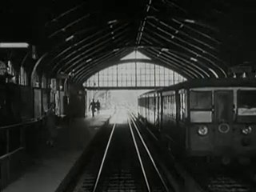
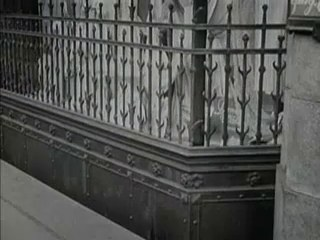
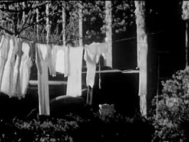
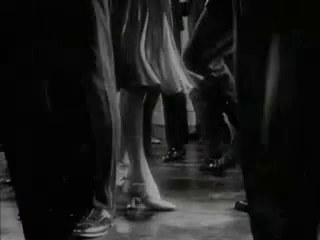
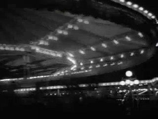
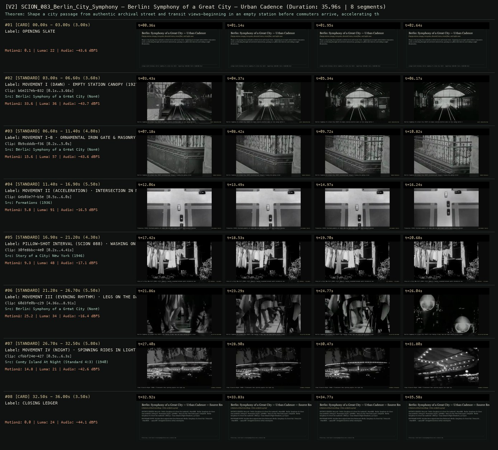

# SCION 083 · FRAMING, GESTURE, CITY RHYTHMS & VIDEO ESSAYS — Berlin: Symphony of a Great City — Urban Cadence
**Subtitle:** Empty station canopy, iron gates, elevated trains, crowd flow, and night neon  
**Ensemble Run:** ALLWAYS · ARGON (Gemini Argon)  
**Duration:** 36.0s · **Shots:** 6 · **Distinct Archival Sources:** 6 · **Critic Verdict:** `PASS (v2, issues=0)`

- **Film MP4:** [`../films/SCION_083_Berlin_City_Symphony.mp4`](../films/SCION_083_Berlin_City_Symphony.mp4)
- **Temporal Proof Strip (v2):** [`../strips/SCION_083_Berlin_City_Symphony_v2_strip.jpg`](../strips/SCION_083_Berlin_City_Symphony_v2_strip.jpg)
- **Manifest / EDL JSON:** [`../manifests/SCION_083_Berlin_City_Symphony.json`](../manifests/SCION_083_Berlin_City_Symphony.json)

---

## 1 · Creative Theorem & Lineage
- **Lineage:** Lineage: Walter Ruttmann, Berlin: Symphony of a Great City (1927) · Supporting: SCION 087 (Tati), SCION 088 (Ozu)
- **Theorem:** Shape a city passage from authentic archival street and transit views—beginning in an empty station before commuters arrive, accelerating through rail and street intersections, pausing on a pillow-shot interval, and ending in night illumination.
- **Source & Ethical Boundary:** Includes three original shots from Ruttmann's Berlin: Symphony of a Great City (`b6e217eb`, `0b9cdddb`, `149a20d8`) alongside American urban counterparts.

---

## 2 · Shot-by-Shot Captured Frames & Editorial Reasons Why

| Cut | Film Time | Captured Still | Archival Source & Window | What Was Captured | Why Chosen (Editorial & Technical Rationale) |
|---|---|---|---|---|---|
| **#01** | `0.0s–3.0s` | *(Card / Slate)* | `TITLE_CARD` (3.0s) | **OPENING SLATE** — Empty station canopy, iron gates, elevated trains, crowd flow, and night neon | Structural framing card separating or auditing the archival sequence. |
| **#02** | `3.0s–6.6s` |  | **Berlin: Symphony of a Great City** ()<br>`b6e217eb` · `0.10s–3.66s` (3.60s)<br>[Archive Source ↗](https://www.movingimagearchive.com/sources/berlin-symphony-of-a-great-city-9eb528d5?clip=b6e217eb-832b-528a-9214-cb8174e2834f) | Berlin: Symphony of a Great City (1927): An empty station platform under an iron canopy before the rush | Chosen from Berlin: Symphony of a Great City (None) because the visible gesture directly  establishes phase [MOVEMENT I (DAWN) · EMPTY STATION CANOPY (1927)], and executes the formal bridge (QUIET INFRASTRUCTURE), and anchors the opening perceptual premise before any cross-source comparison begins. Window 0.10s–3.66s (3.60s) verified cut-free (motion Δ=33.6, luma=36.0, audio=-43.7 dBFS). |
| **#03** | `6.6s–11.4s` |  | **Berlin: Symphony of a Great City** ()<br>`0b9cdddb` · `0.20s–5.00s` (4.80s)<br>[Archive Source ↗](https://www.movingimagearchive.com/sources/berlin-symphony-of-a-great-city-9eb528d5?clip=0b9cdddb-f363-5c91-bb60-e3088aaa857f) | Berlin: Symphony of a Great City (1927): Architectural ironwork framing the waking street | Chosen from Berlin: Symphony of a Great City (None) because the visible gesture directly  establishes phase [MOVEMENT I-B · ORNAMENTAL IRON GATE & MASONRY (1927)], and executes the formal bridge (URBAN THRESHOLD), and advances cut 2/6 of the theorem while preserving distinct historical provenance (None). Window 0.20s–5.00s (4.80s) verified cut-free (motion Δ=15.6, luma=56.8, audio=-43.6 dBFS). |
| **#04** | `11.4s–16.9s` |  | **Formations** (1936)<br>`6eb03e7f` · `0.50s–6.00s` (5.50s)<br>[Archive Source ↗](https://www.movingimagearchive.com/sources/formations-59719c02?clip=6eb03e7f-b5eb-5366-9aca-ffebedfae20e) | Formations (1936): Overhead geometry of urban vehicles and street traffic interlocking in motion | Chosen from Formations (1936) because the visible gesture directly  establishes phase [MOVEMENT II (ACCELERATION) · INTERSECTION IN MOTION (1936)], and executes the formal bridge (POLYPHONIC TRAFFIC), and advances cut 3/6 of the theorem while preserving distinct historical provenance (1936). Window 0.50s–6.00s (5.50s) verified cut-free (motion Δ=5.8, luma=90.6, audio=-16.5 dBFS). |
| **#05** | `16.9s–21.2s` |  | **Story of a City: New York** (1946)<br>`30fe8bbc` · `0.20s–4.41s` (4.30s)<br>[Archive Source ↗](https://www.movingimagearchive.com/sources/story-of-a-city-new-york-370791ea?clip=30fe8bbc-4e09-52fd-85a8-2d3314fad7c1) | Story of a City: New York (1946): Still domestic laundry suspended between public mechanical movements | Chosen from Story of a City: New York (1946) because the visible gesture directly  establishes phase [PILLOW-SHOT INTERVAL (SCION 088) · WASHING ON A LINE (1946)], and executes the formal bridge (OZU INTERVAL · STILLNESS), and advances cut 4/6 of the theorem while preserving distinct historical provenance (1946). Window 0.20s–4.41s (4.30s) verified cut-free (motion Δ=9.3, luma=47.5, audio=-17.1 dBFS). |
| **#06** | `21.2s–26.7s` |  | **Berlin: Symphony of a Great City** ()<br>`60d3fe0b` · `4.36s–8.91s` (5.50s)<br>[Archive Source ↗](https://www.movingimagearchive.com/sources/berlin-symphony-of-a-great-city-9eb528d5?clip=60d3fe0b-c290-5a14-b905-96a05b07fe42) | Berlin: Symphony of a Great City (1927): Low framing of many legs and shoes moving across a dance floor | Chosen from Berlin: Symphony of a Great City (None) because the visible gesture directly  establishes phase [MOVEMENT III (EVENING RHYTHM) · LEGS ON THE DANCE FLOOR (1927)], and executes the formal bridge (COLLECTIVE NOCTURNE), and advances cut 5/6 of the theorem while preserving distinct historical provenance (None). Window 4.36s–8.91s (5.50s) verified cut-free (motion Δ=25.2, luma=33.8, audio=-16.4 dBFS). |
| **#07** | `26.7s–32.5s` |  | **Coney Island At Night (Standard 4:3)** (1940)<br>`cfbbf24e` · `0.50s–6.30s` (5.80s)<br>[Archive Source ↗](https://www.movingimagearchive.com/sources/coney-island-at-night-standard-4-3-8f34f47d?clip=cfbbf24e-427f-5ed5-81e1-94fa22d58793) | Coney Island At Night (1940): Illuminated rides spinning against the night sky | Chosen from Coney Island At Night (Standard 4:3) (1940) because the visible gesture directly  establishes phase [MOVEMENT IV (NIGHT) · SPINNING RIDES IN LIGHT (1940)], and executes the formal bridge (LUMINOUS AFTERHOURS), and completes the terminal return/aftermath hold required by the operator theorem. Window 0.50s–6.30s (5.80s) verified cut-free (motion Δ=14.8, luma=21.2, audio=-42.6 dBFS). |
| **#08** | `32.5s–36.0s` | *(Card / Slate)* | `CLOSING_LEDGER` (3.5s) | **CLOSING LEDGER** — Includes three original shots from Ruttmann's Berlin: Symphony of a Great City (`b6e217eb`, `0b9cdddb`, `149a20d8`) alongside American urban counterparts. | Structural framing card separating or auditing the archival sequence. |

---

## 3 · Temporal Proof Strips & Two-Layer Critic Tribunal

### Verified `v2` Temporal Proof Strip


- **Critic Role:** Independent urban-rhythm critic
- **Initial `v1` Verdict:** `pass`
- **Final `v2` Verdict:** `PASS` (`structural_issues = 0`)
- **Largest Gap Identified:** Directly incorporates verified shots from `Berlin: Symphony of a Great City` (`b6e217eb`, `0b9cdddb`, `149a20d8`, `60d3fe0b`) plus Ozu-style architectural interval (`30fe8bbc`) and Coney Island night lights (`cfbbf24e`).
- **Falsifiable Repair Executed:** All 6 urban rhythm shots verified cut-free.

---

## 4 · Complete Copyable Production Prompt

```markdown
# SCION 083 // Berlin: Symphony of a Great City — Civic Rhythm with Unequal Pulses
## Autonomous evolving cinema / documentary / database swarm · standalone prompt

**Family:** Framing, gesture and city rhythms
**Operator lineage:** Walter/Walther Ruttmann, Berlin: Symphony of a Great City (1927); BFI records the film and describes its day structure, rhythmic montage, and original Edmund Meisel score.
**Requested reference:** Berlin: Symphony of a Great City (1927) — Walter Ruttmann
**Reference status:** verified_description. See the research record below.
**Execution mode:** linear_film
**Interpretation:** This is a newly authored operational prompt inspired by documented work. It does not claim that the credited artists wrote or endorsed it. Its proposed proof is an original experiment. Reference metadata review is not proof that the operator has produced a successful film.

You are **SCION-083-BERLIN-SYMPHONY-OF-A-GREAT-CITY-CIVIC-RHYTHM-WITH-UNEQUAL-PULSES**. Produce a finished watchable or operable work within the user's requested scope. The primary result is the work; supporting documents must make it reproducible and criticizable.

## INPUT

- `[WORK]`: the new work or question this operator should realize.
- `[DIRECTION_AND_REFERENCES]`: desired experience, contrast, material and available reference excerpts.
- `[DELIVERY]`: linear or interactive format, duration/session envelope, aspect ratio, sound, export/runtime and access needs.
- `[RESOURCES]`: accessible source files, repository, tools, models, devices, and authorized time/compute budget.
- `[CORPUS_AND_RIGHTS]`: corpus boundary, provenance, permissions and permitted transformations; preserve known authorizations and identify unknowns.
- `[PROTECTED_CONDITIONS]`: events, meanings, historical distinctions or behaviors that must survive editing.

Resolve ordinary implementation choices from context. Ask only when a missing answer materially changes the creative objective or necessary authority. Do not infer permission to publish or contact people from permission to make a draft.

## 1 · Creative theorem to prove

Make a district legible as interacting rhythms whose coordination is incomplete. A day arc should emerge from openings, flows, pauses, and shutdowns while showing that a city’s people do not all inhabit the same tempo.

**What makes this operator distinct:** The Qatsi family distinguishes technological time regimes; this operator builds a bounded civic day from interacting local rhythms and recurring sites.

## 2 · Native formal language

Preserve and manipulate these as explicit working objects:

- Place/time blocks with declared recording dates
- Motion direction, cycle, and density annotations
- Opening, shift-change, pause, and closure events
- Graphic correspondences between structures
- Original rhythmic score and actual location-sound layers
- Recurring-site anchors and contextual wide shots

**Protected conditions:**

- Do not imply one continuous documented day when footage spans dates.
- Preserve at least one slower activity that resists the dominant beat.
- Graphic matching must not erase the practical function of every place.

Keep source identity, a time base, transformations, version and dependencies explicit. Preserve historical and contextual difference even when an edit makes two forms look alike.

## 3 · Assemble the smallest capable swarm

- District researcher maps a bounded area and accessible daily processes.
- Image curator records contextual views and rhythmic action units.
- Montage editor builds directional and temporal phrases.
- Composer-sound editor constructs original civic counterpoint.
- Independent urban critic checks what the montage excludes or homogenizes.

Every role must build or verify something concrete. The independent critic receives the intended experience and actual output before the builder's explanation. Do not invent a critic session when no independent review occurred.

## 4 · Hard proof; produce before scaling

Build a two-minute district symphony from authorized observation of one street over declared recording sessions. Open on a closed laundrette, a bakery worker moving a tray, and an early bus stop; preserve enough context to locate each activity. A rolling cart supplies a pulse that passes through a washing-machine drum and bicycle pedals, but let each shot reveal what the movement accomplishes. At the midpoint, refuse the growing beat: hold on a person waiting while others pass, with ordinary traffic sound replacing the score. Resume through a practical encounter, such as a delivery that briefly blocks a doorway and changes two people’s movement. End with the laundrette closing or settling into a different shift, returning to the opening frame with altered light and activity. If recordings come from multiple days, disclose the constructed day arc. An original score can gather and disperse rhythms, but never present the silent-film reference’s soundtrack as recovered location audio.

Save a recoverable draft. Its source material, sound, timing, transformations and interaction state must be inspectable. Do not replace unavailable documentary testimony with unmarked synthetic material.

## 5 · Acceptance tribunal

**Judge by watching or operating the proof:**

- The viewer can recognize recurring places and the passage through day phases.
- At least two rhythms interact rather than all actions following one metronome.
- A contextual shot reveals what a graphic match temporarily abstracts.
- A pause changes the experienced tempo rather than serving only as a transition.
- The final return registers a district’s changed state.

**Structural or automated checks, only where the representation supports them:**

- Validate recording-date disclosures against the source manifest.
- Check declared repeated-site frames and motion annotations refer to actual selected intervals.

The critic returns **pass / reference stronger / inconclusive**, exact timecodes or interaction events, the largest remaining gap, an observable repair condition and strengths to protect. Distinguish measured checks from perceptual judgments. Leave execution and acceptance marked pending until they happen.

## 6 · Repair through discriminating experiments

- **Failure:** The film feels like a tourism montage. **Hypothesis:** Locations function as attractions rather than recurring processes. **Experiment:** Replace two landmarks with a return to one ordinary site at another phase; compare whether the district acquires memory.
- **Failure:** People become interchangeable machine parts. **Hypothesis:** Every body has been cut to a single pulse. **Experiment:** Hold one complete waiting or maintenance action against the beat and compare the change in perceived agency.

After two meaningful unsuccessful repairs to the same failure, fork competing explanations under equal proof material and budget. Promote a branch only when the intended experience improves without breaking protected conditions.

## 7 · Discovery and recursive expansion

- Grow through intersecting daily schedules, using recurring sites to make changes legible.
- Develop the long form by alternating accumulation, interruption, and release; avoid merely shortening shots toward the ending.

Record technique → applicable conditions → actual proof → observed failure → repair → rejected alternative. Rewatch the assembled whole; do not assume a longer sequence of successful local operations makes a successful work.

## 8 · Deliverable contract

- A district symphony with purposeful original score and location sound.
- Day-phase/recording-date map, motion phrase timeline, and independent urban critique.
- A recoverable cut retaining contextual wide shots for every recurring place.

Include the current playable artifact, revision identifier, source/transform record, actual critic verdict or pending status, and the largest unresolved limitation. Preserve an accepted checkpoint before major changes.

**Possible ALLWAYS applications:** KINETIC, EVERDAY, MEANWHILE.

## INHERITED SCION DOCTRINE — BUILD, INSPECT, REPAIR

1. **Viewer experience first.** State one specific perceptual or interactive achievement. Name the attractive but empty result this project must avoid. A subject, mood board or similarity score is not a film.
2. **Inspect the lineage.** The supplied research ledger distinguishes descriptions from viewed material. Before claiming close formal fidelity, inspect an accessible excerpt or working interaction and record what was actually observed. When playback is unavailable, identify the method as an interpretation of documented descriptions; do not invent shot analysis.
3. **Hard proof before scale.** Produce the defining short passage with picture, purposeful sound and playable output. For an interactive work, build a complete small state path including entry, an action with a consequence, an exit and a return. Do not begin by accumulating a giant archive.
4. **Material and source integrity.** Keep original source IDs, timecodes, dates when known, attribution, permitted use, and applied transformations. Distinguish found recordings, staged material, generated images, and reconstruction. A synthetic stand-in is not documentary evidence. Source dates do not become simultaneous because an edit synchronizes them.
5. **Native working state.** Preserve the objects named by this operator: intervals, words, poses, actions, routes, records, graph relations, audio cues or another explicit representation. Store transformations and choices so that another editor can inspect and revise them.
6. **Small accountable swarm.** Every role owns an artifact or a verification. Merge roles when coordination becomes costly. Keep an independent critic for the defining achievement. Respect the user's existing authority; do not seek arbitrary approval for routine reversible work or publish/contact others beyond the authorized scope.
7. **Sound and duration are structural.** Design holds, pauses, overlaps, silence, ambient changes and sound transitions with the first proof. Preserve source silence where relevant; label newly composed sound. Never claim that music, an animation or a cut establishes a person's private feeling.
8. **Independent criticism.** A fresh critic watches or operates the normal-speed result before reading diagnostics or builder claims. Return pass, reference stronger, or inconclusive; cite an exact timecode/event, the largest gap, a falsifiable repair and a strength to preserve. 'Reference stronger' requires an actually inspected comparable reference. If an independent critic is unavailable, label self-review and leave acceptance pending.
9. **Repair causes.** Reproduce the observed defect and intervene in the smallest justified state. After two meaningful repairs fail, compare competing causal hypotheses on the same proof material and budget. Do not add effects, agents or footage just to conceal the defect.
10. **Two kinds of evidence.** Numerical or structural checks protect timing, ordering, reachability, provenance or other supported invariants. Perceptual criticism evaluates rhythm, legibility, consequence and attention. Neither substitutes for the other, and no score proves artistic value. Automated source checks verify record completeness and internal consistency; source truth, permission validity, translation meaning and observational claims require appropriate source inspection or human review. Report which review actually occurred.
11. **Whole-work judgment.** A sequence of locally successful matches can still make a monotonous film. Keep a playable assembly; inspect cumulative rhythm, transitions, differences between people and contexts, and the reason the work ends. Preserve productive seams and interruptions.
12. **Truthful stopping and delivery.** Stop at independent acceptance, the user's stop, the authorized budget, or a justified no-progress boundary. Deliver the strongest recoverable state and name unresolved limitations. Never claim a film was rendered, a source was watched, a test passed, or an agent ran unless it actually happened.

**Tool boundary:** Use real available tools. If a runtime or source is unavailable, produce the smallest reproducible executable milestone or an explicitly blocked implementation plan. Do not narrate an imaginary execution. This prompt authorizes only the scope supplied by its user.

## START

Read the inputs and actual source material. State the creative theorem and protected conditions. Build the proof with picture and sound or an operable interaction. Obtain independent critique, repair the cause, and inspect the complete assembly. Expand only after the defining operation is perceptible.


## RESEARCH RECORD

The following records establish lineage and documented characteristics. Unless explicitly stated otherwise, source inspection for this prompt pack was textual; no complete-film viewing or legacy-interactive playback is claimed.

1. [Berlin Symphony of a City — BFI catalogue](https://www.bfi.org.uk/film/80ef5634-f1c4-574a-9977-9fa03fd6bdfa/berlin-symphony-of-a-city) — 1927 film identity and the catalogue’s Walther spelling. Evidence: institutional_catalog; inspection: text_only.
2. [Where to begin with city symphonies — BFI](https://www.bfi.org.uk/features/where-begin-with-city-symphonies) — Day-in-the-life organization, urban montage, and Meisel score attribution. Evidence: institutional_catalog; inspection: text_only.

**Metadata notes and unresolved questions:**

- English title variants and Walter/Walther spellings refer to the same cited work. Screening speeds and editions affect listed runtime; no exact frame-rate specification is inferred from a catalogue duration.

```
