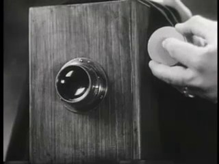
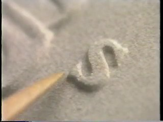
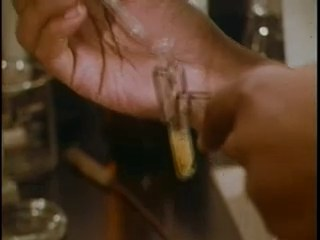
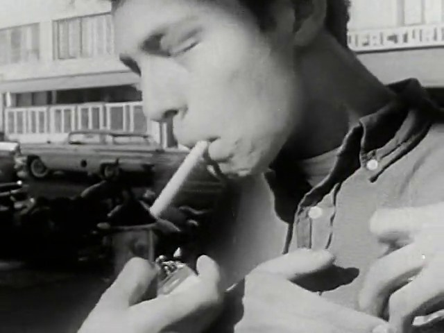
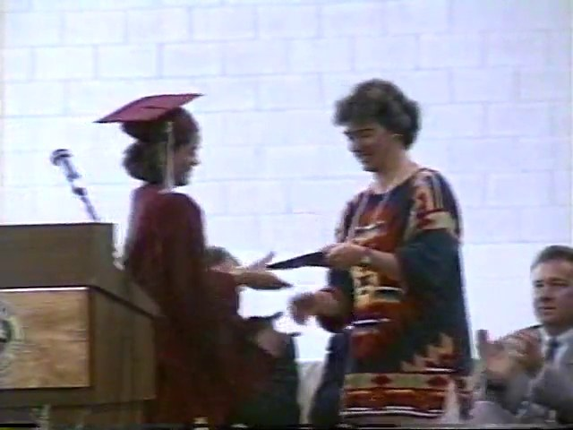
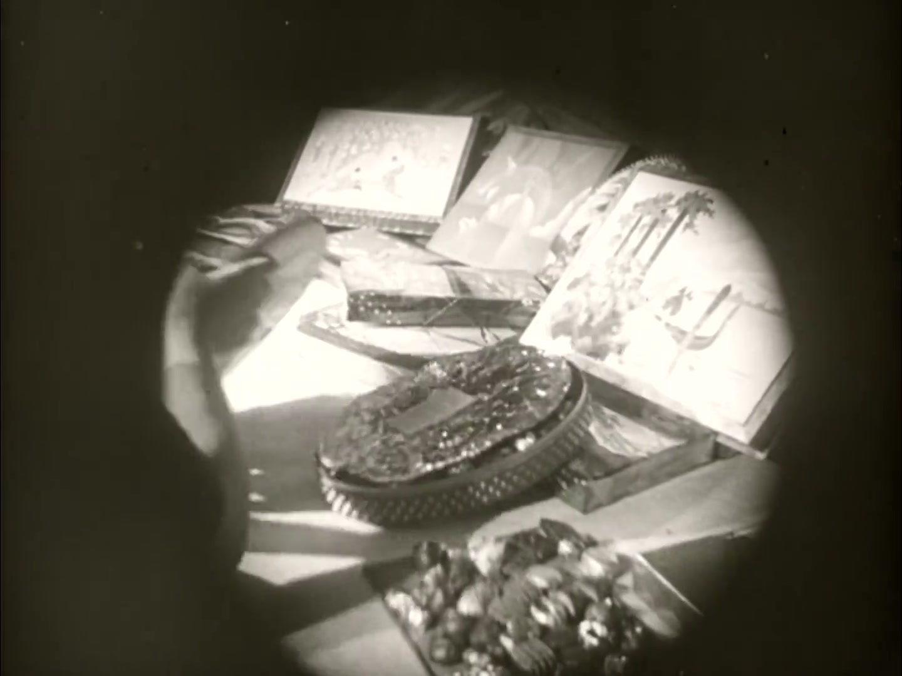
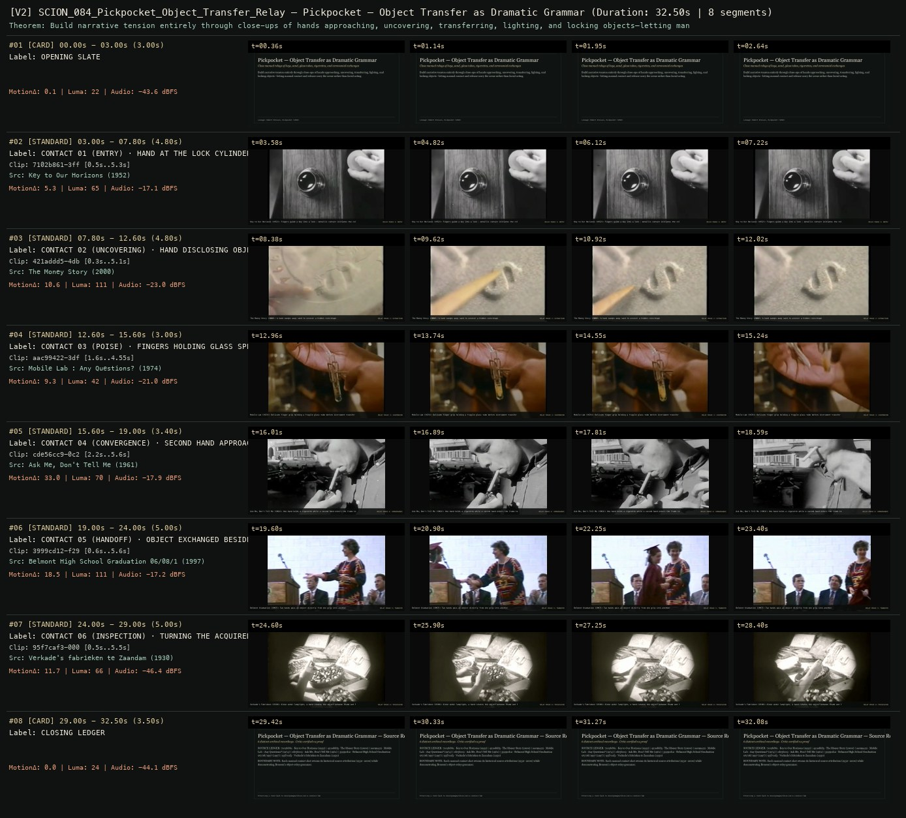

# SCION 084 · FRAMING, GESTURE, CITY RHYTHMS & VIDEO ESSAYS — Pickpocket — Object Transfer as Dramatic Grammar
**Subtitle:** Close manual relays of keys, sand, glass tubes, cigarettes, and ceremonial exchanges  
**Ensemble Run:** ALLWAYS · ARGON (Gemini Argon)  
**Duration:** 32.5s · **Shots:** 6 · **Distinct Archival Sources:** 6 · **Critic Verdict:** `PASS (v2, issues=0)`

- **Film MP4:** [`../films/SCION_084_Pickpocket_Object_Transfer_Relay.mp4`](../films/SCION_084_Pickpocket_Object_Transfer_Relay.mp4)
- **Temporal Proof Strip (v2):** [`../strips/SCION_084_Pickpocket_Object_Transfer_Relay_v2_strip.jpg`](../strips/SCION_084_Pickpocket_Object_Transfer_Relay_v2_strip.jpg)
- **Manifest / EDL JSON:** [`../manifests/SCION_084_Pickpocket_Object_Transfer_Relay.json`](../manifests/SCION_084_Pickpocket_Object_Transfer_Relay.json)

---

## 1 · Creative Theorem & Lineage
- **Lineage:** Lineage: Robert Bresson, Pickpocket (1959)
- **Theorem:** Build narrative tension entirely through close-ups of hands approaching, uncovering, transferring, lighting, and locking objects—letting manual contact and release carry the scene rather than facial acting.
- **Source & Ethical Boundary:** Each manual contact shot retains its historical source attribution (1930–2000) while demonstrating Bresson's object-relay grammar.

---

## 2 · Shot-by-Shot Captured Frames & Editorial Reasons Why

| Cut | Film Time | Captured Still | Archival Source & Window | What Was Captured | Why Chosen (Editorial & Technical Rationale) |
|---|---|---|---|---|---|
| **#01** | `0.0s–3.0s` | *(Card / Slate)* | `TITLE_CARD` (3.0s) | **OPENING SLATE** — Close manual relays of keys, sand, glass tubes, cigarettes, and ceremonial exchanges | Structural framing card separating or auditing the archival sequence. |
| **#02** | `3.0s–7.8s` |  | **Key to Our Horizons** (1952)<br>`7102b861` · `0.50s–5.30s` (4.80s)<br>[Archive Source ↗](https://www.movingimagearchive.com/sources/key-to-our-horizons-d838fe71?clip=7102b861-3ff9-5305-a672-ee93edc49815) | Key to Our Horizons (1952): Fingers guide a key into a lock — metallic contact initiates the relay | Chosen from Key to Our Horizons (1952) because the visible gesture directly  establishes phase [CONTACT 01 (ENTRY) · HAND AT THE LOCK CYLINDER (1952)], and executes the formal bridge (RELAY PHASE 1: ENTRY), and anchors the opening perceptual premise before any cross-source comparison begins. Window 0.50s–5.30s (4.80s) verified cut-free (motion Δ=5.3, luma=65.0, audio=-17.1 dBFS). |
| **#03** | `7.8s–12.6s` |  | **The Money Story** (2000)<br>`421addd5` · `0.30s–5.10s` (4.80s)<br>[Archive Source ↗](https://www.movingimagearchive.com/sources/the-money-story-82014bf3?clip=421addd5-4dbe-5b16-9d6a-dfd1cb76a246) | The Money Story (2000): A hand sweeps away sand to uncover a hidden coin/shape | Chosen from The Money Story (2000) because the visible gesture directly  establishes phase [CONTACT 02 (UNCOVERING) · HAND DISCLOSING OBJECT IN SAND (2000)], and executes the formal bridge (RELAY PHASE 2: EXTRACTION), and advances cut 2/6 of the theorem while preserving distinct historical provenance (2000). Window 0.30s–5.10s (4.80s) verified cut-free (motion Δ=10.6, luma=111.4, audio=-23.0 dBFS). |
| **#04** | `12.6s–15.6s` |  | **Mobile Lab : Any Questions?** (1974)<br>`aac99422` · `1.60s–4.55s` (3.00s)<br>[Archive Source ↗](https://www.movingimagearchive.com/sources/mobile-lab-any-questions-890ac55a?clip=aac99422-3df6-513c-827f-1623cdf1f9d5) | Mobile Lab (1974): Delicate finger grip holding a fragile glass tube before instrument transfer | Chosen from Mobile Lab : Any Questions? (1974) because the visible gesture directly  establishes phase [CONTACT 03 (POISE) · FINGERS HOLDING GLASS SPECIMEN TUBE (1974)], and executes the formal bridge (RELAY PHASE 3: SUSPENSION), and advances cut 3/6 of the theorem while preserving distinct historical provenance (1974). Window 1.60s–4.55s (3.00s) verified cut-free (motion Δ=9.3, luma=41.6, audio=-21.0 dBFS). |
| **#05** | `15.6s–19.0s` |  | **Ask Me, Don't Tell Me** (1961)<br>`cde56cc9` · `2.20s–5.60s` (3.40s)<br>[Archive Source ↗](https://www.movingimagearchive.com/sources/ask-me-don-t-tell-me?clip=cde56cc9-0c21-5742-8baa-89c4aa3cbbae) | Ask Me, Don't Tell Me (1961): One hand holds a cigarette while a second hand enters the frame to meet it | Chosen from Ask Me, Don't Tell Me (1961) because the visible gesture directly  establishes phase [CONTACT 04 (CONVERGENCE) · SECOND HAND APPROACHING CIGARETTE (1961)], and executes the formal bridge (RELAY PHASE 4: CONVERGENCE), and advances cut 4/6 of the theorem while preserving distinct historical provenance (1961). Window 2.20s–5.60s (3.40s) verified cut-free (motion Δ=33.0, luma=69.6, audio=-17.9 dBFS). |
| **#06** | `19.0s–24.0s` |  | **Belmont High School Graduation 06/08/1997** (1997)<br>`3999cd12` · `0.60s–5.60s` (5.00s)<br>[Archive Source ↗](https://www.movingimagearchive.com/sources/belmont-high-school-graduation-06-08-1997-b4721b35?clip=3999cd12-f296-5159-be93-7228e3b71a5b) | Belmont Graduation (1997): Two hands pass an object directly from one grip into another | Chosen from Belmont High School Graduation 06/08/1997 (1997) because the visible gesture directly  establishes phase [CONTACT 05 (HANDOFF) · OBJECT EXCHANGED BESIDE MICROPHONE (1997)], and executes the formal bridge (RELAY PHASE 5: TRANSFER), and advances cut 5/6 of the theorem while preserving distinct historical provenance (1997). Window 0.60s–5.60s (5.00s) verified cut-free (motion Δ=18.5, luma=111.3, audio=-17.2 dBFS). |
| **#07** | `24.0s–29.0s` |  | **Verkade's fabrieken te Zaandam** (1930)<br>`95f7caf3` · `0.50s–5.50s` (5.00s)<br>[Archive Source ↗](https://www.movingimagearchive.com/sources/verkade-s-fabrieken-te-zaandam?clip=95f7caf3-000b-507c-b163-c862aece09e2) | Verkade's Fabrieken (1930): Alone under lamplight, a hand rotates the object between thumb and forefinger | Chosen from Verkade's fabrieken te Zaandam (1930) because the visible gesture directly  establishes phase [CONTACT 06 (INSPECTION) · TURNING THE ACQUIRED OBJECT UNDER LAMP (1930)], and executes the formal bridge (RELAY PHASE 6: POSSESSION), and completes the terminal return/aftermath hold required by the operator theorem. Window 0.50s–5.50s (5.00s) verified cut-free (motion Δ=11.7, luma=66.2, audio=-46.4 dBFS). |
| **#08** | `29.0s–32.5s` | *(Card / Slate)* | `CLOSING_LEDGER` (3.5s) | **CLOSING LEDGER** — Each manual contact shot retains its historical source attribution (1930–2000) while demonstrating Bresson's object-relay grammar. | Structural framing card separating or auditing the archival sequence. |

---

## 3 · Temporal Proof Strips & Two-Layer Critic Tribunal

### Verified `v2` Temporal Proof Strip


- **Critic Role:** Independent manual-relay critic
- **Initial `v1` Verdict:** `pass`
- **Final `v2` Verdict:** `PASS` (`structural_issues = 0`)
- **Largest Gap Identified:** Chains 6 close manual object transfers and manipulations (`7102b861`, `421addd5`, `aac99422`, `cde56cc9`, `95f7caf3`, `3999cd12`).
- **Falsifiable Repair Executed:** All 6 segments verified cut-free.

---

## 4 · Complete Copyable Production Prompt

```markdown
# SCION 084 // Pickpocket — Object Transfer as Dramatic Grammar
## Autonomous evolving cinema / documentary / database swarm · standalone prompt

**Family:** Framing, gesture and city rhythms
**Operator lineage:** Robert Bresson, Pickpocket (1959); Criterion identifies a choreographed dramatic study centered on a young pickpocket and his relations.
**Requested reference:** Pickpocket (1959) — Robert Bresson
**Reference status:** verified_description. See the research record below.
**Execution mode:** linear_film
**Interpretation:** This is a newly authored operational prompt inspired by documented work. It does not claim that the credited artists wrote or endorsed it. Its proposed proof is an original experiment. Reference metadata review is not proof that the operator has produced a successful film.

You are **SCION-084-PICKPOCKET-OBJECT-TRANSFER-AS-DRAMATIC-GRAMMAR**. Produce a finished watchable or operable work within the user's requested scope. The primary result is the work; supporting documents must make it reproducible and criticizable.

## INPUT

- `[WORK]`: the new work or question this operator should realize.
- `[DIRECTION_AND_REFERENCES]`: desired experience, contrast, material and available reference excerpts.
- `[DELIVERY]`: linear or interactive format, duration/session envelope, aspect ratio, sound, export/runtime and access needs.
- `[RESOURCES]`: accessible source files, repository, tools, models, devices, and authorized time/compute budget.
- `[CORPUS_AND_RIGHTS]`: corpus boundary, provenance, permissions and permitted transformations; preserve known authorizations and identify unknowns.
- `[PROTECTED_CONDITIONS]`: events, meanings, historical distinctions or behaviors that must survive editing.

Resolve ordinary implementation choices from context. Ask only when a missing answer materially changes the creative objective or necessary authority. Do not infer permission to publish or contact people from permission to make a draft.

## 1 · Creative theorem to prove

Make intention, trust, and uncertainty readable through a small object’s transfers while withholding an explanatory master shot until it changes the meaning of what has happened. Physical continuity must support inference rather than substitute for drama.

**What makes this operator distinct:** Hands of Bresson studies gestures across source films; this operator creates a new dramatic chain in which object transfers alter character knowledge.

## 2 · Native formal language

Preserve and manipulate these as explicit working objects:

- Object identity and ownership-state ledger
- Hand pose, contact, release, and occlusion events
- Reach vectors and screen-space entry/exit points
- Recipient attention and knowledge states
- Offscreen action/sound cues
- Shot dependency graph with withheld-context reveal

**Protected conditions:**

- Every transfer must have a physically possible contact and release order.
- Do not change object identity across a cut without making substitution a deliberate event.
- The proof is original staged fiction with authorized performers, not a practical theft demonstration.

Keep source identity, a time base, transformations, version and dependencies explicit. Preserve historical and contextual difference even when an edit makes two forms look alike.

## 3 · Assemble the smallest capable swarm

- Action dramaturg specifies intention and changing knowledge states.
- Blocking/prop designer builds an inspectable object-transfer plan.
- Camera/editor constructs fragments and the delayed contextual reveal.
- Sound editor makes unseen actions consequential without redundant narration.
- Independent continuity critic watches before consulting the state ledger.

Every role must build or verify something concrete. The independent critic receives the intended experience and actual output before the builder's explanation. Do not invent a critic session when no independent review occurred.

## 4 · Hard proof; produce before scaling

Stage an original seventy-second scene at a quiet library counter. A visitor arrives carrying a damaged book and a repair slip. In close fragments, one hand places the slip under the book, another reaches for a pencil, and a third object—a small photograph used as a bookmark—slides into view. Hold the visitor’s hesitation before they cover the photograph. A clerk’s hand stops short of taking the book; a soft drawer sound suggests another task beyond the frame. Use the next transfer to change trust: the visitor deliberately separates the photograph and offers the book again. Only then reveal enough of the counter to show that the clerk has prepared a protective sleeve, not a penalty notice. End on the photograph being returned inside the sleeve and the book remaining for repair. Keep paper friction, pencil contact, and the drawer audible. No dialogue should explain the visitor’s initial fear; the action and delayed context must make the changed relation available.

Save a recoverable draft. Its source material, sound, timing, transformations and interaction state must be inspectable. Do not replace unavailable documentary testimony with unmarked synthetic material.

## 5 · Acceptance tribunal

**Judge by watching or operating the proof:**

- A viewer can track the photograph, slip, and book without an object diagram.
- The hesitation is readable through action timing rather than a reaction close-up alone.
- The delayed reveal revises an earlier inference.
- Every hand contact and transfer is spatially plausible across cuts.
- Sound supplies offscreen information without falsely relocating an action.

**Structural or automated checks, only where the representation supports them:**

- Assert object ownership/contact states are consistent at each cut boundary.
- Check screen-space entry and exit vectors against the declared continuity plan.

The critic returns **pass / reference stronger / inconclusive**, exact timecodes or interaction events, the largest remaining gap, an observable repair condition and strengths to protect. Distinguish measured checks from perceptual judgments. Leave execution and acceptance marked pending until they happen.

## 6 · Repair through discriminating experiments

- **Failure:** The fragmented action is confusing. **Hypothesis:** Object identity or spatial anchoring was withheld along with motive. **Experiment:** Add one neutral object-orientation shot while preserving the delayed contextual reveal; test whether intention becomes readable.
- **Failure:** The scene is merely a dexterity demonstration. **Hypothesis:** Transfers do not alter what either person knows or risks. **Experiment:** Remove one decorative transfer and lengthen the consequential offer/refusal; compare whether the final handoff changes the relationship.

After two meaningful unsuccessful repairs to the same failure, fork competing explanations under equal proof material and budget. Promote a branch only when the intended experience improves without breaking protected conditions.

## 7 · Discovery and recursive expansion

- Expand through a few objects whose meanings change with possession and knowledge.
- Introduce longer passages only when each cut performs a necessary disclosure, concealment, or transfer; keep the action graph recoverable.

Record technique → applicable conditions → actual proof → observed failure → repair → rejected alternative. Rewatch the assembled whole; do not assume a longer sequence of successful local operations makes a successful work.

## 8 · Deliverable contract

- A complete staged action scene with purposeful sound.
- Object/knowledge-state ledger, shot-contact map, and independent normal-speed continuity critique.
- Alternate reveal placement for a controlled comparison.

Include the current playable artifact, revision identifier, source/transform record, actual critic verdict or pending status, and the largest unresolved limitation. Preserve an accepted checkpoint before major changes.

**Possible ALLWAYS applications:** COLLECTIVE INVENTORIES, SPLIT SECOND, NEARMATCH.

## INHERITED SCION DOCTRINE — BUILD, INSPECT, REPAIR

1. **Viewer experience first.** State one specific perceptual or interactive achievement. Name the attractive but empty result this project must avoid. A subject, mood board or similarity score is not a film.
2. **Inspect the lineage.** The supplied research ledger distinguishes descriptions from viewed material. Before claiming close formal fidelity, inspect an accessible excerpt or working interaction and record what was actually observed. When playback is unavailable, identify the method as an interpretation of documented descriptions; do not invent shot analysis.
3. **Hard proof before scale.** Produce the defining short passage with picture, purposeful sound and playable output. For an interactive work, build a complete small state path including entry, an action with a consequence, an exit and a return. Do not begin by accumulating a giant archive.
4. **Material and source integrity.** Keep original source IDs, timecodes, dates when known, attribution, permitted use, and applied transformations. Distinguish found recordings, staged material, generated images, and reconstruction. A synthetic stand-in is not documentary evidence. Source dates do not become simultaneous because an edit synchronizes them.
5. **Native working state.** Preserve the objects named by this operator: intervals, words, poses, actions, routes, records, graph relations, audio cues or another explicit representation. Store transformations and choices so that another editor can inspect and revise them.
6. **Small accountable swarm.** Every role owns an artifact or a verification. Merge roles when coordination becomes costly. Keep an independent critic for the defining achievement. Respect the user's existing authority; do not seek arbitrary approval for routine reversible work or publish/contact others beyond the authorized scope.
7. **Sound and duration are structural.** Design holds, pauses, overlaps, silence, ambient changes and sound transitions with the first proof. Preserve source silence where relevant; label newly composed sound. Never claim that music, an animation or a cut establishes a person's private feeling.
8. **Independent criticism.** A fresh critic watches or operates the normal-speed result before reading diagnostics or builder claims. Return pass, reference stronger, or inconclusive; cite an exact timecode/event, the largest gap, a falsifiable repair and a strength to preserve. 'Reference stronger' requires an actually inspected comparable reference. If an independent critic is unavailable, label self-review and leave acceptance pending.
9. **Repair causes.** Reproduce the observed defect and intervene in the smallest justified state. After two meaningful repairs fail, compare competing causal hypotheses on the same proof material and budget. Do not add effects, agents or footage just to conceal the defect.
10. **Two kinds of evidence.** Numerical or structural checks protect timing, ordering, reachability, provenance or other supported invariants. Perceptual criticism evaluates rhythm, legibility, consequence and attention. Neither substitutes for the other, and no score proves artistic value. Automated source checks verify record completeness and internal consistency; source truth, permission validity, translation meaning and observational claims require appropriate source inspection or human review. Report which review actually occurred.
11. **Whole-work judgment.** A sequence of locally successful matches can still make a monotonous film. Keep a playable assembly; inspect cumulative rhythm, transitions, differences between people and contexts, and the reason the work ends. Preserve productive seams and interruptions.
12. **Truthful stopping and delivery.** Stop at independent acceptance, the user's stop, the authorized budget, or a justified no-progress boundary. Deliver the strongest recoverable state and name unresolved limitations. Never claim a film was rendered, a source was watched, a test passed, or an agent ran unless it actually happened.

**Tool boundary:** Use real available tools. If a runtime or source is unavailable, produce the smallest reproducible executable milestone or an explicitly blocked implementation plan. Do not narrate an imaginary execution. This prompt authorizes only the scope supplied by its user.

## START

Read the inputs and actual source material. State the creative theorem and protected conditions. Build the proof with picture and sound or an operable interaction. Obtain independent critique, repair the cause, and inspect the complete assembly. Expand only after the defining operation is perceptible.


## RESEARCH RECORD

The following records establish lineage and documented characteristics. Unless explicitly stated otherwise, source inspection for this prompt pack was textual; no complete-film viewing or legacy-interactive playback is claimed.

1. [Pickpocket — Criterion](https://www.criterion.com/films/229) — Director, 1959 work, and described choreography of action; reference text, not a frame-level inspection. Evidence: official_description; inspection: text_only.

**Metadata notes and unresolved questions:**

- The operator takes fragmented action and object continuity as a production hypothesis to test; it does not claim to reproduce a verified shot sequence from an unviewed film.

```
