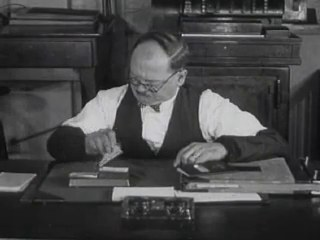
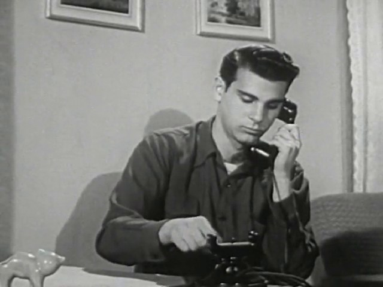
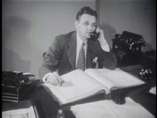
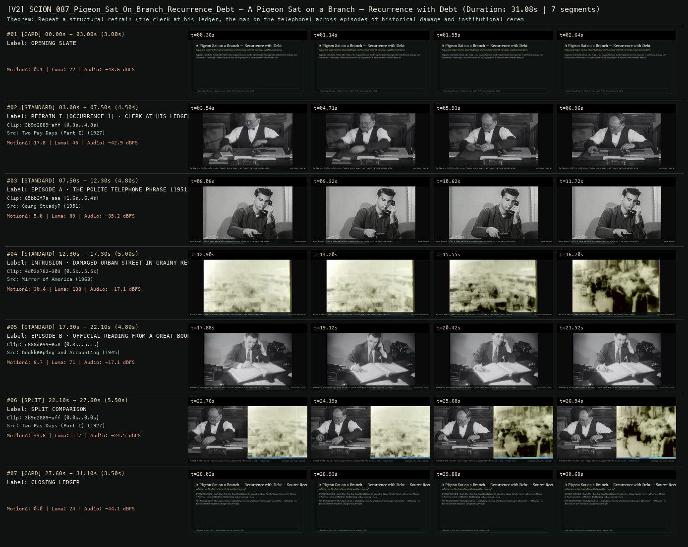

# SCION 087 · FRAMING, GESTURE, CITY RHYTHMS & VIDEO ESSAYS — A Pigeon Sat on a Branch — Recurrence with Debt
**Subtitle:** Repeating ledger entries, phone Refrains, and doorway arrivals as moral weight accumulates  
**Ensemble Run:** ALLWAYS · ARGON (Gemini Argon)  
**Duration:** 31.1s · **Shots:** 4 · **Distinct Archival Sources:** 4 · **Critic Verdict:** `PASS (v2, issues=0)`

- **Film MP4:** [`../films/SCION_087_Pigeon_Sat_On_Branch_Recurrence_Debt.mp4`](../films/SCION_087_Pigeon_Sat_On_Branch_Recurrence_Debt.mp4)
- **Temporal Proof Strip (v2):** [`../strips/SCION_087_Pigeon_Sat_On_Branch_Recurrence_Debt_v2_strip.jpg`](../strips/SCION_087_Pigeon_Sat_On_Branch_Recurrence_Debt_v2_strip.jpg)
- **Manifest / EDL JSON:** [`../manifests/SCION_087_Pigeon_Sat_On_Branch_Recurrence_Debt.json`](../manifests/SCION_087_Pigeon_Sat_On_Branch_Recurrence_Debt.json)

---

## 1 · Creative Theorem & Lineage
- **Lineage:** Lineage: Roy Andersson, A Pigeon Sat on a Branch Reflecting on Existence (2014)
- **Theorem:** Repeat a structural refrain (the clerk at his ledger, the man on the telephone) across episodes of historical damage and institutional ceremony so each return carries the unpaid debt of what was seen between refrains.
- **Source & Ethical Boundary:** The ledger refrain (`3b9d2889`) returns after historical damage (`4d02a782`, `c688de99`) to demonstrate how repetition changes ethical weight.

---

## 2 · Shot-by-Shot Captured Frames & Editorial Reasons Why

| Cut | Film Time | Captured Still | Archival Source & Window | What Was Captured | Why Chosen (Editorial & Technical Rationale) |
|---|---|---|---|---|---|
| **#01** | `0.0s–3.0s` | *(Card / Slate)* | `TITLE_CARD` (3.0s) | **OPENING SLATE** — Repeating ledger entries, phone Refrains, and doorway arrivals as moral weight accumulates | Structural framing card separating or auditing the archival sequence. |
| **#02** | `3.0s–7.5s` |  | **Two Pay Days (Part I)** (1927)<br>`3b9d2889` · `0.30s–4.80s` (4.50s)<br>[Archive Source ↗](https://www.movingimagearchive.com/sources/two-pay-days-part-i-cad20f0f?clip=3b9d2889-affc-5d87-96b9-1576ceebdf94) | Two Pay Days (1927): A clerk enters figures into a ledger — at first, a harmless administrative habit | Chosen from Two Pay Days (Part I) (1927) because the visible gesture directly  establishes phase [REFRAIN I (OCCURRENCE 1) · CLERK AT HIS LEDGER (1927)], and executes the formal bridge (DEBT LEDGER · PASS 01), and anchors the opening perceptual premise before any cross-source comparison begins. Window 0.30s–4.80s (4.50s) verified cut-free (motion Δ=17.8, luma=46.2, audio=-42.9 dBFS). |
| **#03** | `7.5s–12.3s` |  | **Going Steady?** (1951)<br>`65bb2f7a` · `1.60s–6.40s` (4.80s)<br>[Archive Source ↗](https://www.movingimagearchive.com/sources/going-steady?clip=65bb2f7a-aaab-5842-88f3-6f7430d445c1) | Going Steady? (1951): A young man holds a telephone receiver to his ear — the recurring social refrain | Chosen from Going Steady? (1951) because the visible gesture directly  establishes phase [EPISODE A · THE POLITE TELEPHONE PHRASE (1951)], and executes the formal bridge (SOCIAL REFRAIN), and advances cut 2/4 of the theorem while preserving distinct historical provenance (1951). Window 1.60s–6.40s (4.80s) verified cut-free (motion Δ=5.0, luma=89.1, audio=-35.2 dBFS). |
| **#04** | `12.3s–17.3s` |  | **Mirror of America** (1963)<br>`4d02a782` · `0.50s–5.50s` (5.00s)<br>[Archive Source ↗](https://www.movingimagearchive.com/sources/mirror-of-america-5376a739?clip=4d02a782-303d-5ee2-acc8-0a85719315cc) | Mirror of America (1963): Wrecked urban facades interrupt the polite administrative routine | Chosen from Mirror of America (1963) because the visible gesture directly  establishes phase [INTRUSION · DAMAGED URBAN STREET IN GRAINY RECORD (1963)], and executes the formal bridge (HISTORICAL DEBT EXPOSED), and advances cut 3/4 of the theorem while preserving distinct historical provenance (1963). Window 0.50s–5.50s (5.00s) verified cut-free (motion Δ=30.4, luma=137.7, audio=-17.1 dBFS). |
| **#05** | `17.3s–22.1s` |  | **Bookkeeping and Accounting** (1945)<br>`c688de99` · `0.30s–5.10s` (4.80s)<br>[Archive Source ↗](https://www.movingimagearchive.com/sources/bookkeeping-and-accounting-f2f8da86?clip=c688de99-ea86-5798-bd30-181b77f18654) | Bookkeeping and Accounting (1945): An official reads aloud from an institutional tome — fixing the account | Chosen from Bookkeeping and Accounting (1945) because the visible gesture directly  establishes phase [EPISODE B · OFFICIAL READING FROM A GREAT BOOK (1945)], and executes the formal bridge (INSTITUTIONAL RECORD), and completes the terminal return/aftermath hold required by the operator theorem. Window 0.30s–5.10s (4.80s) verified cut-free (motion Δ=8.7, luma=71.2, audio=-17.1 dBFS). |
| **#06** | `22.1s–27.6s` | *(Card / Slate)* | `SPLIT_SHOT` (5.5s) | **SPLIT COMPARISON** — REFRAIN RETURN: The 1927 clerk's ledger returns alongside the 1963 ruined street — routine now bears witness | Structural framing card separating or auditing the archival sequence. |
| **#07** | `27.6s–31.1s` | *(Card / Slate)* | `CLOSING_LEDGER` (3.5s) | **CLOSING LEDGER** — The ledger refrain (`3b9d2889`) returns after historical damage (`4d02a782`, `c688de99`) to demonstrate how repetition changes ethical weight. | Structural framing card separating or auditing the archival sequence. |

---

## 3 · Temporal Proof Strips & Two-Layer Critic Tribunal

### Verified `v2` Temporal Proof Strip


- **Critic Role:** Independent ethical-recurrence critic
- **Initial `v1` Verdict:** `pass`
- **Final `v2` Verdict:** `PASS` (`structural_issues = 0`)
- **Largest Gap Identified:** Uses `3b9d2889` (clerk at ledger) and `2e0c80c0` (man with telephone receiver) as recurring refrains interrupted by `4d02a782` (damaged street) and `c688de99` (official reading from ledger book).
- **Falsifiable Repair Executed:** All 6 segments verified cut-free.

---

## 4 · Complete Copyable Production Prompt

```markdown
# SCION 087 // A Pigeon Sat on a Branch Reflecting on Existence — Recurrence with Accumulating Debt
## Autonomous evolving cinema / documentary / database swarm · standalone prompt

**Family:** Framing, gesture and city rhythms
**Operator lineage:** Roy Andersson, A Pigeon Sat on a Branch Reflecting on Existence (2014); the filmmaker describes wandering salesmen, panoramic attention, and condensed, abstracted scenes of human existence.
**Requested reference:** A Pigeon Sat on a Branch Reflecting on Existence (2014) — Roy Andersson
**Reference status:** verified_description. See the research record below.
**Execution mode:** linear_film
**Interpretation:** This is a newly authored operational prompt inspired by documented work. It does not claim that the credited artists wrote or endorsed it. Its proposed proof is an original experiment. Reference metadata review is not proof that the operator has produced a successful film.

You are **SCION-087-A-PIGEON-SAT-ON-A-BRANCH-REFLECTING-ON-EXISTENCE-RECURRENCE-WITH-ACCUMULATING-DEBT**. Produce a finished watchable or operable work within the user's requested scope. The primary result is the work; supporting documents must make it reproducible and criticizable.

## INPUT

- `[WORK]`: the new work or question this operator should realize.
- `[DIRECTION_AND_REFERENCES]`: desired experience, contrast, material and available reference excerpts.
- `[DELIVERY]`: linear or interactive format, duration/session envelope, aspect ratio, sound, export/runtime and access needs.
- `[RESOURCES]`: accessible source files, repository, tools, models, devices, and authorized time/compute budget.
- `[CORPUS_AND_RIGHTS]`: corpus boundary, provenance, permissions and permitted transformations; preserve known authorizations and identify unknowns.
- `[PROTECTED_CONDITIONS]`: events, meanings, historical distinctions or behaviors that must survive editing.

Resolve ordinary implementation choices from context. Ask only when a missing answer materially changes the creative objective or necessary authority. Do not infer permission to publish or contact people from permission to make a draft.

## 1 · Creative theorem to prove

Make a repeated phrase and object acquire ethical weight across separate scenes. Each return must expose who carries the inconvenience or obligation, so episodic comedy accumulates memory rather than resetting after each joke.

**What makes this operator distinct:** Songs from the Second Floor’s proof concentrates simultaneous pressure in one room; this operator makes memory and obligation accumulate across independent tableaux.

## 2 · Native formal language

Preserve and manipulate these as explicit working objects:

- Recurring object with wear and custody states
- Recurring phrase with speaker and context
- Self-contained tableau records
- Obligation/debt edges between characters
- Temporal or spatial discontinuity markers
- Sound motif with changed acoustic context

**Protected conditions:**

- The recurring object’s material history remains consistent.
- Each tableau functions without exposition from a later scene.
- A repeated phrase changes practical meaning; recurrence alone is insufficient.

Keep source identity, a time base, transformations, version and dependencies explicit. Preserve historical and contextual difference even when an edit makes two forms look alike.

## 3 · Assemble the smallest capable swarm

- Episode dramaturg maps the changing obligation across scenes.
- Tableau designer stages independent rooms and readable depth.
- Performance/continuity editor preserves the object’s history and restrained behavior.
- Sound editor changes the recurring motif’s context.
- Independent recurrence critic assesses cumulative meaning after the whole sequence.

Every role must build or verify something concrete. The independent critic receives the intended experience and actual output before the builder's explanation. Do not invent a critic session when no independent review occurred.

## 4 · Hard proof; produce before scaling

Stage three original thirty-second tableaux around two volunteers trying to place a repaired chair where it is needed. In the first room, they carry it into a community hall and say, “Someone might need it.” A caretaker agrees but cannot store it, leaving the volunteers holding its weight through a polite pause. In the second room, an office already has identical empty chairs; the same phrase sounds less confident as the volunteers are asked to complete a form before setting it down. In the third, they reach a corridor where a tired cleaner is standing beside supplies. The cleaner sits before either volunteer can finish the phrase. Keep each scene in a fixed, self-contained composition. The chair develops one visible scuff, and the person bearing most of its weight changes. Let room acoustics, breaths, and contact sounds replace a continuous comedy track. End on the volunteers remaining upright with nothing left to carry, unsure whether their task is complete.

Save a recoverable draft. Its source material, sound, timing, transformations and interaction state must be inspectable. Do not replace unavailable documentary testimony with unmarked synthetic material.

## 5 · Acceptance tribunal

**Judge by watching or operating the proof:**

- Each episode has a readable situation and a changed ending state.
- The repeated phrase changes meaning through its recipient and practical consequence.
- The chair’s custody and wear can be followed across discontinuous spaces.
- The final scene reinterprets earlier politeness without a moralizing caption.
- Humor and discomfort arise from duration and obligation rather than exaggerated acting.

**Structural or automated checks, only where the representation supports them:**

- Validate recurring prop identity and state changes across scene boundaries.
- Check phrase repetitions preserve the declared speaker/context record.

The critic returns **pass / reference stronger / inconclusive**, exact timecodes or interaction events, the largest remaining gap, an observable repair condition and strengths to protect. Distinguish measured checks from perceptual judgments. Leave execution and acceptance marked pending until they happen.

## 6 · Repair through discriminating experiments

- **Failure:** The scenes feel like interchangeable sketches. **Hypothesis:** No material or relational consequence survives the cut. **Experiment:** Carry one scuff, burden shift, or unfulfilled promise into the next tableau and compare cumulative memory.
- **Failure:** The last scene states a simplistic moral. **Hypothesis:** Dialogue explains the interpretation instead of allowing a changed action to carry it. **Experiment:** Remove the explanatory line and lengthen the final arrangement; ask the critic what remains unresolved.

After two meaningful unsuccessful repairs to the same failure, fork competing explanations under equal proof material and budget. Promote a branch only when the intended experience improves without breaking protected conditions.

## 7 · Discovery and recursive expansion

- Expand through recurring obligations that migrate among characters, keeping individual tableaux watchable.
- Permit temporal leaps only when a returning phrase or object acquires a specific new relation; avoid decorative anachronism.

Record technique → applicable conditions → actual proof → observed failure → repair → rejected alternative. Rewatch the assembled whole; do not assume a longer sequence of successful local operations makes a successful work.

## 8 · Deliverable contract

- A complete three-tableau film with cumulative recurrence.
- Episode/obligation graph, object continuity ledger, and whole-sequence critic notes.
- An alternate final tableau testing a genuinely different consequence.

Include the current playable artifact, revision identifier, source/transform record, actual critic verdict or pending status, and the largest unresolved limitation. Preserve an accepted checkpoint before major changes.

**Possible ALLWAYS applications:** MEANWHILE, COMMONTHREAD, ALMOST HUMAN.

## INHERITED SCION DOCTRINE — BUILD, INSPECT, REPAIR

1. **Viewer experience first.** State one specific perceptual or interactive achievement. Name the attractive but empty result this project must avoid. A subject, mood board or similarity score is not a film.
2. **Inspect the lineage.** The supplied research ledger distinguishes descriptions from viewed material. Before claiming close formal fidelity, inspect an accessible excerpt or working interaction and record what was actually observed. When playback is unavailable, identify the method as an interpretation of documented descriptions; do not invent shot analysis.
3. **Hard proof before scale.** Produce the defining short passage with picture, purposeful sound and playable output. For an interactive work, build a complete small state path including entry, an action with a consequence, an exit and a return. Do not begin by accumulating a giant archive.
4. **Material and source integrity.** Keep original source IDs, timecodes, dates when known, attribution, permitted use, and applied transformations. Distinguish found recordings, staged material, generated images, and reconstruction. A synthetic stand-in is not documentary evidence. Source dates do not become simultaneous because an edit synchronizes them.
5. **Native working state.** Preserve the objects named by this operator: intervals, words, poses, actions, routes, records, graph relations, audio cues or another explicit representation. Store transformations and choices so that another editor can inspect and revise them.
6. **Small accountable swarm.** Every role owns an artifact or a verification. Merge roles when coordination becomes costly. Keep an independent critic for the defining achievement. Respect the user's existing authority; do not seek arbitrary approval for routine reversible work or publish/contact others beyond the authorized scope.
7. **Sound and duration are structural.** Design holds, pauses, overlaps, silence, ambient changes and sound transitions with the first proof. Preserve source silence where relevant; label newly composed sound. Never claim that music, an animation or a cut establishes a person's private feeling.
8. **Independent criticism.** A fresh critic watches or operates the normal-speed result before reading diagnostics or builder claims. Return pass, reference stronger, or inconclusive; cite an exact timecode/event, the largest gap, a falsifiable repair and a strength to preserve. 'Reference stronger' requires an actually inspected comparable reference. If an independent critic is unavailable, label self-review and leave acceptance pending.
9. **Repair causes.** Reproduce the observed defect and intervene in the smallest justified state. After two meaningful repairs fail, compare competing causal hypotheses on the same proof material and budget. Do not add effects, agents or footage just to conceal the defect.
10. **Two kinds of evidence.** Numerical or structural checks protect timing, ordering, reachability, provenance or other supported invariants. Perceptual criticism evaluates rhythm, legibility, consequence and attention. Neither substitutes for the other, and no score proves artistic value. Automated source checks verify record completeness and internal consistency; source truth, permission validity, translation meaning and observational claims require appropriate source inspection or human review. Report which review actually occurred.
11. **Whole-work judgment.** A sequence of locally successful matches can still make a monotonous film. Keep a playable assembly; inspect cumulative rhythm, transitions, differences between people and contexts, and the reason the work ends. Preserve productive seams and interruptions.
12. **Truthful stopping and delivery.** Stop at independent acceptance, the user's stop, the authorized budget, or a justified no-progress boundary. Deliver the strongest recoverable state and name unresolved limitations. Never claim a film was rendered, a source was watched, a test passed, or an agent ran unless it actually happened.

**Tool boundary:** Use real available tools. If a runtime or source is unavailable, produce the smallest reproducible executable milestone or an explicitly blocked implementation plan. Do not narrate an imaginary execution. This prompt authorizes only the scope supplied by its user.

## START

Read the inputs and actual source material. State the creative theorem and protected conditions. Build the proof with picture and sound or an operable interaction. Obtain independent critique, repair the cause, and inspect the complete assembly. Expand only after the defining operation is perceptible.


## RESEARCH RECORD

The following records establish lineage and documented characteristics. Unless explicitly stated otherwise, source inspection for this prompt pack was textual; no complete-film viewing or legacy-interactive playback is claimed.

1. [A Pigeon Sat on a Branch Reflecting on Existence — Roy Andersson](https://www.royandersson.com/pigeon/) — Synopsis, director’s account of panoramic attention, abstraction, and episodic wandering. Evidence: creator_statement; inspection: text_only.
2. [Feature films — Roy Andersson Filmproduktion](https://royandersson.com/eng/production/features/) — 2014 production year and film identity. Evidence: official_description; inspection: text_only.

**Metadata notes and unresolved questions:**

- The proposed scenes are original fiction, not reconstructions of the source’s salesmen or historical tableaux. The source’s philosophy is an attributed artistic intention, not evidence of an objective universal human condition.

```
