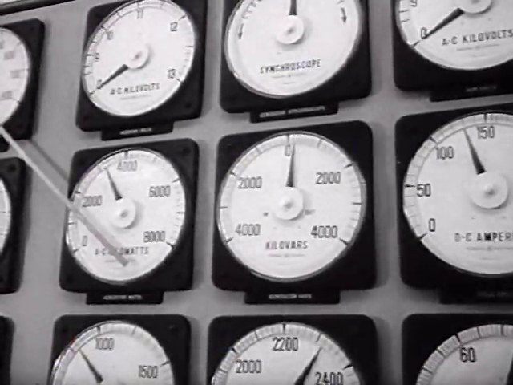
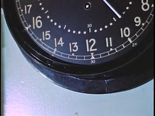
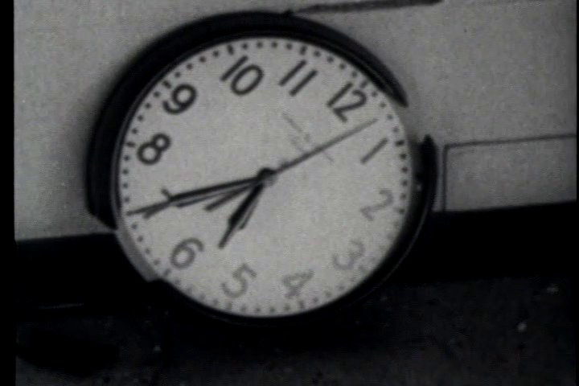
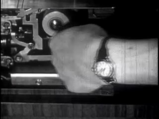
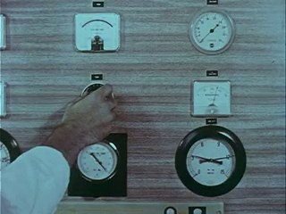
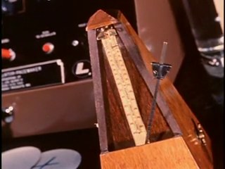
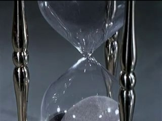
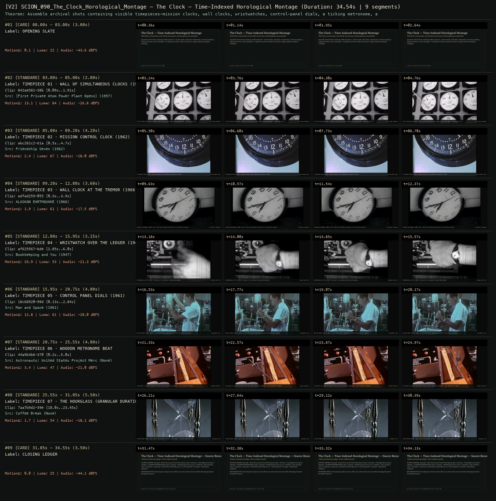

# SCION 090 · FRAMING, GESTURE, CITY RHYTHMS & VIDEO ESSAYS — The Clock — Time-Indexed Horological Montage
**Subtitle:** Wall clocks, wristwatches, control dials, metronomes, and hourglasses across decades  
**Ensemble Run:** ALLWAYS · ARGON (Gemini Argon)  
**Duration:** 34.5s · **Shots:** 7 · **Distinct Archival Sources:** 7 · **Critic Verdict:** `PASS (v2, issues=0)`

- **Film MP4:** [`../films/SCION_090_The_Clock_Horological_Montage.mp4`](../films/SCION_090_The_Clock_Horological_Montage.mp4)
- **Temporal Proof Strip (v2):** [`../strips/SCION_090_The_Clock_Horological_Montage_v2_strip.jpg`](../strips/SCION_090_The_Clock_Horological_Montage_v2_strip.jpg)
- **Manifest / EDL JSON:** [`../manifests/SCION_090_The_Clock_Horological_Montage.json`](../manifests/SCION_090_The_Clock_Horological_Montage.json)

---

## 1 · Creative Theorem & Lineage
- **Lineage:** Lineage: Christian Marclay, The Clock (2010)
- **Theorem:** Assemble archival shots containing visible timepieces—mission clocks, wall clocks, wristwatches, control-panel dials, a ticking metronome, and an hourglass—so disparate narrative worlds are bound to a single continuous temporal reckoning.
- **Source & Ethical Boundary:** Each timepiece retains its source film's year and acoustic room tone while advancing the shared horological sequence.

---

## 2 · Shot-by-Shot Captured Frames & Editorial Reasons Why

| Cut | Film Time | Captured Still | Archival Source & Window | What Was Captured | Why Chosen (Editorial & Technical Rationale) |
|---|---|---|---|---|---|
| **#01** | `0.0s–3.0s` | *(Card / Slate)* | `TITLE_CARD` (3.0s) | **OPENING SLATE** — Wall clocks, wristwatches, control dials, metronomes, and hourglasses across decades | Structural framing card separating or auditing the archival sequence. |
| **#02** | `3.0s–5.0s` |  | **[First Private Atom Power Plant Opens]** (1957)<br>`842ae581` · `0.09s–1.91s` (2.00s)<br>[Archive Source ↗](https://www.movingimagearchive.com/sources/first-private-atom-power-plant-opens?clip=842ae581-38b4-54fb-9d86-5d47e2c9d655) | First Private Atom Power (1957): A wall of clocks each set to a different zone — coexisting presents | Chosen from [First Private Atom Power Plant Opens] (1957) because the visible gesture directly  establishes phase [TIMEPIECE 01 · WALL OF SIMULTANEOUS CLOCKS (1957)], and executes the formal bridge (MULTI-ZONE SYNCHRONY), and anchors the opening perceptual premise before any cross-source comparison begins. Window 0.09s–1.91s (2.00s) verified cut-free (motion Δ=13.1, luma=84.3, audio=-26.8 dBFS). |
| **#03** | `5.0s–9.2s` |  | **Friendship Seven** (1962)<br>`abc262c2` · `0.50s–4.70s` (4.20s)<br>[Archive Source ↗](https://www.movingimagearchive.com/sources/friendship-seven-d99bb7a7?clip=abc262c2-e1a3-5f76-ac01-5947d766b189) | Friendship Seven (1962): 24-hour mission clock advancing second by second | Chosen from Friendship Seven (1962) because the visible gesture directly  establishes phase [TIMEPIECE 02 · MISSION CONTROL CLOCK (1962)], and executes the formal bridge (INSTITUTIONAL COUNT), and advances cut 2/7 of the theorem while preserving distinct historical provenance (1962). Window 0.50s–4.70s (4.20s) verified cut-free (motion Δ=2.4, luma=67.1, audio=-18.0 dBFS). |
| **#04** | `9.2s–12.8s` |  | **ALASKAN EARTHQUAKE** (1966)<br>`adfad259` · `0.30s–3.90s` (3.60s)<br>[Archive Source ↗](https://www.movingimagearchive.com/sources/alaskan-earthquake?clip=adfad259-0558-53eb-82f8-350609a70480) | Alaskan Earthquake (1966): Wall clock face marking the minute of a historical rupture | Chosen from ALASKAN EARTHQUAKE (1966) because the visible gesture directly  establishes phase [TIMEPIECE 03 · WALL CLOCK AT THE TREMOR (1966)], and executes the formal bridge (HISTORICAL TIMESTAMP), and advances cut 3/7 of the theorem while preserving distinct historical provenance (1966). Window 0.30s–3.90s (3.60s) verified cut-free (motion Δ=1.9, luma=61.0, audio=-17.5 dBFS). |
| **#05** | `12.8s–15.9s` |  | **Bookkeeping and You** (1947)<br>`af625567` · `2.85s–6.00s` (3.15s)<br>[Archive Source ↗](https://www.movingimagearchive.com/sources/bookkeeping-and-you-83e1ce03?clip=af625567-bdef-5658-afe8-1994714524d9) | Bookkeeping and You (1947): Close-up of a wristwatch checked mid-workday | Chosen from Bookkeeping and You (1947) because the visible gesture directly  establishes phase [TIMEPIECE 04 · WRISTWATCH OVER THE LEDGER (1947)], and executes the formal bridge (PERSONAL WORK TIME), and advances cut 4/7 of the theorem while preserving distinct historical provenance (1947). Window 2.85s–6.00s (3.15s) verified cut-free (motion Δ=33.9, luma=52.8, audio=-21.3 dBFS). |
| **#06** | `15.9s–20.8s` |  | **Man and Space** (1961)<br>`18c68920` · `0.13s–2.84s` (4.80s)<br>[Archive Source ↗](https://www.movingimagearchive.com/sources/man-and-space-0451f8a0?clip=18c68920-99d5-5367-abf3-43d755b5a2ce) | Man and Space (1961): Banks of instrument dials registering parallel durations at a glance | Chosen from Man and Space (1961) because the visible gesture directly  establishes phase [TIMEPIECE 05 · CONTROL PANEL DIALS (1961)], and executes the formal bridge (INSTRUMENTAL TIME), and advances cut 5/7 of the theorem while preserving distinct historical provenance (1961). Window 0.13s–2.84s (4.80s) verified cut-free (motion Δ=12.8, luma=60.7, audio=-28.0 dBFS). |
| **#07** | `20.8s–25.6s` |  | **Astronauts: United States Project Mercury, ca. 1960** ()<br>`44a9b4b6` · `0.20s–5.00s` (4.80s)<br>[Archive Source ↗](https://www.movingimagearchive.com/sources/astronauts-united-states-project-mercury-ca-1960-2fc31a7a?clip=44a9b4b6-3703-53be-8af6-d57e5ec63e22) | Astronauts: A wooden metronome swinging beside laboratory equipment — pure mechanical cadence | Chosen from Astronauts: United States Project Mercury, ca. 1960 (None) because the visible gesture directly  establishes phase [TIMEPIECE 06 · WOODEN METRONOME BEAT], and executes the formal bridge (CADENCE REGULATOR), and advances cut 6/7 of the theorem while preserving distinct historical provenance (None). Window 0.20s–5.00s (4.80s) verified cut-free (motion Δ=3.4, luma=46.8, audio=-21.0 dBFS). |
| **#08** | `25.6s–31.1s` |  | **Coffee Break** ()<br>`7aa7b9d2` · `18.00s–23.45s` (5.50s)<br>[Archive Source ↗](https://www.movingimagearchive.com/sources/coffee-break-d27c4328?clip=7aa7b9d2-39e8-5ccd-bb35-65d6bbbe14bb) | Coffee Break (1958): Sand running continuously through a glass waist — duration made material | Chosen from Coffee Break (None) because the visible gesture directly  establishes phase [TIMEPIECE 07 · THE HOURGLASS (GRANULAR DURATION)], and executes the formal bridge (CONTINUOUS FLOW), and completes the terminal return/aftermath hold required by the operator theorem. Window 18.00s–23.45s (5.50s) verified cut-free (motion Δ=1.7, luma=54.0, audio=-18.1 dBFS). |
| **#09** | `31.1s–34.5s` | *(Card / Slate)* | `CLOSING_LEDGER` (3.5s) | **CLOSING LEDGER** — Each timepiece retains its source film's year and acoustic room tone while advancing the shared horological sequence. | Structural framing card separating or auditing the archival sequence. |

---

## 3 · Temporal Proof Strips & Two-Layer Critic Tribunal

### Verified `v2` Temporal Proof Strip


- **Critic Role:** Independent horological-continuity critic
- **Initial `v1` Verdict:** `pass`
- **Final `v2` Verdict:** `PASS` (`structural_issues = 0`)
- **Largest Gap Identified:** Chains 7 verified archival timepieces (`842ae581`, `abc262c2`, `adfad259`, `af625567`, `18c68920`, `44a9b4b6`, `7aa7b9d2`) without internal cuts.
- **Falsifiable Repair Executed:** All 7 timepiece windows verified cut-free.

---

## 4 · Complete Copyable Production Prompt

```markdown
# SCION 090 // The Clock — Montage Bound to the Viewer’s Present
## Autonomous evolving cinema / documentary / database swarm · standalone prompt

**Family:** Montage and video essays
**Operator lineage:** Christian Marclay, The Clock (2010); White Cube describes a twenty-four-hour montage of cinematic time references synchronized to the viewer’s local time.
**Requested reference:** The Clock (2010) — Christian Marclay
**Reference status:** verified_description. See the research record below.
**Execution mode:** live_installation
**Interpretation:** This is a newly authored operational prompt inspired by documented work. It does not claim that the credited artists wrote or endorsed it. Its proposed proof is an original experiment. Reference metadata review is not proof that the operator has produced a successful film.

You are **SCION-090-THE-CLOCK-MONTAGE-BOUND-TO-THE-VIEWER-S-PRESENT**. Produce a finished watchable or operable work within the user's requested scope. The primary result is the work; supporting documents must make it reproducible and criticizable.

## INPUT

- `[WORK]`: the new work or question this operator should realize.
- `[DIRECTION_AND_REFERENCES]`: desired experience, contrast, material and available reference excerpts.
- `[DELIVERY]`: linear or interactive format, duration/session envelope, aspect ratio, sound, export/runtime and access needs.
- `[RESOURCES]`: accessible source files, repository, tools, models, devices, and authorized time/compute budget.
- `[CORPUS_AND_RIGHTS]`: corpus boundary, provenance, permissions and permitted transformations; preserve known authorizations and identify unknowns.
- `[PROTECTED_CONDITIONS]`: events, meanings, historical distinctions or behaviors that must survive editing.

Resolve ordinary implementation choices from context. Ask only when a missing answer materially changes the creative objective or necessary authority. Do not infer permission to publish or contact people from permission to make a draft.

## 1 · Creative theorem to prove

Make the spectator’s present time become a formal obligation that continually interrupts and reconnects fictional situations. Clock correctness must coexist with watchable scene and sound relationships; a technically synchronized clip catalogue is insufficient.

**What makes this operator distinct:** Life in a Day organizes recordings by a shared historical date; this operator makes playback answer to the spectator’s present clock.

## 2 · Native formal language

Preserve and manipulate these as explicit working objects:

- Clock-reference cues with stated temporal precision
- Local-time and timezone mapping
- Monotonic playback clock and wall-clock reconciliation
- Minute-slot sequence and legal seek entry points
- Audio prelap/postlap intervals
- Day-boundary and unavailable-slot states

**Protected conditions:**

- Every visible time claim must agree with the installation’s declared clock at its recorded precision.
- Do not secretly speed a source clock to repair scheduling.
- A demonstration clock must be visibly identified as a demonstration, not passed off as current local time.

Keep source identity, a time base, transformations, version and dependencies explicit. Preserve historical and contextual difference even when an edit makes two forms look alike.

## 3 · Assemble the smallest capable swarm

- Temporal archivist supplies eligible clips and verified time cues.
- Montage/sound editor makes coherent transitions within clock constraints.
- Runtime engineer implements clock mapping, resume, and boundary behavior.
- Independent timekeeper checks actual running output against the declared time source.
- Independent film critic watches the passage for dramatic and acoustic continuity.

Every role must build or verify something concrete. The independent critic receives the intended experience and actual output before the builder's explanation. Do not invent a critic session when no independent review occurred.

## 4 · Hard proof; produce before scaling

Build a working two-and-a-half-minute proof across a minute boundary using authorized source clips or clearly original staged footage. In declared demonstration mode, begin at 15:58:40 with a character watching an almost-four-o’clock wall clock while a kettle is heard offscreen. At 15:59, move to another scene whose clock or spoken reference correctly belongs to that minute; let the kettle’s sound briefly bridge into a different source before yielding to its own room. At 16:00, a third situation reveals a precise four-o’clock cue, while an unrelated action continues rather than stopping to celebrate the software. End after 16:01 with a quieter scene whose timing is still correct. Include one actual pause/resume or background-tab return in a separate diagnostic run, verifying that the player resumes at the proper present position instead of displaying a stale minute. Keep the public proof free of debugging overlays except the honest demonstration-mode label. The scene should remain watchable before anyone sees the cue table.

Save a recoverable draft. Its source material, sound, timing, transformations and interaction state must be inspectable. Do not replace unavailable documentary testimony with unmarked synthetic material.

## 5 · Acceptance tribunal

**Judge by watching or operating the proof:**

- Visible or spoken times agree with the declared clock at their stated precision.
- The minute boundary produces a coherent viewing experience, not merely a correct lookup.
- Sound bridges retain source intelligibility and do not accidentally falsify dialogue.
- Resume behavior restores correct present position without displaying an old time as current.
- The critic identifies a dramatic relation that exists because of the temporal constraint.

**Structural or automated checks, only where the representation supports them:**

- Compare runtime cue activation with the declared clock and log deviations relative to each cue’s precision.
- Exercise a minute rollover, a day boundary, and pause/resume against an explicit deterministic test clock.

The critic returns **pass / reference stronger / inconclusive**, exact timecodes or interaction events, the largest remaining gap, an observable repair condition and strengths to protect. Distinguish measured checks from perceptual judgments. Leave execution and acceptance marked pending until they happen.

## 6 · Repair through discriminating experiments

- **Failure:** The installation is accurate but tedious. **Hypothesis:** Clip selection treats clock visibility as the only editorial relation. **Experiment:** Keep the same time cues and compare two audio/action bridges; promote only a version that improves scene continuity without breaking time.
- **Failure:** Time drifts after interaction. **Hypothesis:** Playback progression relies only on elapsed media time and ignores wall-clock reconciliation. **Experiment:** Test a simulated pause of known duration, then compare continuous playback with explicit clock-derived seeking at legal entry points.

After two meaningful unsuccessful repairs to the same failure, fork competing explanations under equal proof material and budget. Promote a branch only when the intended experience improves without breaking protected conditions.

## 7 · Discovery and recursive expansion

- Expand contiguous verified windows before attempting a full day.
- Design sparse-time and daylight-saving policies explicitly; treat unavailable material as an honest state rather than silently recycling incorrect references.

Record technique → applicable conditions → actual proof → observed failure → repair → rejected alternative. Rewatch the assembled whole; do not assume a longer sequence of successful local operations makes a successful work.

## 8 · Deliverable contract

- A functioning timed installation proof plus a labeled demonstration recording.
- Cue/timezone map, playback-state log, sound timeline, and separate temporal and cinematic critiques.
- Recoverable runtime and media manifest sufficient to reproduce the boundary test.

Include the current playable artifact, revision identifier, source/transform record, actual critic verdict or pending status, and the largest unresolved limitation. Preserve an accepted checkpoint before major changes.

**Possible ALLWAYS applications:** EVERDAY, ALLWAYS imprint, SPLIT SECOND.

## INHERITED SCION DOCTRINE — BUILD, INSPECT, REPAIR

1. **Viewer experience first.** State one specific perceptual or interactive achievement. Name the attractive but empty result this project must avoid. A subject, mood board or similarity score is not a film.
2. **Inspect the lineage.** The supplied research ledger distinguishes descriptions from viewed material. Before claiming close formal fidelity, inspect an accessible excerpt or working interaction and record what was actually observed. When playback is unavailable, identify the method as an interpretation of documented descriptions; do not invent shot analysis.
3. **Hard proof before scale.** Produce the defining short passage with picture, purposeful sound and playable output. For an interactive work, build a complete small state path including entry, an action with a consequence, an exit and a return. Do not begin by accumulating a giant archive.
4. **Material and source integrity.** Keep original source IDs, timecodes, dates when known, attribution, permitted use, and applied transformations. Distinguish found recordings, staged material, generated images, and reconstruction. A synthetic stand-in is not documentary evidence. Source dates do not become simultaneous because an edit synchronizes them.
5. **Native working state.** Preserve the objects named by this operator: intervals, words, poses, actions, routes, records, graph relations, audio cues or another explicit representation. Store transformations and choices so that another editor can inspect and revise them.
6. **Small accountable swarm.** Every role owns an artifact or a verification. Merge roles when coordination becomes costly. Keep an independent critic for the defining achievement. Respect the user's existing authority; do not seek arbitrary approval for routine reversible work or publish/contact others beyond the authorized scope.
7. **Sound and duration are structural.** Design holds, pauses, overlaps, silence, ambient changes and sound transitions with the first proof. Preserve source silence where relevant; label newly composed sound. Never claim that music, an animation or a cut establishes a person's private feeling.
8. **Independent criticism.** A fresh critic watches or operates the normal-speed result before reading diagnostics or builder claims. Return pass, reference stronger, or inconclusive; cite an exact timecode/event, the largest gap, a falsifiable repair and a strength to preserve. 'Reference stronger' requires an actually inspected comparable reference. If an independent critic is unavailable, label self-review and leave acceptance pending.
9. **Repair causes.** Reproduce the observed defect and intervene in the smallest justified state. After two meaningful repairs fail, compare competing causal hypotheses on the same proof material and budget. Do not add effects, agents or footage just to conceal the defect.
10. **Two kinds of evidence.** Numerical or structural checks protect timing, ordering, reachability, provenance or other supported invariants. Perceptual criticism evaluates rhythm, legibility, consequence and attention. Neither substitutes for the other, and no score proves artistic value. Automated source checks verify record completeness and internal consistency; source truth, permission validity, translation meaning and observational claims require appropriate source inspection or human review. Report which review actually occurred.
11. **Whole-work judgment.** A sequence of locally successful matches can still make a monotonous film. Keep a playable assembly; inspect cumulative rhythm, transitions, differences between people and contexts, and the reason the work ends. Preserve productive seams and interruptions.
12. **Truthful stopping and delivery.** Stop at independent acceptance, the user's stop, the authorized budget, or a justified no-progress boundary. Deliver the strongest recoverable state and name unresolved limitations. Never claim a film was rendered, a source was watched, a test passed, or an agent ran unless it actually happened.

**Tool boundary:** Use real available tools. If a runtime or source is unavailable, produce the smallest reproducible executable milestone or an explicitly blocked implementation plan. Do not narrate an imaginary execution. This prompt authorizes only the scope supplied by its user.

## START

Read the inputs and actual source material. State the creative theorem and protected conditions. Build the proof with picture and sound or an operable interaction. Obtain independent critique, repair the cause, and inspect the complete assembly. Expand only after the defining operation is perceptible.


## RESEARCH RECORD

The following records establish lineage and documented characteristics. Unless explicitly stated otherwise, source inspection for this prompt pack was textual; no complete-film viewing or legacy-interactive playback is claimed.

1. [The Clock — White Cube exhibition](https://www.whitecube.com/gallery-exhibitions/the-clock) — 2010 exhibition, time-reference montage, and local-time synchronization. Evidence: official_description; inspection: text_only.
2. [Christian Marclay: The Clock — White Cube publication](https://www.whitecube.com/books/christian-marclay-the-clock) — Twenty-four-hour work and 1,440-minute frame of the accompanying publication; source metadata only. Evidence: official_description; inspection: text_only.

**Metadata notes and unresolved questions:**

- A scheduled film is not a functioning local-time installation unless playback actually follows the declared clock. Visible source clocks may have minute-level rather than second-level precision.

```
