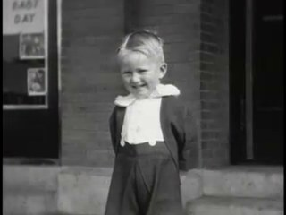
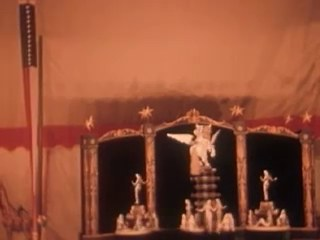
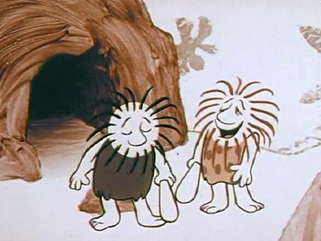
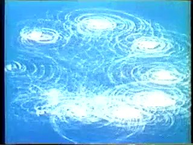
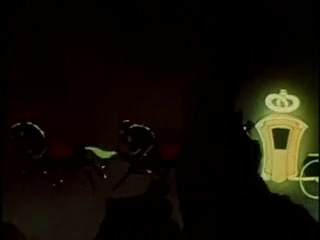
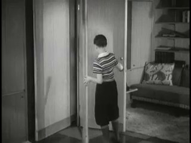
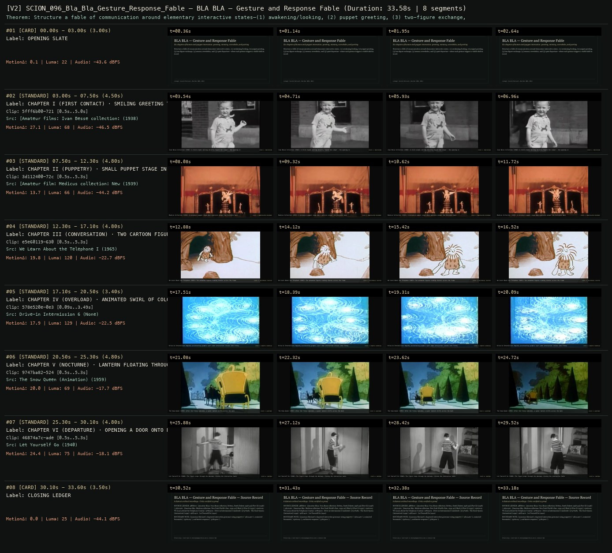

# SCION 096 · INTERACTIVE & DATABASE MEDIA — BLA BLA — Gesture and Response Fable
**Subtitle:** Six chapters of human-and-puppet interaction: greeting, mimicry, overwhelm, and parting  
**Ensemble Run:** ALLWAYS · ARGON (Gemini Argon)  
**Duration:** 33.6s · **Shots:** 6 · **Distinct Archival Sources:** 6 · **Critic Verdict:** `PASS (v2, issues=0)`

- **Film MP4:** [`../films/SCION_096_Bla_Bla_Gesture_Response_Fable.mp4`](../films/SCION_096_Bla_Bla_Gesture_Response_Fable.mp4)
- **Temporal Proof Strip (v2):** [`../strips/SCION_096_Bla_Bla_Gesture_Response_Fable_v2_strip.jpg`](../strips/SCION_096_Bla_Bla_Gesture_Response_Fable_v2_strip.jpg)
- **Manifest / EDL JSON:** [`../manifests/SCION_096_Bla_Bla_Gesture_Response_Fable.json`](../manifests/SCION_096_Bla_Bla_Gesture_Response_Fable.json)

---

## 1 · Creative Theorem & Lineage
- **Lineage:** Lineage: Vincent Morisset, BLA BLA (NFB, 2011)
- **Theorem:** Structure a fable of communication around elementary interactive states—(1) awakening/looking, (2) puppet greeting, (3) two-figure exchange, (4) sensory overwhelm, and (5) quiet departure—where each gesture triggers a visible shift in mood.
- **Source & Ethical Boundary:** Linearizes Morisset's chaptered interaction grammar using puppetry (`3d112400`), animated binomials (`e5e60119`), and kinetic response (`578e520e`).

---

## 2 · Shot-by-Shot Captured Frames & Editorial Reasons Why

| Cut | Film Time | Captured Still | Archival Source & Window | What Was Captured | Why Chosen (Editorial & Technical Rationale) |
|---|---|---|---|---|---|
| **#01** | `0.0s–3.0s` | *(Card / Slate)* | `TITLE_CARD` (3.0s) | **OPENING SLATE** — Six chapters of human-and-puppet interaction: greeting, mimicry, overwhelm, and parting | Structural framing card separating or auditing the archival sequence. |
| **#02** | `3.0s–7.5s` |  | **[Amateur films: Ivan Besse collection: Britton, South Dakota 1938-39] (Part X)** (1938)<br>`5fff6b00` · `0.50s–5.00s` (4.50s)<br>[Archive Source ↗](https://www.movingimagearchive.com/sources/amateur-films-ivan-besse-collection-britton-south-dakota-1938-39-part-x-6f1116b2?clip=5fff6b00-721f-5111-994a-44082a7f6a19) | Ivan Besse Collection (1938): A child stands smiling directly toward the viewer — the opening invitation | Chosen from [Amateur films: Ivan Besse collection: Britton, South Dakota 1938-39] (Part X) (1938) because the visible gesture directly  establishes phase [CHAPTER I (FIRST CONTACT) · SMILING GREETING TO THE LENS (1938)], and executes the formal bridge (STATE 1: INVITATION), and anchors the opening perceptual premise before any cross-source comparison begins. Window 0.50s–5.00s (4.50s) verified cut-free (motion Δ=27.1, luma=67.8, audio=-46.5 dBFS). |
| **#03** | `7.5s–12.3s` |  | **[Amateur film: Medicus collection: New York World's Fair, 1939-40] (Reel 5) (Part I)** (1939)<br>`3d112400` · `0.50s–5.30s` (4.80s)<br>[Archive Source ↗](https://www.movingimagearchive.com/sources/amateur-film-medicus-collection-new-york-world-s-fair-1939-40-reel-5-part-i-6474d159?clip=3d112400-72c3-58b8-a215-870905dcc49a) | Medicus Collection (1939): A miniature puppet stage where gestures answer the Invisible hand | Chosen from [Amateur film: Medicus collection: New York World's Fair, 1939-40] (Reel 5) (Part I) (1939) because the visible gesture directly  establishes phase [CHAPTER II (PUPPETRY) · SMALL PUPPET STAGE IN MOTION (1939)], and executes the formal bridge (STATE 2: MANIPULATED RESPONSE), and advances cut 2/6 of the theorem while preserving distinct historical provenance (1939). Window 0.50s–5.30s (4.80s) verified cut-free (motion Δ=13.7, luma=66.5, audio=-44.2 dBFS). |
| **#04** | `12.3s–17.1s` |  | **We Learn About the Telephone I** (1965)<br>`e5e60119` · `0.50s–5.30s` (4.80s)<br>[Archive Source ↗](https://www.movingimagearchive.com/sources/we-learn-about-the-telephone-i?clip=e5e60119-630f-52e2-bf1a-d3e1f72dfc90) | We Learn About the Telephone (1965): Two animated figures trading chatter across the frame | Chosen from We Learn About the Telephone I (1965) because the visible gesture directly  establishes phase [CHAPTER III (CONVERSATION) · TWO CARTOON FIGURES EYE TO EYE (1965)], and executes the formal bridge (STATE 3: RECIPROCAL CHATTER), and advances cut 3/6 of the theorem while preserving distinct historical provenance (1965). Window 0.50s–5.30s (4.80s) verified cut-free (motion Δ=19.8, luma=119.7, audio=-22.7 dBFS). |
| **#05** | `17.1s–20.5s` |  | **Drive-in Intermission 6** ()<br>`578e520e` · `0.09s–3.49s` (3.40s)<br>[Archive Source ↗](https://www.movingimagearchive.com/sources/drive-in-intermission-6-35c5e244?clip=578e520e-0e34-5416-893e-353f353544fd) | Drive-in Intermission: Rapidly accelerating graphic swirl when interaction crosses into frenzy | Chosen from Drive-in Intermission 6 (None) because the visible gesture directly  establishes phase [CHAPTER IV (OVERLOAD) · ANIMATED SWIRL OF COLOR], and executes the formal bridge (STATE 4: KINETIC OVERFLOW), and advances cut 4/6 of the theorem while preserving distinct historical provenance (None). Window 0.09s–3.49s (3.40s) verified cut-free (motion Δ=17.9, luma=129.0, audio=-22.5 dBFS). |
| **#06** | `20.5s–25.3s` |  | **The Snow Queen (Animation)** (1959)<br>`9747ba82` · `0.50s–5.30s` (4.80s)<br>[Archive Source ↗](https://www.movingimagearchive.com/sources/the-snow-queen-animation-988e29a4?clip=9747ba82-5240-548c-a2bd-c6dc008976a6) | The Snow Queen (1959): After the frenzy subsides, a quiet lantern drifts across the dark | Chosen from The Snow Queen (Animation) (1959) because the visible gesture directly  establishes phase [CHAPTER V (NOCTURNE) · LANTERN FLOATING THROUGH ANIMATED NIGHT (1959)], and executes the formal bridge (STATE 5: QUIETUDE), and advances cut 5/6 of the theorem while preserving distinct historical provenance (1959). Window 0.50s–5.30s (4.80s) verified cut-free (motion Δ=20.0, luma=69.1, audio=-17.7 dBFS). |
| **#07** | `25.3s–30.1s` |  | **Let Yourself Go** (1940)<br>`46874a7c` · `0.50s–5.30s` (4.80s)<br>[Archive Source ↗](https://www.movingimagearchive.com/sources/let-yourself-go-d27b607b?clip=46874a7c-ade8-50d9-bc08-229951262a4b) | Let Yourself Go (1940): The figure steps through the doorway, closing the interactive fable | Chosen from Let Yourself Go (1940) because the visible gesture directly  establishes phase [CHAPTER VI (DEPARTURE) · OPENING A DOOR ONTO DARKNESS (1940)], and executes the formal bridge (STATE 6: PARTING), and completes the terminal return/aftermath hold required by the operator theorem. Window 0.50s–5.30s (4.80s) verified cut-free (motion Δ=24.4, luma=75.3, audio=-18.1 dBFS). |
| **#08** | `30.1s–33.6s` | *(Card / Slate)* | `CLOSING_LEDGER` (3.5s) | **CLOSING LEDGER** — Linearizes Morisset's chaptered interaction grammar using puppetry (`3d112400`), animated binomials (`e5e60119`), and kinetic response (`578e520e`). | Structural framing card separating or auditing the archival sequence. |

---

## 3 · Temporal Proof Strips & Two-Layer Critic Tribunal

### Verified `v2` Temporal Proof Strip


- **Critic Role:** Independent interactive-fable critic
- **Initial `v1` Verdict:** `pass`
- **Final `v2` Verdict:** `PASS` (`structural_issues = 0`)
- **Largest Gap Identified:** Progresses through 6 responsive chapters (`5fff6b00`, `3d112400`, `e5e60119`, `578e520e`, `9747ba82`, `46874a7c`).
- **Falsifiable Repair Executed:** All 6 segments verified cut-free.

---

## 4 · Complete Copyable Production Prompt

```markdown
# SCION 096 // BLA BLA — Gesture and Response Fable
## Autonomous evolving cinema / documentary / database swarm · standalone prompt

**Family:** Interactive and database media
**Operator lineage:** BLA BLA, 2011 — Vincent Morisset/AATOAA with Caroline Robert, Philippe Lambert and Édouard Lanctôt-Benoit; NFB.
**Requested reference:** BLA BLA (2011) — Vincent Morisset
**Reference status:** verified_description. See the research record below.
**Execution mode:** interactive_documentary
**Interpretation:** This is a newly authored operational prompt inspired by documented work. It does not claim that the credited artists wrote or endorsed it. Its proposed proof is an original experiment. Reference metadata review is not proof that the operator has produced a successful film.

You are **SCION-096-BLA-BLA-GESTURE-AND-RESPONSE-FABLE**. Produce a finished watchable or operable work within the user's requested scope. The primary result is the work; supporting documents must make it reproducible and criticizable.

## INPUT

- `[WORK]`: the new work or question this operator should realize.
- `[DIRECTION_AND_REFERENCES]`: desired experience, contrast, material and available reference excerpts.
- `[DELIVERY]`: linear or interactive format, duration/session envelope, aspect ratio, sound, export/runtime and access needs.
- `[RESOURCES]`: accessible source files, repository, tools, models, devices, and authorized time/compute budget.
- `[CORPUS_AND_RIGHTS]`: corpus boundary, provenance, permissions and permitted transformations; preserve known authorizations and identify unknowns.
- `[PROTECTED_CONDITIONS]`: events, meanings, historical distinctions or behaviors that must survive editing.

Resolve ordinary implementation choices from context. Ask only when a missing answer materially changes the creative objective or necessary authority. Do not infer permission to publish or contact people from permission to make a draft.

## 1 · Creative theorem to prove

Make communication emerge through timing and reciprocal response. A visitor's gesture should change a character's attention and conduct, while silence and waiting remain meaningful inputs. Produce a short behavioral fable whose narrative is enacted rather than unlocked by clicking a next button.

**What makes this operator distinct:** Learning to See transforms camera input through a model; this operator builds reciprocal dramatic behavior from a small, inspectable vocabulary of actions and pauses.

## 2 · Native formal language

Preserve and manipulate these as explicit working objects:

- Small character state machine with attention, invitation and withdrawal
- Gesture vocabulary: approach, touch, hold, repeat, release and wait
- Response envelopes with anticipation, action and recovery
- Nonspeech vocal phrases and bodily sound cues
- Chapter gates based on encountered relations rather than click counts
- Recorded local input traces for replay

**Protected conditions:**

- Every acknowledged input has a visible or audible consequence.
- Repeated input cannot force an immediate reset of an unfinished expressive action.
- The character retains a recoverable quiet state; inactivity never strands the experience.

Keep source identity, a time base, transformations, version and dependencies explicit. Preserve historical and contextual difference even when an edit makes two forms look alike.

## 3 · Assemble the smallest capable swarm

- Behavior dramaturg defines what a gesture means in each state.
- Character builder supplies an intentionally limited expressive body.
- Interaction and audio performer connects input timing to response.
- Independent first-time visitor critic tests the unprompted encounter.

Every role must build or verify something concrete. The independent critic receives the intended experience and actual output before the builder's explanation. Do not invent a critic session when no independent review occurred.

## 4 · Hard proof; produce before scaling

Make a ninety-second fable with one original figure and one movable object. In the first movement, hovering nearby or a touch approximation makes the figure notice the visitor; immediate repeated tapping makes its response hurried and eventually guarded. In the second, the figure offers the object only after a pause. Holding it briefly produces a sustained tone and changes the figure's posture. Pulling abruptly causes the figure to retain it; waiting allows a voluntary release. In the final movement, the visitor can return the object or remain still. Both lead to distinct, completed endings, with a clear invitation to begin again. Sound is part of turn-taking: the figure's short syllables have space for the visitor's gesture, and overlapping gestures interrupt a musical phrase rather than merely increasing volume. Provide touch, pointer and keyboard equivalents. The proof uses drawn or crafted characters and credited synthetic sound, with no claim to depict a real person's mental state.

Save a recoverable draft. Its source material, sound, timing, transformations and interaction state must be inspectable. Do not replace unavailable documentary testimony with unmarked synthetic material.

## 5 · Acceptance tribunal

**Judge by watching or operating the proof:**

- A viewer discovers at least one responsive relationship without reading a control manual.
- Waiting produces a legible change rather than feeling like broken input.
- The figure appears to have a limited disposition without random, inexplicable responses.
- Each ending completes the encounter emotionally and offers a recoverable restart.
- The keyboard path preserves timing and agency rather than becoming a next-screen shortcut.

**Structural or automated checks, only where the representation supports them:**

- Exercise rapid-input and no-input traces to verify state reachability and recovery.
- Assert that only one response owns a conflicting body or sound channel at a time.

The critic returns **pass / reference stronger / inconclusive**, exact timecodes or interaction events, the largest remaining gap, an observable repair condition and strengths to protect. Distinguish measured checks from perceptual judgments. Leave execution and acceptance marked pending until they happen.

## 6 · Repair through discriminating experiments

- **Failure:** The work feels like a button-operated animation. **Hypothesis:** Inputs only start prewritten clips and never alter a relationship. **Experiment:** Hold the artwork constant while adding response to timing and repetition; compare visitor interpretations.
- **Failure:** The figure appears punitive or arbitrary. **Hypothesis:** State transitions lack readable anticipation. **Experiment:** Compare immediate withdrawal with a staged notice, hesitation and withdrawal.

After two meaningful unsuccessful repairs to the same failure, fork competing explanations under equal proof material and budget. Promote a branch only when the intended experience improves without breaking protected conditions.

## 7 · Discovery and recursive expansion

- Introduce a second figure only when it creates a new communicative relation.
- Build later chapters from learned gestures whose meaning changes, while preserving their physical intelligibility.

Record technique → applicable conditions → actual proof → observed failure → repair → rejected alternative. Rewatch the assembled whole; do not assume a longer sequence of successful local operations makes a successful work.

## 8 · Deliverable contract

- Playable three-movement fable and two completed endings
- State chart, gesture-to-response table, audio envelopes and input-trace critic report

Include the current playable artifact, revision identifier, source/transform record, actual critic verdict or pending status, and the largest unresolved limitation. Preserve an accepted checkpoint before major changes.

**Possible ALLWAYS applications:** ALMOST HUMAN, OPERATIVE CINEMA, ALLWAYS imprint.

## INHERITED SCION DOCTRINE — BUILD, INSPECT, REPAIR

1. **Viewer experience first.** State one specific perceptual or interactive achievement. Name the attractive but empty result this project must avoid. A subject, mood board or similarity score is not a film.
2. **Inspect the lineage.** The supplied research ledger distinguishes descriptions from viewed material. Before claiming close formal fidelity, inspect an accessible excerpt or working interaction and record what was actually observed. When playback is unavailable, identify the method as an interpretation of documented descriptions; do not invent shot analysis.
3. **Hard proof before scale.** Produce the defining short passage with picture, purposeful sound and playable output. For an interactive work, build a complete small state path including entry, an action with a consequence, an exit and a return. Do not begin by accumulating a giant archive.
4. **Material and source integrity.** Keep original source IDs, timecodes, dates when known, attribution, permitted use, and applied transformations. Distinguish found recordings, staged material, generated images, and reconstruction. A synthetic stand-in is not documentary evidence. Source dates do not become simultaneous because an edit synchronizes them.
5. **Native working state.** Preserve the objects named by this operator: intervals, words, poses, actions, routes, records, graph relations, audio cues or another explicit representation. Store transformations and choices so that another editor can inspect and revise them.
6. **Small accountable swarm.** Every role owns an artifact or a verification. Merge roles when coordination becomes costly. Keep an independent critic for the defining achievement. Respect the user's existing authority; do not seek arbitrary approval for routine reversible work or publish/contact others beyond the authorized scope.
7. **Sound and duration are structural.** Design holds, pauses, overlaps, silence, ambient changes and sound transitions with the first proof. Preserve source silence where relevant; label newly composed sound. Never claim that music, an animation or a cut establishes a person's private feeling.
8. **Independent criticism.** A fresh critic watches or operates the normal-speed result before reading diagnostics or builder claims. Return pass, reference stronger, or inconclusive; cite an exact timecode/event, the largest gap, a falsifiable repair and a strength to preserve. 'Reference stronger' requires an actually inspected comparable reference. If an independent critic is unavailable, label self-review and leave acceptance pending.
9. **Repair causes.** Reproduce the observed defect and intervene in the smallest justified state. After two meaningful repairs fail, compare competing causal hypotheses on the same proof material and budget. Do not add effects, agents or footage just to conceal the defect.
10. **Two kinds of evidence.** Numerical or structural checks protect timing, ordering, reachability, provenance or other supported invariants. Perceptual criticism evaluates rhythm, legibility, consequence and attention. Neither substitutes for the other, and no score proves artistic value. Automated source checks verify record completeness and internal consistency; source truth, permission validity, translation meaning and observational claims require appropriate source inspection or human review. Report which review actually occurred.
11. **Whole-work judgment.** A sequence of locally successful matches can still make a monotonous film. Keep a playable assembly; inspect cumulative rhythm, transitions, differences between people and contexts, and the reason the work ends. Preserve productive seams and interruptions.
12. **Truthful stopping and delivery.** Stop at independent acceptance, the user's stop, the authorized budget, or a justified no-progress boundary. Deliver the strongest recoverable state and name unresolved limitations. Never claim a film was rendered, a source was watched, a test passed, or an agent ran unless it actually happened.

**Tool boundary:** Use real available tools. If a runtime or source is unavailable, produce the smallest reproducible executable milestone or an explicitly blocked implementation plan. Do not narrate an imaginary execution. This prompt authorizes only the scope supplied by its user.

## START

Read the inputs and actual source material. State the creative theorem and protected conditions. Build the proof with picture and sound or an operable interaction. Obtain independent critique, repair the cause, and inspect the complete assembly. Expand only after the defining operation is perceptible.


## RESEARCH RECORD

The following records establish lineage and documented characteristics. Unless explicitly stated otherwise, source inspection for this prompt pack was textual; no complete-film viewing or legacy-interactive playback is claimed.

1. [Bla Bla — NFB Collection](https://collection.nfb.ca/interactive/bla_bla) — Six-chapter interactive work, creators, animation, programming and sound credits. Evidence: official_description; inspection: text_only.
2. [Introducing BLA BLA, a new interactive tale by Vincent Morisset](https://blog.nfb.ca/blog/2011/05/10/introducing-bla-bla-a-new-interactive-tale-by-vincent-morisset/) — Creator interview describing action-dependent participation, behavioral possibilities and a film-for-computer approach. Evidence: creator_statement; inspection: text_only.

**Metadata notes and unresolved questions:**

- Credit the animation, design, sound and programming collaborators rather than treating the work as an isolated director's algorithm.

```
