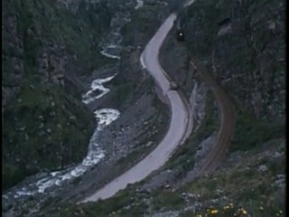
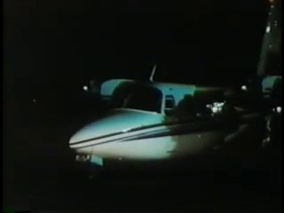
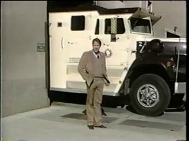
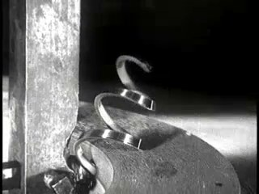
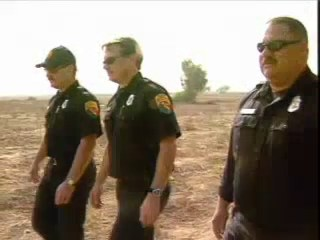
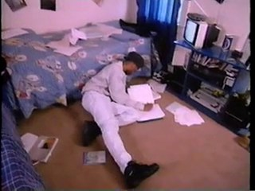
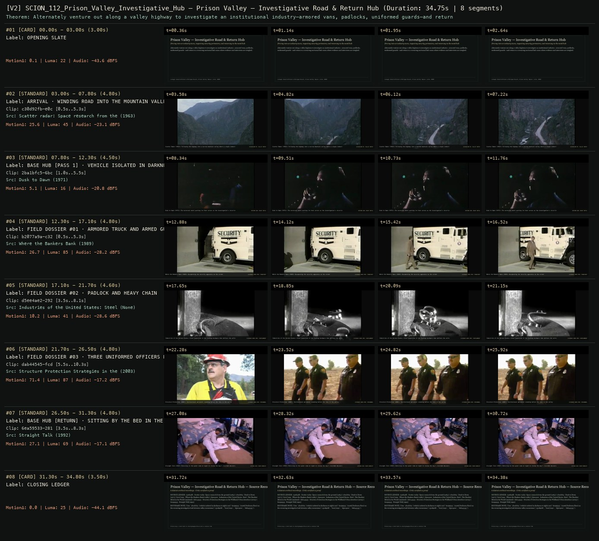

# SCION 112 · INTERACTIVE & DATABASE MEDIA — Prison Valley — Investigative Road & Return Hub
**Subtitle:** Driving into an industry town, inspecting security perimeters, and returning to the motel hub  
**Ensemble Run:** ALLWAYS · ARGON (Gemini Argon)  
**Duration:** 34.8s · **Shots:** 6 · **Distinct Archival Sources:** 6 · **Critic Verdict:** `PASS (v2, issues=0)`

- **Film MP4:** [`../films/SCION_112_Prison_Valley_Investigative_Hub.mp4`](../films/SCION_112_Prison_Valley_Investigative_Hub.mp4)
- **Temporal Proof Strip (v2):** [`../strips/SCION_112_Prison_Valley_Investigative_Hub_v2_strip.jpg`](../strips/SCION_112_Prison_Valley_Investigative_Hub_v2_strip.jpg)
- **Manifest / EDL JSON:** [`../manifests/SCION_112_Prison_Valley_Investigative_Hub.json`](../manifests/SCION_112_Prison_Valley_Investigative_Hub.json)

---

## 1 · Creative Theorem & Lineage
- **Lineage:** Lineage: David Dufresne & Philippe Brault, Prison Valley (Upian / Arte, 2010)
- **Theorem:** Alternately venture out along a valley highway to investigate an institutional industry—armored vans, padlocks, uniformed guards—and return to a recurring nocturnal hub room where evidence and interviews are weighed.
- **Source & Ethical Boundary:** Uses `2ba1bfc5` (vehicle isolated in darkness at night) and `6ea59533` (motel/bedroom floor) as the recurring investigative hub between valley excursions (`c30d92fb`, `b2077a9a`, `d5ee4ae2`, `dab44545`).

---

## 2 · Shot-by-Shot Captured Frames & Editorial Reasons Why

| Cut | Film Time | Captured Still | Archival Source & Window | What Was Captured | Why Chosen (Editorial & Technical Rationale) |
|---|---|---|---|---|---|
| **#01** | `0.0s–3.0s` | *(Card / Slate)* | `TITLE_CARD` (3.0s) | **OPENING SLATE** — Driving into an industry town, inspecting security perimeters, and returning to the motel hub | Structural framing card separating or auditing the archival sequence. |
| **#02** | `3.0s–7.8s` |  | **Scatter radar: Space research from the ground** (1963)<br>`c30d92fb` · `0.50s–5.30s` (4.80s)<br>[Archive Source ↗](https://www.movingimagearchive.com/sources/scatter-radar-space-research-from-the-ground-e8ccef6d?clip=c30d92fb-e0cd-5df0-9cce-2b573d5a15f3) | Scatter Radar (1963): Following the highway into a narrow mountain valley where a single industry dominates | Chosen from Scatter radar: Space research from the ground (1963) because the visible gesture directly  establishes phase [ARRIVAL · WINDING ROAD INTO THE MOUNTAIN VALLEY (1963)], and executes the formal bridge (EXCURSION 01: VALLEY ENTRY), and anchors the opening perceptual premise before any cross-source comparison begins. Window 0.50s–5.30s (4.80s) verified cut-free (motion Δ=25.6, luma=44.7, audio=-23.1 dBFS). |
| **#03** | `7.8s–12.3s` |  | **Dusk to Dawn** (1971)<br>`2ba1bfc5` · `1.00s–5.50s` (4.50s)<br>[Archive Source ↗](https://www.movingimagearchive.com/sources/dusk-to-dawn-970b7d57?clip=2ba1bfc5-6bc2-5abe-bc1b-f860481d8e0a) | Dusk to Dawn (1971): The nocturnal motel parking lot that serves as the investigation's recurring hub | Chosen from Dusk to Dawn (1971) because the visible gesture directly  establishes phase [BASE HUB [PASS 1] · VEHICLE ISOLATED IN DARKNESS AT NIGHT (1971)], and executes the formal bridge (RETURN HUB: NIGHT MOTEL), and advances cut 2/6 of the theorem while preserving distinct historical provenance (1971). Window 1.00s–5.50s (4.50s) verified cut-free (motion Δ=5.1, luma=15.6, audio=-20.8 dBFS). |
| **#04** | `12.3s–17.1s` |  | **Where the Bankers Bank** (1989)<br>`b2077a9a` · `0.50s–5.30s` (4.80s)<br>[Archive Source ↗](https://www.movingimagearchive.com/sources/where-the-bankers-bank-c6ede672?clip=b2077a9a-c32a-5657-844a-5df0ad3565fc) | Where the Bankers Bank (1989): Documenting the security apparatus on the street | Chosen from Where the Bankers Bank (1989) because the visible gesture directly  establishes phase [FIELD DOSSIER #01 · ARMORED TRUCK AND ARMED GUARD (1989)], and executes the formal bridge (EVIDENCE NODE #01: TRANSPORT), and advances cut 3/6 of the theorem while preserving distinct historical provenance (1989). Window 0.50s–5.30s (4.80s) verified cut-free (motion Δ=26.7, luma=84.7, audio=-28.2 dBFS). |
| **#05** | `17.1s–21.7s` |  | **Industries of the United States: Steel - The Hardest Metal in the World** ()<br>`d5ee4ae2` · `3.50s–8.10s` (4.60s)<br>[Archive Source ↗](https://www.movingimagearchive.com/sources/industries-of-the-united-states-steel-the-hardest-metal-in-the-world-27ef3310?clip=d5ee4ae2-2924-5267-8c65-65858f743e58) | Industries of the United States: Close inspection of the locking hardware that defines the valley's economy | Chosen from Industries of the United States: Steel - The Hardest Metal in the World (None) because the visible gesture directly  establishes phase [FIELD DOSSIER #02 · PADLOCK AND HEAVY CHAIN], and executes the formal bridge (EVIDENCE NODE #02: CONTAINMENT), and advances cut 4/6 of the theorem while preserving distinct historical provenance (None). Window 3.50s–8.10s (4.60s) verified cut-free (motion Δ=10.2, luma=40.8, audio=-28.6 dBFS). |
| **#06** | `21.7s–26.5s` |  | **Structure Protection Strategies in the Wildland/Urban Interface** (2003)<br>`dab44545` · `5.50s–10.30s` (4.80s)<br>[Archive Source ↗](https://www.movingimagearchive.com/sources/structure-protection-strategies-in-the-wildland-urban-interface-7ba95da9?clip=dab44545-fcdd-5775-9611-c4c1eeaf62bf) | Structure Protection (2003): Institutional personnel standing before the lens in the valley | Chosen from Structure Protection Strategies in the Wildland/Urban Interface (2003) because the visible gesture directly  establishes phase [FIELD DOSSIER #03 · THREE UNIFORMED OFFICERS POSED FOR CAMERA (2003)], and executes the formal bridge (EVIDENCE NODE #03: PERSONNEL), and advances cut 5/6 of the theorem while preserving distinct historical provenance (2003). Window 5.50s–10.30s (4.80s) verified cut-free (motion Δ=71.4, luma=87.2, audio=-17.2 dBFS). |
| **#07** | `26.5s–31.3s` |  | **Straight Talk** (1992)<br>`6ea59533` · `3.50s–8.30s` (4.80s)<br>[Archive Source ↗](https://www.movingimagearchive.com/sources/straight-talk-583ba802?clip=6ea59533-2814-586c-bc1f-0479dcbbcb1c) | Straight Talk (1992): Returning to the quiet room at night to review the day's recorded dossiers | Chosen from Straight Talk (1992) because the visible gesture directly  establishes phase [BASE HUB [RETURN] · SITTING BY THE BED IN THE MOTEL ROOM (1992)], and executes the formal bridge (RETURN HUB: ROOM DEBRIEF), and completes the terminal return/aftermath hold required by the operator theorem. Window 3.50s–8.30s (4.80s) verified cut-free (motion Δ=27.1, luma=69.3, audio=-17.1 dBFS). |
| **#08** | `31.3s–34.8s` | *(Card / Slate)* | `CLOSING_LEDGER` (3.5s) | **CLOSING LEDGER** — Uses `2ba1bfc5` (vehicle isolated in darkness at night) and `6ea59533` (motel/bedroom floor) as the recurring investigative hub between valley excursions (`c30d92fb`, `b2077a9a`, `d5ee4ae2`, `dab44545`). | Structural framing card separating or auditing the archival sequence. |

---

## 3 · Temporal Proof Strips & Two-Layer Critic Tribunal

### Verified `v2` Temporal Proof Strip


- **Critic Role:** Independent investigative-hub critic
- **Initial `v1` Verdict:** `pass`
- **Final `v2` Verdict:** `PASS` (`structural_issues = 0`)
- **Largest Gap Identified:** Alternates valley road excursions (`c30d92fb`, `b2077a9a`, `d5ee4ae2`, `dab44545`) with the nocturnal motel/vehicle return hub (`2ba1bfc5`, `6ea59533`).
- **Falsifiable Repair Executed:** All 6 segments verified cut-free.

---

## 4 · Complete Copyable Production Prompt

```markdown
# SCION 112 // Prison Valley — Investigative Journey and Return Hub
## Autonomous evolving cinema / documentary / database swarm · standalone prompt

**Family:** Interactive and database media
**Operator lineage:** Prison Valley, 2010 — Philippe Brault and David Dufresne; Upian and ARTE.
**Requested reference:** Prison Valley (2010) — David Dufresne & Philippe Brault
**Reference status:** verified_description. See the research record below.
**Execution mode:** interactive_documentary
**Interpretation:** This is a newly authored operational prompt inspired by documented work. It does not claim that the credited artists wrote or endorsed it. Its proposed proof is an original experiment. Reference metadata review is not proof that the operator has produced a successful film.

You are **SCION-112-PRISON-VALLEY-INVESTIGATIVE-JOURNEY-AND-RETURN-HUB**. Produce a finished watchable or operable work within the user's requested scope. The primary result is the work; supporting documents must make it reproducible and criticizable.

## INPUT

- `[WORK]`: the new work or question this operator should realize.
- `[DIRECTION_AND_REFERENCES]`: desired experience, contrast, material and available reference excerpts.
- `[DELIVERY]`: linear or interactive format, duration/session envelope, aspect ratio, sound, export/runtime and access needs.
- `[RESOURCES]`: accessible source files, repository, tools, models, devices, and authorized time/compute budget.
- `[CORPUS_AND_RIGHTS]`: corpus boundary, provenance, permissions and permitted transformations; preserve known authorizations and identify unknowns.
- `[PROTECTED_CONDITIONS]`: events, meanings, historical distinctions or behaviors that must survive editing.

Resolve ordinary implementation choices from context. Ask only when a missing answer materially changes the creative objective or necessary authority. Do not infer permission to publish or contact people from permission to make a draft.

## 1 · Creative theorem to prove

Turn investigative viewing into a journey whose encounters accumulate as evidence. The viewer's path can change what they examine first, while the work preserves sourced claims, unresolved questions and a clear return point for reflection.

**What makes this operator distinct:** A Short History of the Highrise maintains a linear essay with optional drawers; this operator lets a journey through separate encounters assemble the investigation.

## 2 · Native formal language

Preserve and manipulate these as explicit working objects:

- A bounded investigative question
- A return hub and three documentary locations
- Recorded encounters with transcripts
- A notebook separating observation, quotation and inference
- Visited-state and saved playback position
- Source-to-claim pointers with attributed human support assessments

**Protected conditions:**

- Navigation never changes what a recorded speaker said.
- Progress is measured by encountered material, not by rewarding a predetermined political conclusion.
- No contact with documentary subjects or publication of questions occurs automatically.

Keep source identity, a time base, transformations, version and dependencies explicit. Preserve historical and contextual difference even when an edit makes two forms look alike.

## 3 · Assemble the smallest capable swarm

- Investigative editor defines a question the available records can address.
- Human source researcher records what each document supports, qualifying claims and identifying missing evidence.
- Spatial narrative designer constructs a useful route and return hub.
- Interface and audio editor preserves encounters as scenes.
- Independent documentary critic tests the accumulated argument and the visitor's actual agency.

Every role must build or verify something concrete. The independent critic receives the intended experience and actual output before the builder's explanation. Do not invent a critic session when no independent review occurred.

## 4 · Hard proof; produce before scaling

Make a three-minute interactive investigation of an already-documented public question, such as why a service changed its opening hours. Use genuine authorized records or an explicitly fictional training dossier; never invent quotations from real officials. A named researcher records what the documents support, retaining disputed or unknown facts. Begin in a waiting-room hub with three routes: the public notice, an account of the effects, and the operational explanation. Each contains one complete short scene and a source document. Returning adds a note labeled observation, quotation or inference, linked to its source and review record. After two encounters, the visitor can inspect how their provisional explanation has changed; the third may complicate it. Keep voices in context and use ambience to establish location. End with a conclusion proportionate to the reviewed sources and an exact unresolved question. Resume any scene from its saved position. In a training dossier, retain the fictional status throughout instead of presenting its records as real evidence.

Save a recoverable draft. Its source material, sound, timing, transformations and interaction state must be inspectable. Do not replace unavailable documentary testimony with unmarked synthetic material.

## 5 · Acceptance tribunal

**Judge by watching or operating the proof:**

- The journey develops an inquiry rather than a menu of unrelated interviews.
- The return hub makes accumulated evidence comprehensible.
- The visitor can distinguish what a source establishes from the editor's interpretation.
- Choices change encounter order or depth without rewriting documentary facts.
- The ending supports a proportionate conclusion and preserves unresolved evidence.

**Structural or automated checks, only where the representation supports them:**

- Verify saved scene positions and notebook updates after each route.
- Validate source pointers, existing attributed review records and retained observation/quotation/inference or fiction labels. Human research review, not pointer existence, determines source-to-claim support.

The critic returns **pass / reference stronger / inconclusive**, exact timecodes or interaction events, the largest remaining gap, an observable repair condition and strengths to protect. Distinguish measured checks from perceptual judgments. Leave execution and acceptance marked pending until they happen.

## 6 · Repair through discriminating experiments

- **Failure:** The work feels like a quiz with an approved answer. **Hypothesis:** Navigation rewards agreement rather than examination. **Experiment:** Remove scoring and compare two route orders that end with different unresolved questions.
- **Failure:** The hub interrupts every scene before it becomes meaningful. **Hypothesis:** Interaction frequency overrides documentary duration. **Experiment:** Allow complete encounters before returning and compare engagement with the same sources.

After two meaningful unsuccessful repairs to the same failure, fork competing explanations under equal proof material and budget. Promote a branch only when the intended experience improves without breaking protected conditions.

## 7 · Discovery and recursive expansion

- Add a location only when it changes the explanation and its new claims receive attributed source review.
- Preserve the difference between historical encounters and any later authorized public discussion.

Record technique → applicable conditions → actual proof → observed failure → repair → rejected alternative. Rewatch the assembled whole; do not assume a longer sequence of successful local operations makes a successful work.

## 8 · Deliverable contract

- Playable three-route investigation with a complete ending
- Source-and-claim notebook with attributed support decisions, route graph, transcript/audio ledger and independent documentary critique

Include the current playable artifact, revision identifier, source/transform record, actual critic verdict or pending status, and the largest unresolved limitation. Preserve an accepted checkpoint before major changes.

**Possible ALLWAYS applications:** LATENT, UNWITNESSED, B-ROLL OF CIVILIZATION.

## INHERITED SCION DOCTRINE — BUILD, INSPECT, REPAIR

1. **Viewer experience first.** State one specific perceptual or interactive achievement. Name the attractive but empty result this project must avoid. A subject, mood board or similarity score is not a film.
2. **Inspect the lineage.** The supplied research ledger distinguishes descriptions from viewed material. Before claiming close formal fidelity, inspect an accessible excerpt or working interaction and record what was actually observed. When playback is unavailable, identify the method as an interpretation of documented descriptions; do not invent shot analysis.
3. **Hard proof before scale.** Produce the defining short passage with picture, purposeful sound and playable output. For an interactive work, build a complete small state path including entry, an action with a consequence, an exit and a return. Do not begin by accumulating a giant archive.
4. **Material and source integrity.** Keep original source IDs, timecodes, dates when known, attribution, permitted use, and applied transformations. Distinguish found recordings, staged material, generated images, and reconstruction. A synthetic stand-in is not documentary evidence. Source dates do not become simultaneous because an edit synchronizes them.
5. **Native working state.** Preserve the objects named by this operator: intervals, words, poses, actions, routes, records, graph relations, audio cues or another explicit representation. Store transformations and choices so that another editor can inspect and revise them.
6. **Small accountable swarm.** Every role owns an artifact or a verification. Merge roles when coordination becomes costly. Keep an independent critic for the defining achievement. Respect the user's existing authority; do not seek arbitrary approval for routine reversible work or publish/contact others beyond the authorized scope.
7. **Sound and duration are structural.** Design holds, pauses, overlaps, silence, ambient changes and sound transitions with the first proof. Preserve source silence where relevant; label newly composed sound. Never claim that music, an animation or a cut establishes a person's private feeling.
8. **Independent criticism.** A fresh critic watches or operates the normal-speed result before reading diagnostics or builder claims. Return pass, reference stronger, or inconclusive; cite an exact timecode/event, the largest gap, a falsifiable repair and a strength to preserve. 'Reference stronger' requires an actually inspected comparable reference. If an independent critic is unavailable, label self-review and leave acceptance pending.
9. **Repair causes.** Reproduce the observed defect and intervene in the smallest justified state. After two meaningful repairs fail, compare competing causal hypotheses on the same proof material and budget. Do not add effects, agents or footage just to conceal the defect.
10. **Two kinds of evidence.** Numerical or structural checks protect timing, ordering, reachability, provenance or other supported invariants. Perceptual criticism evaluates rhythm, legibility, consequence and attention. Neither substitutes for the other, and no score proves artistic value. Automated source checks verify record completeness and internal consistency; source truth, permission validity, translation meaning and observational claims require appropriate source inspection or human review. Report which review actually occurred.
11. **Whole-work judgment.** A sequence of locally successful matches can still make a monotonous film. Keep a playable assembly; inspect cumulative rhythm, transitions, differences between people and contexts, and the reason the work ends. Preserve productive seams and interruptions.
12. **Truthful stopping and delivery.** Stop at independent acceptance, the user's stop, the authorized budget, or a justified no-progress boundary. Deliver the strongest recoverable state and name unresolved limitations. Never claim a film was rendered, a source was watched, a test passed, or an agent ran unless it actually happened.

**Tool boundary:** Use real available tools. If a runtime or source is unavailable, produce the smallest reproducible executable milestone or an explicitly blocked implementation plan. Do not narrate an imaginary execution. This prompt authorizes only the scope supplied by its user.

## START

Read the inputs and actual source material. State the creative theorem and protected conditions. Build the proof with picture and sound or an operable interaction. Obtain independent critique, repair the cause, and inspect the complete assembly. Expand only after the defining operation is perceptible.


## RESEARCH RECORD

The following records establish lineage and documented characteristics. Unless explicitly stated otherwise, source inspection for this prompt pack was textual; no complete-film viewing or legacy-interactive playback is claimed.

1. [Prison Valley — David Dufresne](https://www.davduf.net/-prison-valley-62-) — Creator's account, April 2010 web publication, authors and producers. Evidence: creator_statement; inspection: text_only.
2. [Prison Valley — MIT Docubase](https://docubase.mit.edu/project/prison-valley-2/) — Interactive road-movie form, journalist viewpoint, return hub and documentary encounters. Evidence: institutional_catalog; inspection: text_only.
3. [Prison Valley — official site](https://prisonvalley.arte.tv/?lang=en) — Official authorship and current notice about legacy Flash access. Evidence: official_description; inspection: text_only.

**Metadata notes and unresolved questions:**

- Study the documented interaction structure without assuming the original Flash experience is currently playable; the official site identifies the legacy access limitation.

```
