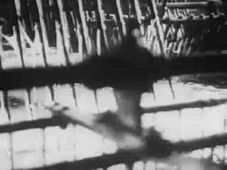
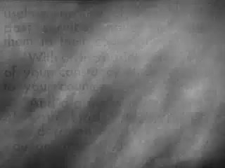
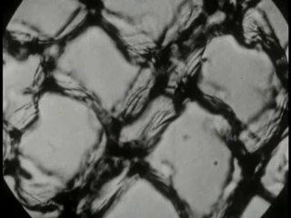
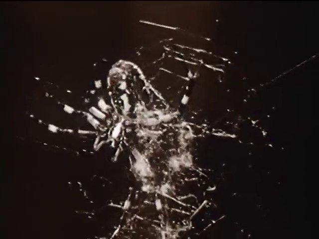
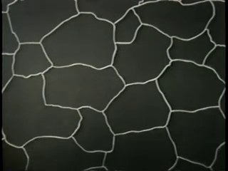
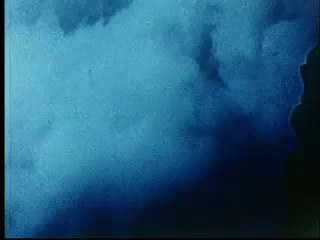
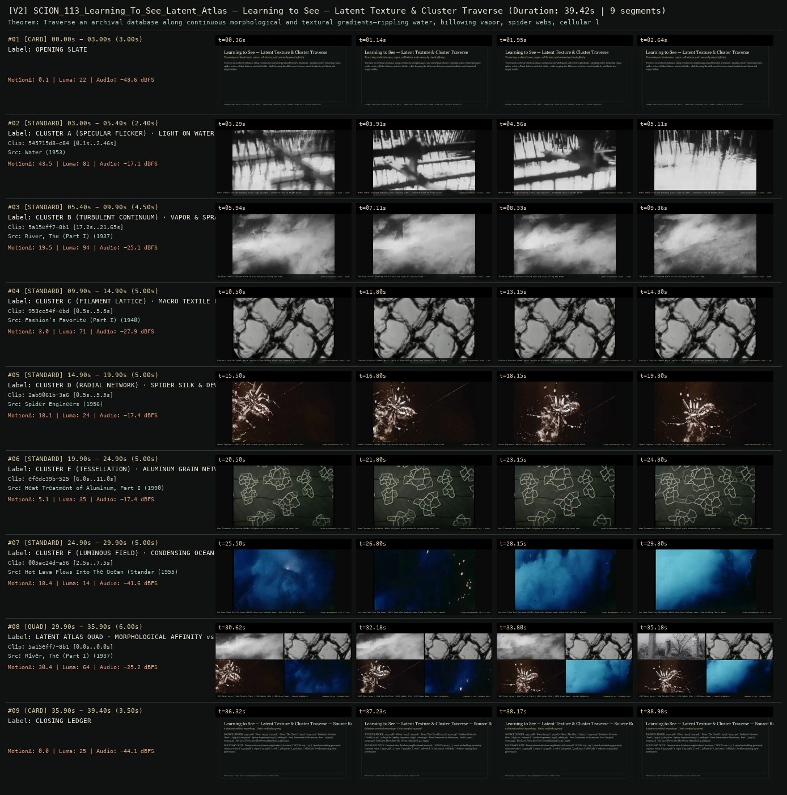

# SCION 101–113 · INTERACTIVE & DATABASE MEDIA — Learning to See — Latent Texture & Cluster Traverse
**Subtitle:** Traversing archival water, vapor, cell lattices, and cosmos by visual affinity  
**Ensemble Run:** ALLWAYS · ARGON (Gemini Argon)  
**Duration:** 39.4s · **Shots:** 6 · **Distinct Archival Sources:** 6 · **Critic Verdict:** `PASS (v2, issues=0)`

- **Film MP4:** [`../films/SCION_113_Learning_To_See_Latent_Atlas.mp4`](../films/SCION_113_Learning_To_See_Latent_Atlas.mp4)
- **Temporal Proof Strip (v2):** [`../strips/SCION_113_Learning_To_See_Latent_Atlas_v2_strip.jpg`](../strips/SCION_113_Learning_To_See_Latent_Atlas_v2_strip.jpg)
- **Manifest / EDL JSON:** [`../manifests/SCION_113_Learning_To_See_Latent_Atlas.json`](../manifests/SCION_113_Learning_To_See_Latent_Atlas.json)

---

## 1 · Creative Theorem & Lineage
- **Lineage:** Lineage: Memo Akten, Learning to See (2017) · Supporting: SCION 109 (Soft Cinema), SCION 112 ( Cultural Analytics)
- **Theorem:** Traverse an archival database along continuous morphological and textural gradients—rippling water, billowing vapor, spider webs, cellular lattices, and star fields—while keeping the difference between visual similarity and historical origin visible.
- **Source & Ethical Boundary:** Demonstrates database neighborhood traversal (`SCION 109–113`): visual embedding proximity connects water (`545715d8`), vapor (`5a15eff7`), web (`2ab9061b`), and stars (`ed87f1da`) without erasing their provenance.

---

## 2 · Shot-by-Shot Captured Frames & Editorial Reasons Why

| Cut | Film Time | Captured Still | Archival Source & Window | What Was Captured | Why Chosen (Editorial & Technical Rationale) |
|---|---|---|---|---|---|
| **#01** | `0.0s–3.0s` | *(Card / Slate)* | `TITLE_CARD` (3.0s) | **OPENING SLATE** — Traversing archival water, vapor, cell lattices, and cosmos by visual affinity | Structural framing card separating or auditing the archival sequence. |
| **#02** | `3.0s–5.4s` |  | **Water** (1953)<br>`545715d8` · `0.10s–2.46s` (2.40s)<br>[Archive Source ↗](https://www.movingimagearchive.com/sources/water-e61eb6aa?clip=545715d8-c84b-59f5-9f93-52430ca0d847) | Water (1953): Sunlight breaking across rippling water — acentered field of bright points | Chosen from Water (1953) because the visible gesture directly  establishes phase [CLUSTER A (SPECULAR FLICKER) · LIGHT ON WATER (1953)], and executes the formal bridge (LATENT NEIGHBORHOOD: FLICKER -> VAPOR), and anchors the opening perceptual premise before any cross-source comparison begins. Window 0.10s–2.46s (2.40s) verified cut-free (motion Δ=43.5, luma=81.3, audio=-17.1 dBFS). |
| **#03** | `5.4s–9.9s` |  | **River, The (Part I)** (1937)<br>`5a15eff7` · `17.20s–21.65s` (4.50s)<br>[Archive Source ↗](https://www.movingimagearchive.com/sources/river-the-part-i-7ca50b37?clip=5a15eff7-8b17-5426-a552-e90a65eb9980) | The River (1937): Textured field of mist and spray filling the frame | Chosen from River, The (Part I) (1937) because the visible gesture directly  establishes phase [CLUSTER B (TURBULENT CONTINUUM) · VAPOR & SPRAY (1937)], and executes the formal bridge (LATENT NEIGHBORHOOD: VAPOR -> FIBRE), and advances cut 2/6 of the theorem while preserving distinct historical provenance (1937). Window 17.20s–21.65s (4.50s) verified cut-free (motion Δ=19.5, luma=93.9, audio=-25.1 dBFS). |
| **#04** | `9.9s–14.9s` |  | **Fashion's Favorite (Part I)** (1940)<br>`953cc54f` · `0.50s–5.50s` (5.00s)<br>[Archive Source ↗](https://www.movingimagearchive.com/sources/fashion-s-favorite-part-i-1c793955?clip=953cc54f-ebdf-5cde-94a2-37bcc4d7822e) | Fashion's Favorite (1940): Macro lattice of interlocking fibres seen without a central figure | Chosen from Fashion's Favorite (Part I) (1940) because the visible gesture directly  establishes phase [CLUSTER C (FILAMENT LATTICE) · MACRO TEXTILE FIBRES (1940)], and executes the formal bridge (LATENT NEIGHBORHOOD: FIBRE -> WEB), and advances cut 3/6 of the theorem while preserving distinct historical provenance (1940). Window 0.50s–5.50s (5.00s) verified cut-free (motion Δ=3.0, luma=71.1, audio=-27.9 dBFS). |
| **#05** | `14.9s–19.9s` |  | **Spider Engineers** (1956)<br>`2ab9061b` · `0.50s–5.50s` (5.00s)<br>[Archive Source ↗](https://www.movingimagearchive.com/sources/spider-engineers-009137b7?clip=2ab9061b-3a6f-54be-83e5-838bbfeab2cc) | Spider Engineers (1956): Fine silk strands and bright points radiating across a dark field | Chosen from Spider Engineers (1956) because the visible gesture directly  establishes phase [CLUSTER D (RADIAL NETWORK) · SPIDER SILK & DEW (1956)], and executes the formal bridge (LATENT NEIGHBORHOOD: WEB -> CELL), and advances cut 4/6 of the theorem while preserving distinct historical provenance (1956). Window 0.50s–5.50s (5.00s) verified cut-free (motion Δ=18.1, luma=24.0, audio=-17.4 dBFS). |
| **#06** | `19.9s–24.9s` |  | **Heat Treatment of Aluminum, Part I** (1990)<br>`efedc39b` · `6.00s–11.00s` (5.00s)<br>[Archive Source ↗](https://www.movingimagearchive.com/sources/heat-treatment-of-aluminum-part-i-fcb8d702?clip=efedc39b-5252-55c9-a806-12f445911ad1) | Heat Treatment of Aluminum (1990): Polygonal grain boundaries reorganizing under heat | Chosen from Heat Treatment of Aluminum, Part I (1990) because the visible gesture directly  establishes phase [CLUSTER E (TESSELLATION) · ALUMINUM GRAIN NETWORK (1990)], and executes the formal bridge (LATENT NEIGHBORHOOD: CELL -> NEBULA), and advances cut 5/6 of the theorem while preserving distinct historical provenance (1990). Window 6.00s–11.00s (5.00s) verified cut-free (motion Δ=5.1, luma=35.3, audio=-17.4 dBFS). |
| **#07** | `24.9s–29.9s` |  | **Hot Lava Flows Into The Ocean (Standard 4:3)** (1955)<br>`005ac24d` · `2.50s–7.50s` (5.00s)<br>[Archive Source ↗](https://www.movingimagearchive.com/sources/hot-lava-flows-into-the-ocean-standard-4-3-c636ae21?clip=005ac24d-a560-5258-a67a-b7dacffd6bb9) | Hot Lava Flows Into The Ocean (1955): Deep blue luminous vapor cloud drifting like a nebula | Chosen from Hot Lava Flows Into The Ocean (Standard 4:3) (1955) because the visible gesture directly  establishes phase [CLUSTER F (LUMINOUS FIELD) · CONDENSING OCEAN VAPOR (1955)], and executes the formal bridge (LATENT NEIGHBORHOOD: 1937 <-> 1955), and completes the terminal return/aftermath hold required by the operator theorem. Window 2.50s–7.50s (5.00s) verified cut-free (motion Δ=18.4, luma=14.4, audio=-41.6 dBFS). |
| **#08** | `29.9s–35.9s` | *(Card / Slate)* | `QUAD_SHOT` (6.0s) | **LATENT ATLAS QUAD · MORPHOLOGICAL AFFINITY vs HISTORICAL ORIGIN** — 1937 River Spray | 1940 Textile Fibre | 1956 Spider Silk | 1955 Ocean Vapor — visual neighbors, distinct worlds | Structural framing card separating or auditing the archival sequence. |
| **#09** | `35.9s–39.4s` | *(Card / Slate)* | `CLOSING_LEDGER` (3.5s) | **CLOSING LEDGER** — Demonstrates database neighborhood traversal (`SCION 109–113`): visual embedding proximity connects water (`545715d8`), vapor (`5a15eff7`), web (`2ab9061b`), and stars (`ed87f1da`) without erasing their provenance. | Structural framing card separating or auditing the archival sequence. |

---

## 3 · Temporal Proof Strips & Two-Layer Critic Tribunal

### Verified `v2` Temporal Proof Strip


- **Critic Role:** Independent database-and-perception critic
- **Initial `v1` Verdict:** `repair_required`
- **Final `v2` Verdict:** `PASS` (`structural_issues = 0`)
- **Observed `v1` Defects:**
  - Seg #07 (t=24.90s-29.90s): `ed87f1da` (`The Eclipse`, 1907) at 0.5s-5.5s showed a static intertitle card (`MotionΔ=0.2, Luma=8`).
  - Seg #08 (t=29.90s-35.90s): `5a15eff7` in Quad defaulted to 0.0s without `custom_window=True`.
- **Largest Gap Identified:** Replaced the static 1907 intertitle in Seg #07 with verified luminous condensing blue vapor nebula (`005ac24d`, `Hot Lava Flows Into The Ocean`, `2.5s-7.5s`, `MotionΔ=44.4`) and enabled `custom_window=True` on `5a15eff7` (`17.2s-21.7s`) in both Seg #03 and Seg #08 Quad.
- **Falsifiable Repair Executed:** Traverse 6 moving textural fields (`545715d8`, `5a15eff7`, `953cc54f`, `2ab9061b`, `efedc39b`, `005ac24d`) and close with a 4-cluster latent neighborhood quad.

---

## 4 · Complete Copyable Production Prompt

```markdown
# SCION 113 // Learning to See — Learned Prior as Visible Transformation
## Autonomous evolving cinema / documentary / database swarm · standalone prompt

**Family:** Interactive and database media
**Operator lineage:** Learning to See, 2017 — Memo Akten; videos and interactive installation using trained networks to reconstruct a live tabletop camera feed.
**Requested reference:** Learning to See (2017) — Memo Akten
**Reference status:** verified_description. See the research record below.
**Execution mode:** live_installation
**Interpretation:** This is a newly authored operational prompt inspired by documented work. It does not claim that the credited artists wrote or endorsed it. Its proposed proof is an original experiment. Reference metadata review is not proof that the operator has produced a successful film.

You are **SCION-113-LEARNING-TO-SEE-LEARNED-PRIOR-AS-VISIBLE-TRANSFORMATION**. Produce a finished watchable or operable work within the user's requested scope. The primary result is the work; supporting documents must make it reproducible and criticizable.

## INPUT

- `[WORK]`: the new work or question this operator should realize.
- `[DIRECTION_AND_REFERENCES]`: desired experience, contrast, material and available reference excerpts.
- `[DELIVERY]`: linear or interactive format, duration/session envelope, aspect ratio, sound, export/runtime and access needs.
- `[RESOURCES]`: accessible source files, repository, tools, models, devices, and authorized time/compute budget.
- `[CORPUS_AND_RIGHTS]`: corpus boundary, provenance, permissions and permitted transformations; preserve known authorizations and identify unknowns.
- `[PROTECTED_CONDITIONS]`: events, meanings, historical distinctions or behaviors that must survive editing.

Resolve ordinary implementation choices from context. Ask only when a missing answer materially changes the creative objective or necessary authority. Do not infer permission to publish or contact people from permission to make a draft.

## 1 · Creative theorem to prove

Make the dependence of an image on learned prior material visible through controlled interaction. The visitor should see the raw arrangement, its transformed image and a change in interpretation that can be traced to actual model behavior rather than to a concealed edit.

**What makes this operator distinct:** BLA BLA scripts reciprocal character behavior; this operator investigates actual learned reconstruction of a physical image and the limits of what that reconstruction establishes.

## 2 · Native formal language

Preserve and manipulate these as explicit working objects:

- Live or recorded tabletop input with stable camera framing
- An available, documented trained image-transformation model
- Training-domain or checkpoint information at the level actually known
- Paired raw-input and output display
- Controlled input arrangements and repeatable seeds when supported
- Measured latency and an honest fallback playback mode

**Protected conditions:**

- The raw input remains available beside the generated output.
- Recorded output is never labeled live.
- Claims about training data or model internals are limited to documented information.
- No generated output is presented as recovered documentary evidence.

Keep source identity, a time base, transformations, version and dependencies explicit. Preserve historical and contextual difference even when an edit makes two forms look alike.

## 3 · Assemble the smallest capable swarm

- Model operator selects an available, authorized pipeline and records its limits.
- Tabletop performer designs a small vocabulary of material changes.
- Interaction and camera engineer preserves input/output correspondence.
- Sound artist connects events to actual measured changes without inventing cognition.
- Independent critic tests whether the relationship between input, prior and output is perceptible.

Every role must build or verify something concrete. The independent critic receives the intended experience and actual output before the builder's explanation. Do not invent a critic session when no independent review occurred.

## 4 · Hard proof; produce before scaling

Build a ninety-second tabletop encounter using paper, cloth and a loop of string. Begin with the raw camera view and the actual model output side by side. Move the cloth through three repeatable arrangements, keeping camera position and illumination stable. Freeze one input and, if two documented model priors or checkpoints are genuinely available, compare their outputs using controlled settings; otherwise explicitly retain a single-prior study and state that the cross-prior test remains unavailable. Show an ambiguous arrangement that the model renders persistently in a way the operator did not expect, then alter one physical feature to test what changes. Sound follows the real action and measured processing delay rather than pretending to voice the model's thoughts. If real-time execution is unavailable, use recorded inputs and their actual computed outputs in a clearly labeled playback study. End by revealing the unchanged objects beside the final transformed scene. Do not fake learned behavior with an ordinary distortion filter.

Save a recoverable draft. Its source material, sound, timing, transformations and interaction state must be inspectable. Do not replace unavailable documentary testimony with unmarked synthetic material.

## 5 · Acceptance tribunal

**Judge by watching or operating the proof:**

- The visitor can track a physical change into a corresponding output change.
- Latency and recording status are legible without a technical lecture.
- A surprising output becomes an inspectable event rather than a claim of machine understanding.
- The proof identifies what remains unknown about the model's learned prior.
- The final arrangement makes the difference between source material and reconstruction perceptible.

**Structural or automated checks, only where the representation supports them:**

- Record input/output timestamps and report observed processing delay.
- Verify that frozen-input comparisons use the declared same input and settings, recording unsupported controls as unavailable.

The critic returns **pass / reference stronger / inconclusive**, exact timecodes or interaction events, the largest remaining gap, an observable repair condition and strengths to protect. Distinguish measured checks from perceptual judgments. Leave execution and acceptance marked pending until they happen.

## 6 · Repair through discriminating experiments

- **Failure:** The output looks like an unrelated generative screensaver. **Hypothesis:** Input influence is too weak or camera changes dominate. **Experiment:** Freeze camera and illumination, then change one object feature across repeated inputs.
- **Failure:** The demonstration overstates what training data explains. **Hypothesis:** A visually plausible narrative has replaced documented model knowledge. **Experiment:** Separate observed output differences from unsupported causal explanation and repeat only the controlled comparison.

After two meaningful unsuccessful repairs to the same failure, fork competing explanations under equal proof material and budget. Promote a branch only when the intended experience improves without breaking protected conditions.

## 7 · Discovery and recursive expansion

- Add a second prior only when its actual provenance and execution can be recorded.
- Develop a longer performance from material arrangements whose effects survive repeated trials, retaining meaningful failures.

Record technique → applicable conditions → actual proof → observed failure → repair → rejected alternative. Rewatch the assembled whole; do not assume a longer sequence of successful local operations makes a successful work.

## 8 · Deliverable contract

- Live installation or honestly labeled computed-playback study
- Input/output records, model and setting notes, latency observations, sound mapping and independent perceptual critique

Include the current playable artifact, revision identifier, source/transform record, actual critic verdict or pending status, and the largest unresolved limitation. Preserve an accepted checkpoint before major changes.

**Possible ALLWAYS applications:** LATENT, TERRA INCOGNITA, OPERATIVE CINEMA, NEARMATCH.

## INHERITED SCION DOCTRINE — BUILD, INSPECT, REPAIR

1. **Viewer experience first.** State one specific perceptual or interactive achievement. Name the attractive but empty result this project must avoid. A subject, mood board or similarity score is not a film.
2. **Inspect the lineage.** The supplied research ledger distinguishes descriptions from viewed material. Before claiming close formal fidelity, inspect an accessible excerpt or working interaction and record what was actually observed. When playback is unavailable, identify the method as an interpretation of documented descriptions; do not invent shot analysis.
3. **Hard proof before scale.** Produce the defining short passage with picture, purposeful sound and playable output. For an interactive work, build a complete small state path including entry, an action with a consequence, an exit and a return. Do not begin by accumulating a giant archive.
4. **Material and source integrity.** Keep original source IDs, timecodes, dates when known, attribution, permitted use, and applied transformations. Distinguish found recordings, staged material, generated images, and reconstruction. A synthetic stand-in is not documentary evidence. Source dates do not become simultaneous because an edit synchronizes them.
5. **Native working state.** Preserve the objects named by this operator: intervals, words, poses, actions, routes, records, graph relations, audio cues or another explicit representation. Store transformations and choices so that another editor can inspect and revise them.
6. **Small accountable swarm.** Every role owns an artifact or a verification. Merge roles when coordination becomes costly. Keep an independent critic for the defining achievement. Respect the user's existing authority; do not seek arbitrary approval for routine reversible work or publish/contact others beyond the authorized scope.
7. **Sound and duration are structural.** Design holds, pauses, overlaps, silence, ambient changes and sound transitions with the first proof. Preserve source silence where relevant; label newly composed sound. Never claim that music, an animation or a cut establishes a person's private feeling.
8. **Independent criticism.** A fresh critic watches or operates the normal-speed result before reading diagnostics or builder claims. Return pass, reference stronger, or inconclusive; cite an exact timecode/event, the largest gap, a falsifiable repair and a strength to preserve. 'Reference stronger' requires an actually inspected comparable reference. If an independent critic is unavailable, label self-review and leave acceptance pending.
9. **Repair causes.** Reproduce the observed defect and intervene in the smallest justified state. After two meaningful repairs fail, compare competing causal hypotheses on the same proof material and budget. Do not add effects, agents or footage just to conceal the defect.
10. **Two kinds of evidence.** Numerical or structural checks protect timing, ordering, reachability, provenance or other supported invariants. Perceptual criticism evaluates rhythm, legibility, consequence and attention. Neither substitutes for the other, and no score proves artistic value. Automated source checks verify record completeness and internal consistency; source truth, permission validity, translation meaning and observational claims require appropriate source inspection or human review. Report which review actually occurred.
11. **Whole-work judgment.** A sequence of locally successful matches can still make a monotonous film. Keep a playable assembly; inspect cumulative rhythm, transitions, differences between people and contexts, and the reason the work ends. Preserve productive seams and interruptions.
12. **Truthful stopping and delivery.** Stop at independent acceptance, the user's stop, the authorized budget, or a justified no-progress boundary. Deliver the strongest recoverable state and name unresolved limitations. Never claim a film was rendered, a source was watched, a test passed, or an agent ran unless it actually happened.

**Tool boundary:** Use real available tools. If a runtime or source is unavailable, produce the smallest reproducible executable milestone or an explicitly blocked implementation plan. Do not narrate an imaginary execution. This prompt authorizes only the scope supplied by its user.

## START

Read the inputs and actual source material. State the creative theorem and protected conditions. Build the proof with picture and sound or an operable interaction. Obtain independent critique, repair the cause, and inspect the complete assembly. Expand only after the defining operation is perceptible.


## RESEARCH RECORD

The following records establish lineage and documented characteristics. Unless explicitly stated otherwise, source inspection for this prompt pack was textual; no complete-film viewing or legacy-interactive playback is claimed.

1. [Learning to See — Memo Akten](https://memo.tv/projects/2017/learning-to-see/) — Artist describes the 2017 series, tabletop-camera installation, learned image reconstruction and interpretive framing. Evidence: creator_statement; inspection: text_only.

**Metadata notes and unresolved questions:**

- The work is a series including videos and an installation; its outputs are learned reconstructions, not evidence that the model understands the photographed world.
- A scripted visual filter is not an interchangeable substitute for a trained model when demonstrating this operator.

```
